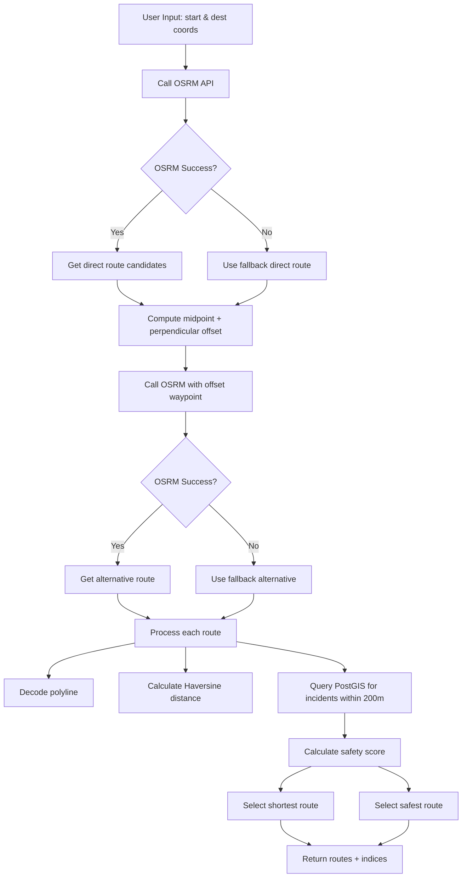

# SafeCity — Algorithms

## 1. Safe Routing Algorithm

### 1.1 Plain-English Explanation

When a user requests a route from point A to point B, the system:

1. **Calls OSRM** (Open Source Routing Machine) to get candidate driving routes.
2. **Generates a "safer alternative"** by offsetting the midpoint of the direct path to bypass potential risk zones.
3. **Calculates the exact geodesic distance of each route using the Haversine formula on the decoded polyline.
4. **Evaluates each route's safety** by querying PostGIS for approved incidents within a 200m buffer of the route.
5. **Scores each route** using a severity-weighted penalty system.
6. **Returns both the shortest route** (by distance) and the **safest route** (by safety score, with shorter distance as tie-breaker).

### 1.2 Technical Explanation

**Source file**: `apps/backend/app/services/route_service.py`

- **Routing engine**: OSRM public API at `http://router.project-osrm.org/route/v1/driving`
- **Route generation**: `_query_osrm_candidates()` calls OSRM with `overview=full&geometries=polyline&alternatives=true`
- **Distance calculation**: `calculate_polyline_distance()` decodes the polyline and sums Haversine distances between consecutive points
- **Safety evaluation**: `SafetyScoreService.calculate_route_safety()` creates a LineString from the polyline and uses `ST_DWithin` to find approved incidents within 200m
- **Route selection**: `get_safe_route()` returns `shortest_route_idx` (min distance) and `safest_route_idx` (max safety score, tie-break by shorter distance)

### 1.3 Step-by-Step Algorithm

1. User provides `start_lat, start_lng, dest_lat, dest_lng`
2. Call OSRM with direct coordinates → get direct route candidates (with alternatives)
3. If OSRM fails, use a hardcoded fallback route
4. Compute midpoint of start/dest
5. Compute perpendicular offset (0.003 to 0.015 degrees) to create an alternative waypoint
6. Call OSRM with `[start, offset_midpoint, dest]` → get alternative route
7. If OSRM fails, use a hardcoded fallback alternative
8. For each route:
   - Decode polyline
   - Calculate exact distance via Haversine
   - Query PostGIS for approved incidents within 200m of the route
   - Calculate safety score (see Section 2)
9. Select shortest route = min distance
10. Select safest route = max safety score, tie-break by shorter distance
11. Return `{routes, shortest_route_idx, safest_route_idx}`

### 1.4 Mathematical Formula

**Haversine distance** (in `route_service.py`):
```
R = 6371000  # Earth radius in meters
a = sin²(Δφ/2) + cos(φ1)·cos(φ2)·sin²(Δλ/2)
c = 2·atan2(√a, √(1−a))
d = R·c
```

**Route safety score** (in `safety_score_service.py`):
```
score = 100
score -= (critical_count × 15)
score -= (high_count × 10)
score -= (medium_count × 5)
score -= (low_count × 2)
score = max(0, score)
```

**Risk level**:
- `score < 40 → "unsafe"`
- `40 ≤ score < 75 → "moderate"`
- `score ≥ 75 → "safe"`

### 1.5 Pseudocode

```
function get_safe_route(start, dest):
    routes = []
    
    # 1. Direct route candidates
    try:
        direct = osrm_query([start, dest], alternatives=true)
        routes.extend(direct)
    except:
        routes.append(fallback_direct)
    
    # 2. Safer alternative via offset midpoint
    mid = midpoint(start, dest)
    offset = perpendicular_offset(mid, magnitude=clamp(0.003, 0.015, length*0.4))
    try:
        alt = osrm_query([start, alt_point, dest], alternatives=false)
        routes.extend(alt)
    except:
        routes.append(fallback_alt)
    
    # 3. Process each route
    for route in routes:
        polyline = decode(route.geometry)
        distance = haversine_sum(polyline)
        safety = safety_service.calculate_route_safety(polyline, radius_km=0.2)
        processed.append({
            geometry, distance_m, duration_s,
            safety_score, route_risk_level, incidents
        })
    
    # 4. Select
    shortest_idx = argmin(distance_m)
    safest_idx = argmax(safety_score, tiebreak=-distance_m)
    
    return {routes, shortest_route_idx, safest_route_idx}
```

### 1.6 Mermaid Flowchart



### 1.7 Source References

- `apps/backend/app/services/route_service.py` — `RouteService.get_safe_route()`, `_query_osrm_candidates()`, `calculate_polyline_distance()`, `haversine_distance()`
- `apps/backend/app/services/safety_score_service.py` — `SafetyScoreService.calculate_route_safety()`
- `apps/backend/app/api/v1/routers/routes.py` — `GET /routes/plan`

## 2. Area Safety Index / Safety Score

### 2.1 Plain-English Explanation

The system calculates a **safety score (0-100)** for a geographic area. The score starts at 100 (safest) and deducts points based on the **number and severity of approved incidents** within a radius. Recent incidents (last 7 days) are penalized more heavily. The score is then categorized into `safe`, `moderate`, or `unsafe`.

### 2.2 Technical Explanation

**Source file**: `apps/backend/app/services/safety_score_service.py`

- **Method**: `calculate_area_score_detailed(lat, lng, radius_km)`
- **Input**: latitude, longitude, radius (default 1.0 km)
- **Query**: `ST_DWithin` on `incidents.location_geom` (PostGIS Geography) with `status=APPROVED` and `deleted_at IS NULL`
- **Features**:
  - Severity weight: LOW=2, MEDIUM=5, HIGH=10, CRITICAL=15
  - Recency multiplier: last 7 days = 1.5x, last 30 days = 1.2x, older = 1.0x
  - Density penalty: >5 incidents/km² = -10, >2 incidents/km² = -5
- **Output**: score, risk_level, incident_count, density_per_km2, top_categories, recent_7d, recent_30d

### 2.3 Step-by-Step Workflow

1. User provides lat, lng, radius_km
2. Query PostGIS for approved incidents within radius
3. If no incidents → return score=100, risk=safe
4. For each incident:
   - Get severity weight
   - Apply recency multiplier
   - Track category counts
5. Sum weighted penalties
6. Apply density penalty
7. Cap score at 0
8. Determine risk level
9. Return result

### 2.4 Formula

```
weighted_penalty = Σ (severity_weight × recency_multiplier)
score = max(0, 100 − weighted_penalty)

density = incident_count / (π × radius_km²)
if density > 5: score = max(0, score − 10)
elif density > 2: score = max(0, score − 5)

risk_level = "safe" if score ≥ 75
          = "moderate" if 40 ≤ score < 75
          = "unsafe" if score < 40
```

### 2.5 Pseudocode

```
function calculate_area_score_detailed(lat, lng, radius_km):
    incidents = query_approved_incidents_within(lat, lng, radius_km)
    if not incidents:
        return {score: 100, risk: "safe", count: 0, ...}
    
    weighted_penalty = 0
    for inc in incidents:
        base_w = severity_weight[inc.severity]
        recency_mult = 1.0
        if inc.created_at >= 7_days_ago: recency_mult = 1.5
        elif inc.created_at >= 30_days_ago: recency_mult = 1.2
        weighted_penalty += base_w * recency_mult
    
    score = max(0, 100 - weighted_penalty)
    
    density = len(incidents) / (π * radius_km²)
    if density > 5: score = max(0, score - 10)
    elif density > 2: score = max(0, score - 5)
    
    risk = "safe" if score >= 75
    risk = "moderate" if 40 <= score < 75
    risk = "unsafe" if score < 40
    
    return {score, risk, count, density, top_categories, recent_7d, recent_30d}
```

### 2.6 Mermaid Flowchart

```mermaid
flowchart TD
    A[User provides lat, lng, radius] --> B[Query PostGIS ST_DWithin]
    B --> C{Any approved incidents?]
    C -->|No| D[Return score=100, risk=safe]
    C -->|Yes| E[For each incident]
    E --> F[Get severity weight]
    F --> G[Apply recency multiplier]
    G --> H[Track category counts]
    H --> I[Sum weighted penalty]
    I --> J[Apply density penalty]
    J --> K[Cap score at 0]
    K --> L[Determine risk level]
    L --> M[Return result]
    D --> M
```

### 2.7 Source References

- `apps/backend/app/services/safety_score_service.py` — `calculate_area_score_detailed()`, `calculate_area_score()`, `get_city_overview()`
- `apps/backend/app/api/v1/routers/safety.py` — `GET /safety/area`, `GET /safety/city`

## 3. ML / AI Components

**Not found in the inspected repository.**

There is **no machine learning model** (e.g., Random Forest, neural network, etc.) implemented in the SafeCity codebase. The safety score is calculated using a **rule-based weighted penalty system** as described in Section 2.

The README mentions "ML" in the context of the project description, but no ML code exists in the repository. The safety scoring is purely **deterministic rule-based** using severity weights, recency multipliers, and density penalties.

## 4. Implementation Reality Check

### [IMPLEMENTED]
- JWT authentication (access + refresh tokens)
- Incident reporting with PostGIS spatial queries
- Nearby incident search (ST_DWithin)
- Heatmap data generation
- Area safety score (rule-based)
- Route planning with OSRM
- SOS trigger/resolve
- Emergency contacts (max 5)
- Community alerts
- Learning articles
- Notifications
- Admin dashboard with stats
- Password reset OTP flow
- Global search

### [PARTIALLY IMPLEMENTED]
- **Safe route "alternative" is a simple midpoint offset, not a true risk-avoidance algorithm
- **Heatmap** uses a simple severity weight (low=1, medium=2, high=3, critical=4) rather than a true heatmap intensity calculation
- **Admin stats** `new_users_this_month` is hardcoded to 0

### [DOCUMENTED ONLY]
- **"ML model"** — mentioned in README but no ML code exists
- **"Real-time"** alerts — no WebSocket/SSE/polling implementation found; alerts are fetched via REST

### [INFERRED]
- **Route safety** is inferred to be used by the frontend to display the safest route
- **City overview** default coordinates (11.0168, 76.9558) are Coimbatore, Tamil Nadu

### Not found in the inspected repository:
- No ML model files (no `sklearn`, `tensorflow`, `torch`, etc. in requirements.txt)
- No background jobs / task queue (no Celery, Redis, etc.)
- No WebSocket / real-time push
- No audit log table
- No evidence recording module