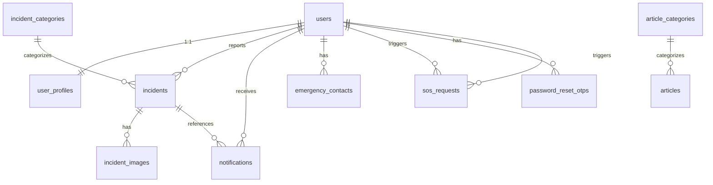

# SafeCity — Database Schema

## 1. Overview

The database is **PostgreSQL 15 with PostGIS 3.3** (from `docker-compose.yml`). All geographic data uses **PostGIS Geography** type with **SRID 4326** (WGS 84).

## 2. Complete Table List (11 tables)

| # | Table | Purpose |
|---|---|---|
| 1 | `users` | User accounts (citizen/admin) |
| 2 | `user_profiles` | Extended profile data (1:1 with users) |
| 3 | `incident_categories` | Incident categories (crime, road hazard, etc.) |
| 4 | `incidents` | Incident reports with PostGIS point |
| 5 | `incident_images` | Evidence images for incidents |
| 6 | `notifications` | In-app notifications per user |
| 6 | `article_categories` | Learning article categories |
| 7 | `articles` | Safety learning articles |
| 8 | `community_alerts` | Active safety alerts |
| 9 | `emergency_contacts` | User emergency contacts |
| 10 | `sos_requests` | SOS emergency requests |
| 11 | `password_reset_otps` | OTP records for password reset |

## 3. Table-by-Table Schema

### 3.1 `users`
| Column | Type | Nullable | Constraints |
|---|---|---|---|
| `id` | VARCHAR(36) | NO | PK, UUID |
| `email` | VARCHAR(255) | NO | UNIQUE, INDEX |
| `full_name` | VARCHAR(255) | NO | |
| `hashed_password` | VARCHAR(255) | NO | bcrypt hash |
| `role` | userrole ENUM | NO | `CITIZEN` / `ADMIN` (default CITIZEN), INDEX |
| `is_active` | BOOLEAN | NO | default true |
| `is_verified` | BOOLEAN | NO | default false |
| `created_at` | TIMESTAMPTZ | NO | INDEX |
| `updated_at` | TIMESTAMPTZ | NO | |

**Indexes**: `ix_users_email` (UNIQUE), `ix_users_role`, `ix_users_created_at`

### 3.2 `user_profiles`
| Column | Type | Nullable | Constraints |
|---|---|---|---|
| `id` | VARCHAR(36) | NO | PK |
| `user_id` | VARCHAR(36) | NO | FK → users.id ON DELETE CASCADE, UNIQUE |
| `avatar_url` | VARCHAR(512) | YES | |
| `phone` | VARCHAR(50) | YES | |
| `bio` | TEXT | YES | |
| `emergency_contact_name` | VARCHAR(255) | YES | |
| `emergency_contact_phone` | VARCHAR(50) | YES | |
| `city` | VARCHAR(100) | YES | |
| `country` | VARCHAR(100) | YES | |
| `created_at` | TIMESTAMPTZ | NO | |
| `updated_at` | TIMESTAMPTZ | NO | |

### 3.3 `incident_categories`
| Column | Type | Nullable | Constraints |
|---|---|---|---|
| `id` | VARCHAR(36) | NO | PK |
| `name` | VARCHAR(100) | NO | UNIQUE |
| `slug` | VARCHAR(100) | NO | UNIQUE, INDEX |
| `description` | TEXT | YES | |
| `icon` | VARCHAR(10) | NO | default '📋' |
| `color` | VARCHAR(20) | NO | default '#6B7280' |
| `is_active` | BOOLEAN | NO | default true |
| `created_at` | TIMESTAMPTZ | NO | |

### 3.4 `incidents`
| Column | Type | Nullable | Constraints |
|---|---|---|---|
| `id` | VARCHAR(36) | NO | PK |
| `title` | VARCHAR(255) | NO | |
| `description` | TEXT | NO | |
| `category_id` | VARCHAR(36) | NO | FK → incident_categories.id ON DELETE RESTRICT, INDEX |
| `severity` | severitylevel ENUM | NO | `LOW`/`MEDIUM`/`HIGH`/`CRITICAL` (default MEDIUM), INDEX |
| `status` | incidentstatus ENUM | NO | `PENDING`/`UNDER_REVIEW`/`APPROVED`/`REJECTED`/`RESOLVED` (default PENDING), INDEX |
| `is_anonymous` | BOOLEAN | NO | default false |
| `location_address` | VARCHAR(512) | YES | |
| `location_lat` | DOUBLE PRECISION | NO | |
| `location_lng` | DOUBLE PRECISION | NO | |
| `location_geom` | geography(POINT, 4326) | YES | PostGIS |
| `admin_note` | TEXT | YES | |
| `reporter_id` | VARCHAR(36) | YES | FK → users.id ON DELETE SET NULL, INDEX |
| `deleted_at` | TIMESTAMPTZ | YES | Soft delete |
| `created_at` | TIMESTAMPTZ | NO | INDEX |
| `updated_at` | TIMESTAMPTZ | NO | |

**Indexes**: `ix_incidents_category_id`, `ix_incidents_reporter_id`, `ix_incidents_severity`, `ix_incidents_status`, `ix_incidents_created_at`, `ix_incidents_status_created` (composite), `ix_incidents_cat_status` (composite)

### 3.5 `incident_images`
| Column | Type | Nullable | Constraints |
|---|---|---|---|
| `id` | VARCHAR(36) | NO | PK |
| `incident_id` | VARCHAR(36) | NO | FK → incidents.id ON DELETE CASCADE, INDEX |
| `filename` | VARCHAR(255) | NO | |
| `url` | VARCHAR(512) | NO | |
| `created_at` | TIMESTAMPTZ | NO | |

### 3.6 `notifications`
| Column | Type | Nullable | Constraints |
|---|---|---|---|
| `id` | VARCHAR(36) | NO | PK |
| `user_id` | VARCHAR(36) | NO | FK → users.id ON DELETE CASCADE, INDEX |
| `type` | notificationtype ENUM | NO | `INCIDENT_UPDATE`/`SYSTEM`/`ALERT`/`ADMIN_MESSAGE` |
| `title` | VARCHAR(255) | NO | |
| `message` | TEXT | NO | |
| `is_read` | BOOLEAN | NO | default false, INDEX |
| `incident_id` | VARCHAR(36) | YES | FK → incidents.id ON DELETE SET NULL, INDEX |
| `created_at` | TIMESTAMPTZ | NO | INDEX |

**Indexes**: `ix_notifications_user_id`, `ix_notifications_incident_id`, `ix_notifications_is_read`, `ix_notifications_created_at`, `ix_notifications_user_created` (composite)

### 3.7 `article_categories`
| Column | Type | Nullable | Constraints |
|---|---|---|---|
| `id` | VARCHAR(36) | NO | PK |
| `name` | VARCHAR(100) | NO | UNIQUE |
| `slug` | VARCHAR(100) | NO | UNIQUE, INDEX |
| `description` | TEXT | YES | |
| `icon` | VARCHAR(10) | NO | default '📚' |
| `is_active` | BOOLEAN | NO | default true |
| `created_at` | TIMESTAMPTZ | NO | |

### 3.8 `articles`
| Column | Type | Nullable | Constraints |
|---|---|---|---|
| `id` | VARCHAR(36) | NO | PK |
| `title` | VARCHAR(255) | NO | |
| `slug` | VARCHAR(255) | NO | UNIQUE, INDEX |
| `overview` | TEXT | NO | |
| `content_dos` | TEXT | YES | |
| `content_donts` | TEXT | YES | |
| `emergency_steps` | TEXT | YES | |
| `helpline_numbers` | TEXT | YES | |
| `legal_info` | TEXT | YES | |
| `category_id` | VARCHAR(36) | NO | FK → article_categories.id ON DELETE RESTRICT, INDEX |
| `is_published` | BOOLEAN | NO | default true |
| `created_at` | TIMESTAMPTZ | NO | |
| `updated_at` | TIMESTAMPTZ | NO | |

### 3.9 `community_alerts`
| Column | Type | Nullable | Constraints |
|---|---|---|---|
| `id` | VARCHAR(36) | NO | PK |
| `title` | VARCHAR(255) | NO | |
| `message` | TEXT | NO | |
| `alert_type` | alerttype ENUM | NO | `NEARBY_INCIDENT`/`HIGH_RISK_AREA`/`EMERGENCY_NOTICE`/`SYSTEM_ANNOUNCEMENT`, INDEX |
| `location_lat` | FLOAT | YES | |
| `location_lng` | FLOAT | YES | |
| `radius_km` | FLOAT | YES | |
| `location_geom` | geography(POINT, 4326) | YES | PostGIS |
| `is_active` | BOOLEAN | NO | default true, INDEX |
| `expires_at` | TIMESTAMPTZ | YES | |
| `created_at` | TIMESTAMPTZ | NO | INDEX |

### 3.10 `emergency_contacts`
| Column | Type | Nullable | Constraints |
|---|---|---|---|
| `id` | VARCHAR(36) | NO | PK |
| `user_id` | VARCHAR(36) | NO | FK → users.id ON DELETE CASCADE, INDEX |
| `name` | VARCHAR(255) | NO | |
| `phone` | VARCHAR(50) | NO | |
| `contact_relation` | VARCHAR(100) | YES | |
| `created_at` | TIMESTAMPTZ | NO | |

### 3.11 `sos_requests`
| Column | Type | Nullable | Constraints |
|---|---|---|---|
| `id` | VARCHAR(36) | NO | PK |
| `user_id` | VARCHAR(36) | NO | FK → users.id ON DELETE CASCADE, INDEX |
| `location_lat` | FLOAT | NO | |
| `location_lng` | FLOAT | NO | |
| `location_geom` | geography(POINT, 4326) | YES | PostGIS |
| `status` | sosstatus ENUM | NO | `ACTIVE`/`RESOLVED`/`FALSE_ALARM` (default ACTIVE), INDEX |
| `audio_recording_url` | VARCHAR(512) | YES | |
| `video_recording_url` | VARCHAR(512) | YES | |
| `created_at` | TIMESTAMPTZ | NO | INDEX |
| `resolved_at` | TIMESTAMPTZ | YES | |

### 3.12 `password_reset_otps`
| Column | Type | Nullable | Constraints |
|---|---|---|---|
| `id` | VARCHAR(36) | NO | PK |
| `user_id` | VARCHAR(36) | NO | FK → users.id ON DELETE CASCADE, INDEX |
| `otp_hash` | VARCHAR(255) | NO | bcrypt hash |
| `expires_at` | TIMESTAMPTZ | NO | |
| `used_at` | TIMESTAMPTZ | YES | |
| `attempt_count` | INTEGER | NO | default 0 |
| `created_at` | TIMESTAMPTZ | NO | INDEX |

## 4. Entity Relationship Diagram (Mermaid)



## 5. Relationships Explanation

- **users → user_profiles**: One-to-one (1:1). Each user has exactly one profile. Cascade delete.
- **users → incidents**: One-to-many. A user can report many incidents. `reporter_id` is nullable (anonymous reports). On user delete, incidents set to NULL.
- **users → notifications**: One-to-many. Cascade delete.
- **users → emergency_contacts**: One-to-many. Cascade delete. Max 5 enforced in service.
- **users → sos_requests**: One-to-many. Cascade delete.
- **users → password_reset_otps**: One-to-many. Cascade delete.
- **incident_categories → incidents**: One-to-many. Restrict delete (cannot delete category with incidents).
- **incidents → incident_images**: One-to-many. Cascade delete.
- **incidents → notifications**: One-to-many. `incident_id` FK with SET NULL.
- **article_categories → articles**: One-to-many. Restrict delete.

## 6. Geospatial Columns

| Table | Column | Type | SRID | Purpose |
|---|---|---|---|---|
| `incidents` | `location_geom` | geography(POINT, 4326) | 4326 | Spatial queries (nearby, heatmap, route safety) |
| `community_alerts` | `location_geom` | geography(POINT, 4326) | 4326 | Alert zone center |
| `sos_requests` | `location_geom` | geography(POINT, 4326) | 4326 | SOS location |

**Spatial queries used**:
- `ST_DWithin` — find incidents within radius (incident_repository, safety_score_service)
- `ST_MakePoint` + `ST_SetSRID` — create point from lat/lng
- `ST_GeomFromText` — create LineString for route safety
- `ST_GeogFromText` — create geography from WKT

## 7. Important Indexes

- `ix_incidents_status_created` — fast filtering by status + date (admin dashboard)
- `ix_incidents_cat_status` — filter by category + status
- `ix_notifications_user_created` — user notification list
- `ix_users_email` — login lookup
- `ix_incidents_created_at` — date-range queries
- `ix_incidents_severity` — severity filtering
- `ix_incidents_status` — status filtering
- `ix_incidents_category_id` — category join
- `ix_incidents_reporter_id` — user's incidents
- `ix_incident_images_incident_id` — incident images
- `ix_notifications_user_id` — user notifications
- `ix_notifications_incident_id` — incident notifications
- `ix_notifications_is_read` — unread count
- `ix_notifications_created_at` — date sort
- `ix_articles_slug` — article lookup
- `ix_articles_category_id` — category join
- `ix_community_alerts_alert_type` — alert type filter
- `ix_community_alerts_is_active` — active alerts
- `ix_community_alerts_created_at` — date sort
- `ix_emergency_contacts_user_id` — user contacts
- `ix_sos_requests_user_id` — user SOS
- `ix_sos_requests_status` — active SOS
- `ix_sos_requests_created_at` — date sort
- `ix_password_reset_otps_user_id` — user OTP lookup
- `ix_password_reset_otps_created_at` — cooldown check

## 8. Enum Types

| Enum | Values |
|---|---|
| `userrole` | `CITIZEN`, `ADMIN` |
| `severitylevel` | `LOW`, `MEDIUM`, `HIGH`, `CRITICAL` |
| `incidentstatus` | `PENDING`, `UNDER_REVIEW`, `APPROVED`, `REJECTED`, `RESOLVED` |
| `notificationtype` | `INCIDENT_UPDATE`, `SYSTEM`, `ALERT`, `ADMIN_MESSAGE` |
| `alerttype` | `NEARBY_INCIDENT`, `HIGH_RISK_AREA`, `EMERGENCY_NOTICE`, `SYSTEM_ANNOUNCEMENT` |
| `sosstatus` | `ACTIVE`, `RESOLVED`, `FALSE_ALARM` |

## 9. Seed Data

- **Categories**: 100+ incident categories (from `seed_db.py` CATEGORIES_DATA)
- **Users**: 1 admin + 25 citizens
- **Incidents**: 55 realistic incidents around Coimbatore
- **Notifications**: 45+ generated
- **Images**: sample images in `uploads/`

## 10. Migration Chain

```
001_initial_schema → cd468bd26fdd (learning/alerts/emergency) → 003_add_password_reset_otp