# SafeCity — System Diagrams

## 1. Complete Application Flow

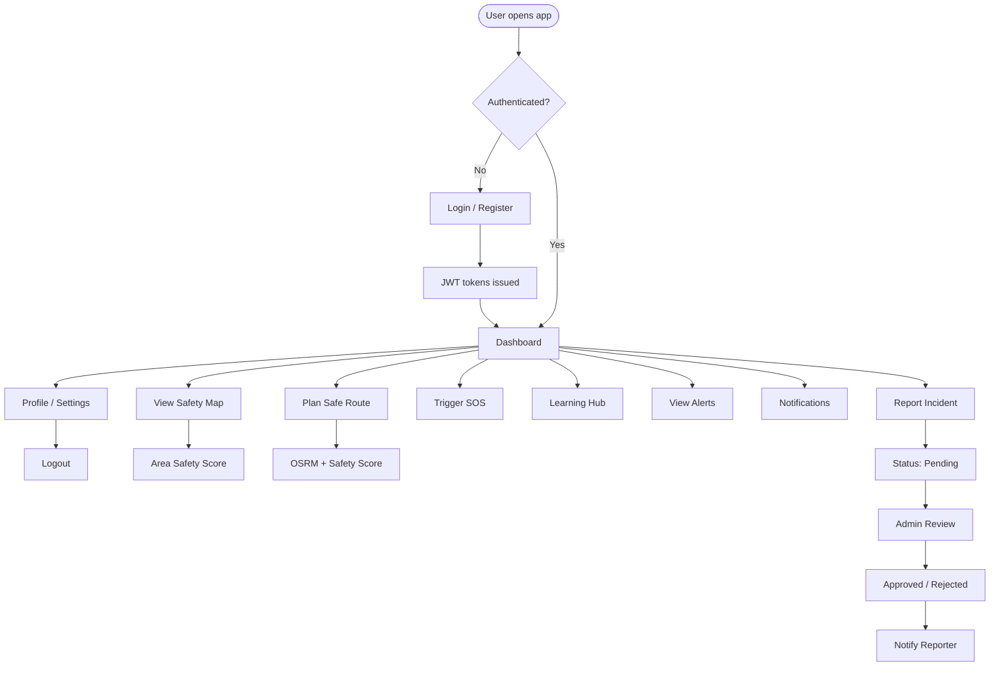

## 2. Simplified Presentation Flow

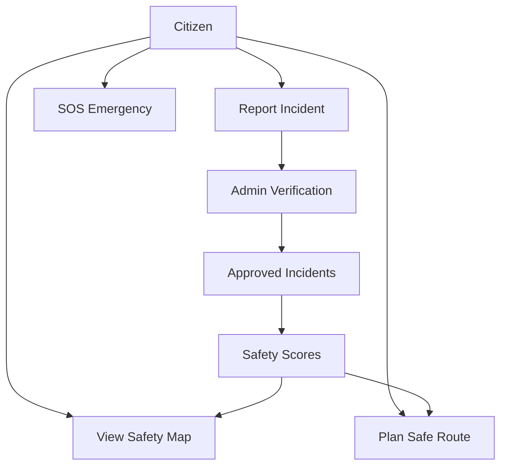

## 3. System Architecture Diagram

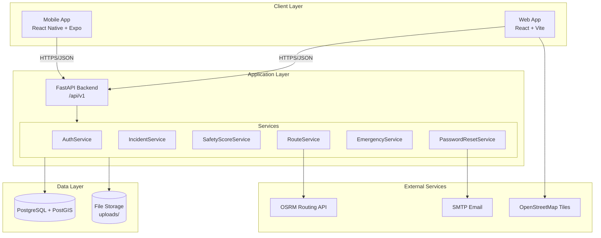

## 4. Citizen/User Workflow

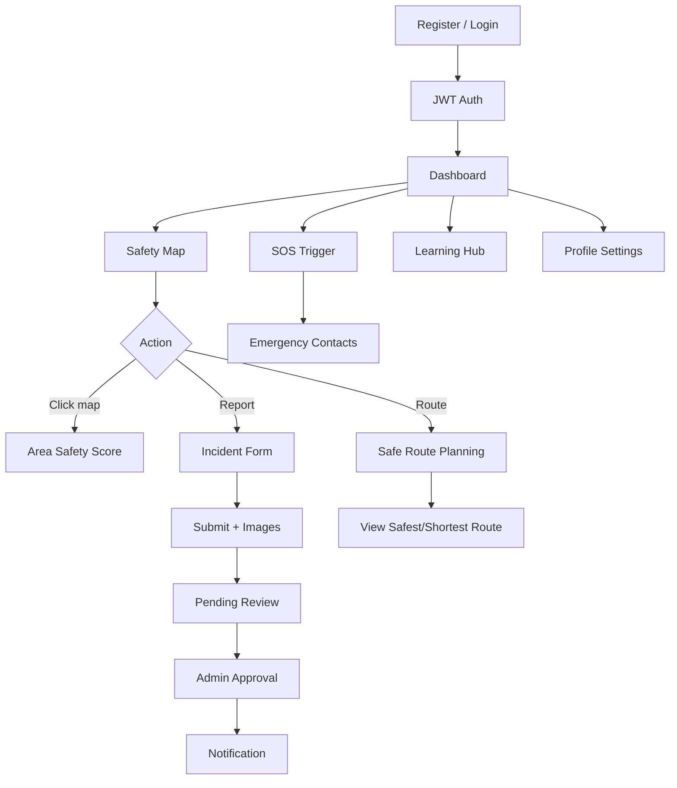

## 5. Administrator Workflow

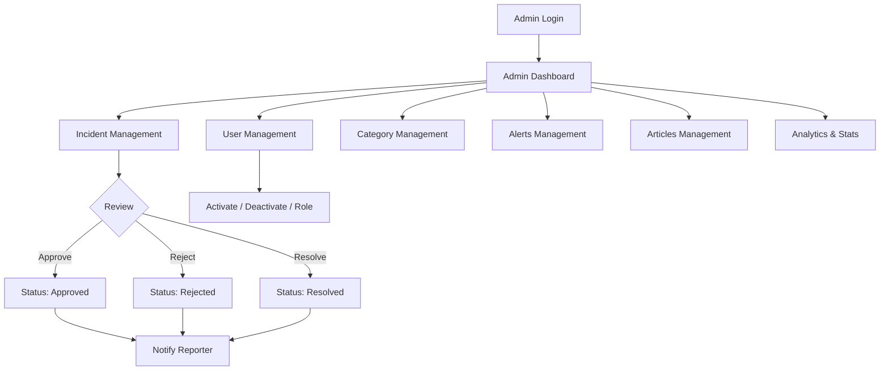

## 6. Safe Routing Algorithm Flow

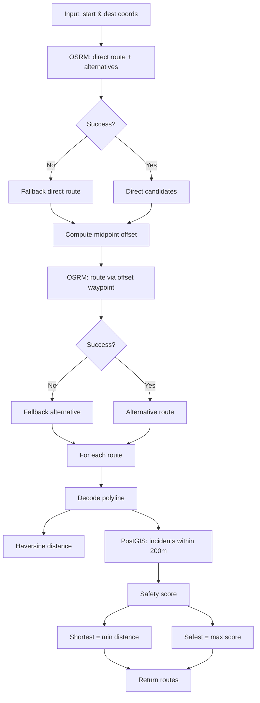

## 7. Area Safety Index / Risk Calculation Flow

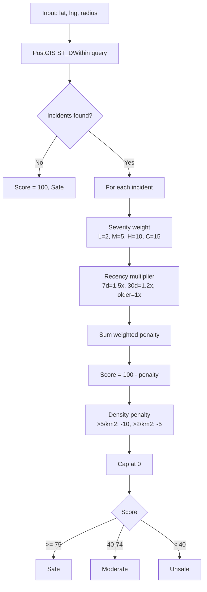

## 8. Database ER Diagram

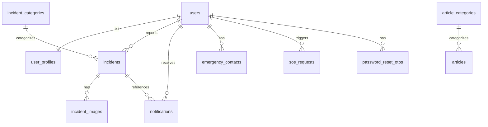

## 9. Data Flow Diagram

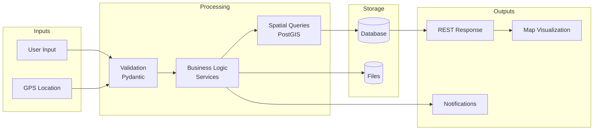

## 10. Authentication Flow

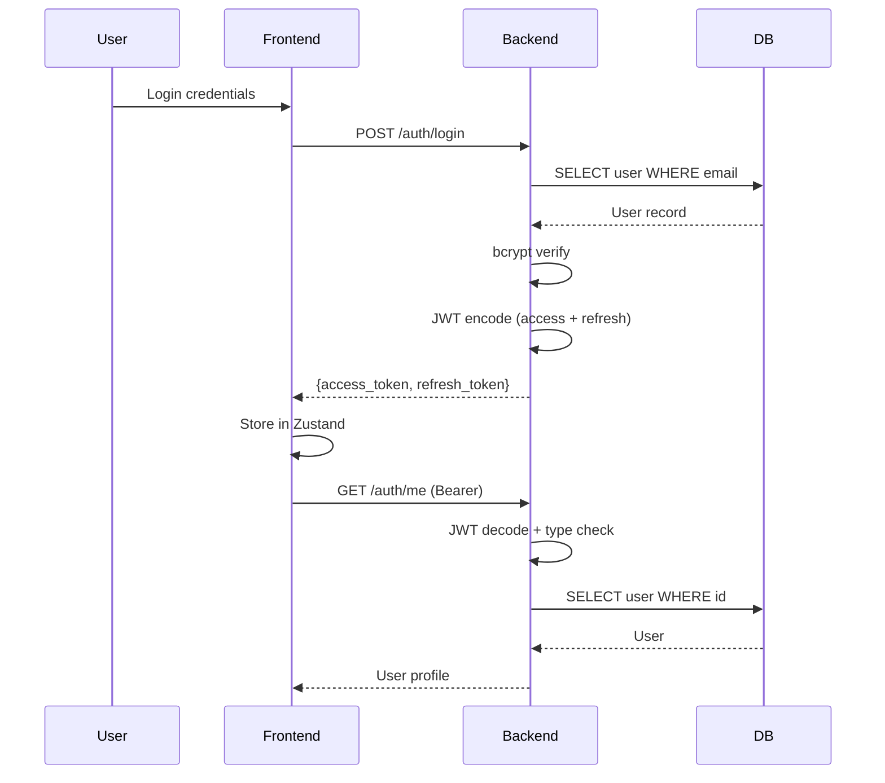

## 11. Incident Reporting Sequence

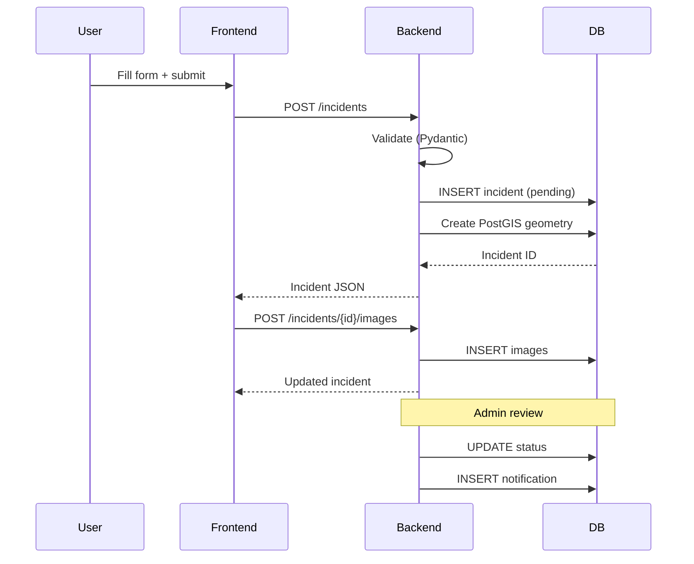

## 12. Safe Routing Sequence

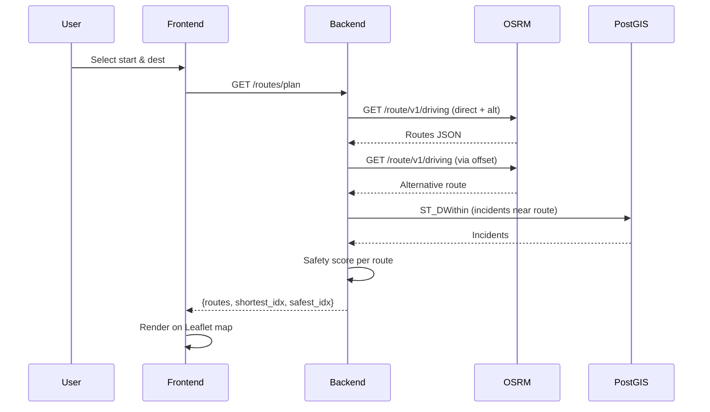

## 13. SOS Sequence

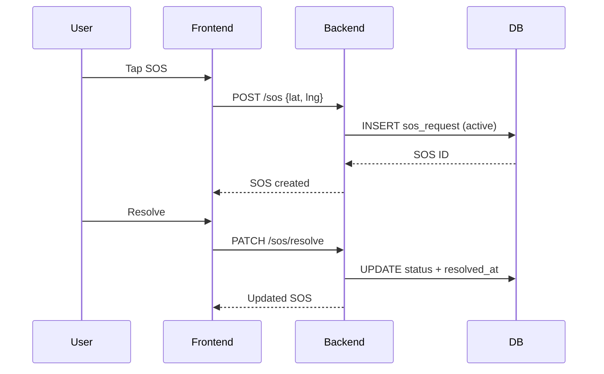

## 14. Component Diagram

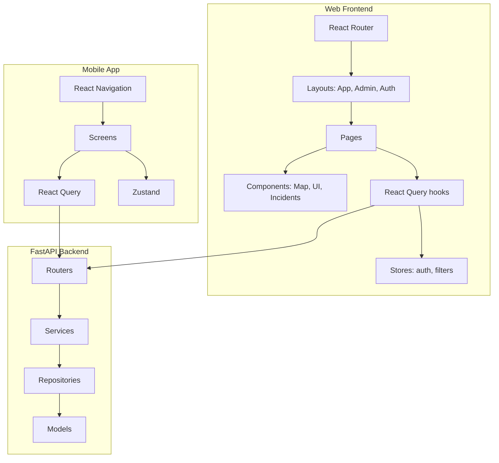

## 15. Deployment Architecture

```mermaid
flowchart TB
    subgraph Docker["Docker Compose"]
        subgraph WebContainer["web (nginx :8080)"]
            NG[Nginx + Static React Build]
        end
        subgraph BackendContainer["backend (:8000)"]
            UV[Uvicorn + FastAPI]
        end
        subgraph DBContainer["db (:5433)"]
            PG[(PostgreSQL 15 + PostGIS 3.3)]
        end
    end

    User[Browser / Mobile] -->|:8080| NG
    User -->|:8000| UV
    NG -->|/api proxy| UV
    UV --> PG
    UV --> OSRM[OSRM Public API]
    UV --> SMTP[SMTP Server]