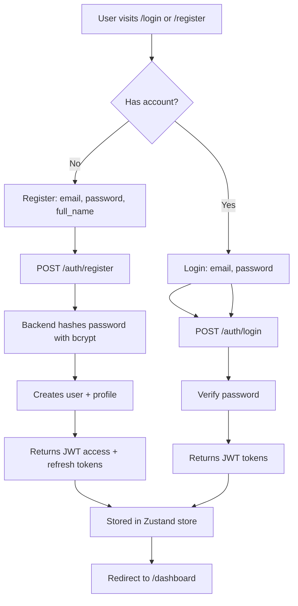
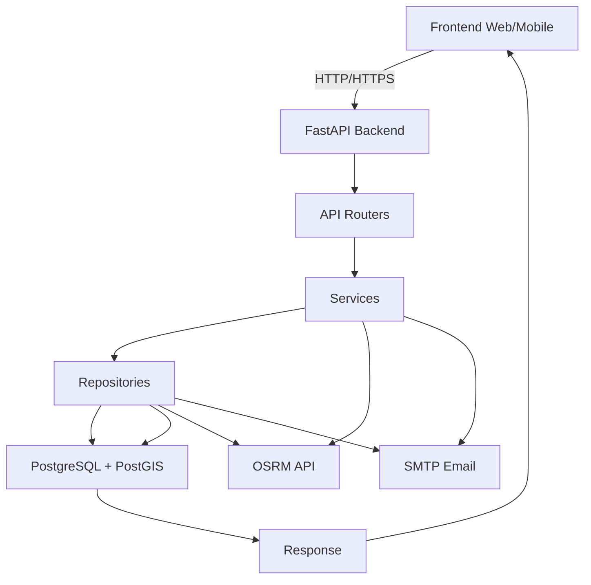
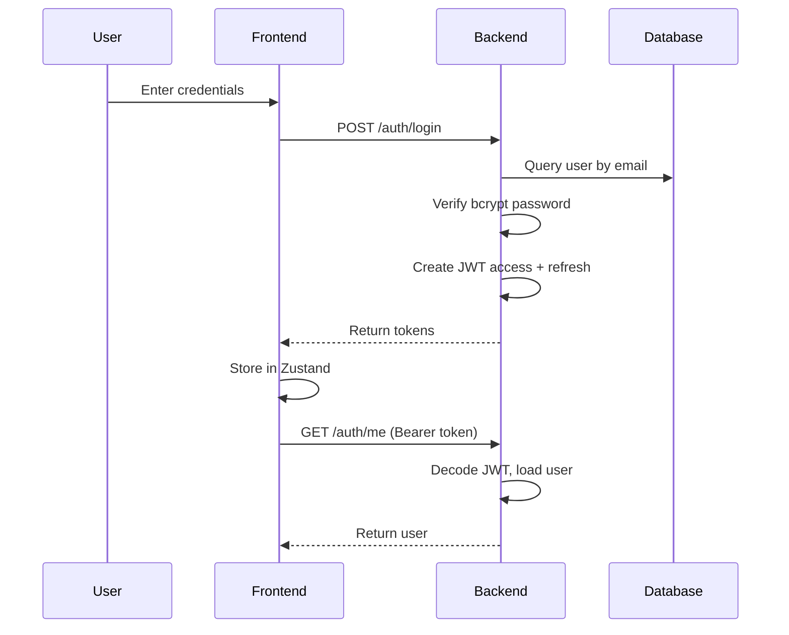
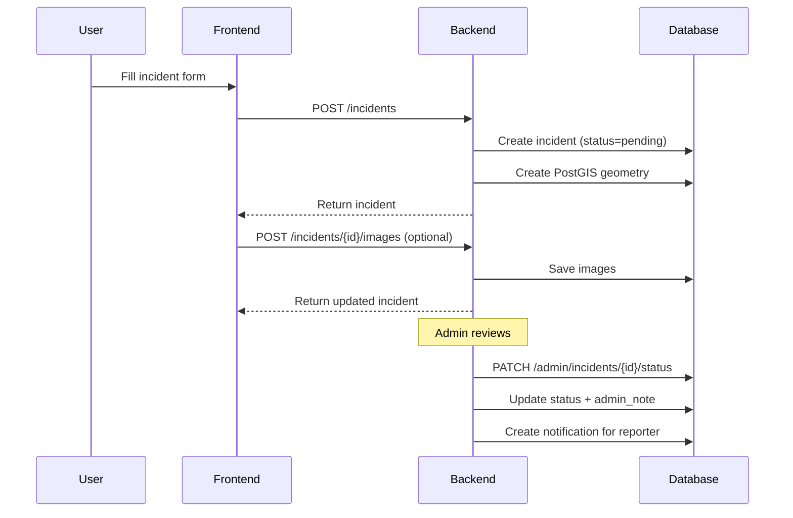
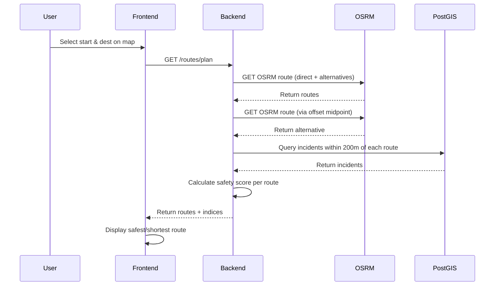

# SafeCity — Application Workflows

## 1. Citizen/User Flow

### 1.1 Registration & Login



### 1.2 Dashboard

- **Route**: `/dashboard` (protected)
- **Features**:
  - Greeting with user's first name
  - Stats: total reports, pending, approved, this month
  - My recent reports (last 5)
  - Notifications (last 3, with unread badge)
  - Quick actions: View Map, Report Incident, View Alerts, Learning Hub

### 1.3 Safety Map

- **Route**: `/map` (protected)
- **Features**:
  - Interactive Leaflet map with incident markers
  - View modes: markers, heatmap, both
  - Filters: category, severity, date range, search
  - Click on map → area safety score panel
  - "My Location" button (browser geolocation)
  - City safety overview (score, total incidents, top category, recent 7d)
  - Unverified incidents toggle
  - Report incident at clicked location

### 1.4 Incident Reporting

- **Route**: `/incidents/new` (protected)
- **Flow**:
  1. User fills title, description, category, severity, location (map click or coords)
  2. Optional: anonymous toggle
  3. POST `/incidents` → creates incident with PostGIS geometry
  4. Optional: upload images (max 5, jpg/png/gif/webp, 10MB each)
  5. Status starts as `pending`
  6. Admin reviews → status changes → notification sent to reporter

### 1.5 Safe Route Planning

- **Route**: `/route-plan` (protected)
- **Flow**:
  1. User selects start & destination on map
  2. Clicks "Find Safest Route"
  3. GET `/routes/plan?start_lat&start_lng&dest_lat&dest_lng`
  4. Backend calls OSRM, evaluates safety, returns routes
  5. Frontend displays route on map with safety score, risk level, distance, duration
  6. User can toggle between "safest" and "shortest" routes
  7. Incidents along route are displayed

### 1.6 SOS & Emergency

- **Flow**:
  1. User triggers SOS (mobile app or API)
  2. POST `/sos` with location
  3. Backend creates SOSRequest with status=active
  4. User can resolve via PATCH `/sos/resolve` with status=resolved or false_alarm
  5. Emergency contacts managed via `/users/me/contacts` (max 5)

### 1.7 Safety Learning Hub

- **Route**: `/learning` (protected)
- **Features**:
  - List article categories
  - List articles (paginated, filter by category, search)
  - View article detail (overview, dos, don'ts, emergency steps, helplines, legal info)

### 1.8 Alerts

- **Route**: `/alerts` (protected)
- **Features**:
  - List active community alerts (paginated)
  - Alert types: nearby_incident, high_risk_area, emergency_notice, system_announcement

### 1.9 Notifications

- **Route**: `/notifications` (protected)
- **Features**:
  - List notifications for current user
  - Unread count badge
  - Mark single as read
  - Mark all as read

### 1.10 Profile

- **Route**: `/profile` (protected)
- **Features**:
  - View/update profile (full_name, phone, bio, emergency_contact_name, emergency_contact_phone, city, city, country)
  - Upload avatar (jpg/png/webp, <5MB)
  - Change password (current + new)
  - Delete account (soft-delete: is_active=false)

## 2. Administrator Flow

### 2.1 Admin Login

- Same as citizen login, but role=admin
- Admin routes protected by `AdminRoute` in App.tsx (checks `user?.role === 'admin'`)

### 2.2 Admin Dashboard

- **Route**: `/admin`
- **Features**:
  - Total incidents, pending, under_review, approved, rejected, resolved
  - By category, by severity
  - Last 30 days count
  - Recent incidents (5)
  - Daily trend (7 days)
  - Total users, active users

### 2.3 Incident Management

- **Route**: `/admin/incidents`
- **Features**:
  - List all incidents with filters (page, limit, category, severity, status, search, sort)
  - Update status: pending → under_review → approved/rejected → resolved
  - Add admin_note
  - Delete (soft delete)
  - Notification sent to reporter on status change

### 2.4 User Management

- **Route**: `/admin/users`
- **Features**:
  - List users (page, limit, search, role filter)
  - Activate / deactivate user
  - Change role (admin <-> citizen) — cannot change own role

### 2.5 Category Management

- **Route**: `/admin/categories`
- **Features**:
  - List all categories (including inactive)
  - Create category (name, slug, description, icon, color)
  - Update category (name, description, icon, color, is_active)

### 2.6 Community Alerts Management

- **Route**: `/admin/alerts` (via admin router)
- **Features**:
  - List all alerts
  - Create alert (title, message, type, location, radius, expires_in_hours)
  - Delete alert (soft: is_active=false)

### 2.7 Learning Articles Management

- **Route**: `/admin/learning`
- **Features**:
  - List articles (paginated)
  - Create article (title, overview, dos, don'ts, emergency_steps, helplines, legal_info, category)
  - Update article
  - Delete article

## 3. System-Level Flow



## 4. Authentication Flow



## 5. Incident Reporting Sequence



## 6. Safe Routing Sequence



## 7. SOS Sequence

```mermaid
sequenceDiagram
    participant U as User
    participant F as Frontend
    participant B as Backend
    participant D as Database

    U->>F: Trigger SOS
    F->>B: POST /sos {lat, lng}
    B->>D: Create SOSRequest (status=active)
    B-->>F: Return SOS request
    U->>F: Resolve SOS
    F->>B: PATCH /sos/resolve {status}
    B->>D: Update status + resolved_at
    B-->>F: Return updated SOS