# SafeCity — Diagram Sources (Mermaid)

**Companion to:** `SafeCity_Project_Report.md`
**Source of truth:** the diagrams below are derived exclusively from the implemented code in this repository (`apps/backend`, `apps/web`, `apps/mobile`, `docker/`). The identical Mermaid source appears at the corresponding location in the report.

All diagrams use vertical (`TB`) orientation where applicable so that they render A4-friendly.

| Figure | Diagram | Type | Report Location |
|---|---|---|---|
| Figure 1 | System Architecture | `flowchart TB` | §3.2 |
| Figure 2 | Module Architecture | `flowchart TB` | §3.3 |
| Figure 3 | Use Case Diagram | `flowchart TB` | §3.12.1 |
| Figure 4 | User Activity Diagram | `flowchart TB` | §3.12.2 |
| Figure 5 | Admin Activity Diagram | `flowchart TB` | §3.12.3 |
| Figure 6 | Class Diagram | `classDiagram` | §3.12.4 |
| Figure 7 | Login Sequence | `sequenceDiagram` | §3.12.5 |
| Figure 8 | Incident Reporting Sequence | `sequenceDiagram` | §3.12.6 |
| Figure 9 | Incident Verification Sequence | `sequenceDiagram` | §3.12.7 |
| Figure 10 | Safe Routing Sequence | `sequenceDiagram` | §3.12.8 |
| Figure 11 | Community Alert Sequence | `sequenceDiagram` | §3.12.9 |
| Figure 12 | Emergency Contact Sequence | `sequenceDiagram` | §3.12.10 |
| Figure 13 | Registration / Login BPMN | `flowchart TB` | §3.13.1 |
| Figure 14 | Incident Reporting BPMN | `flowchart TB` | §3.13.2 |
| Figure 15 | Incident Verification BPMN | `flowchart TB` | §3.13.3 |
| Figure 16 | Safe Routing BPMN | `flowchart TB` | §3.13.4 |
| Figure 17 | Community Alert BPMN | `flowchart TB` | §3.13.5 |
| Figure 18 | Emergency Contact BPMN | `flowchart TB` | §3.13.6 |
| Figure 19 | Context DFD | `flowchart TB` | §3.14.1 |
| Figure 20 | Level-1 DFD | `flowchart TB` | §3.14.2 |
| Figure 21 | Incident Management DFD | `flowchart TB` | §3.14.3 |
| Figure 22 | Safe Routing DFD | `flowchart TB` | §3.14.4 |
| Figure 23 | Safety Analysis DFD | `flowchart TB` | §3.14.5 |
| Figure 24 | ER Diagram | `erDiagram` | §3.15.1 |
| Figure 25 | Database Schema Layout | `flowchart TB` | §3.15.2 |
| Figure 26 | API Architecture | `flowchart TB` | §3.17 |
| Figure 27 | Security Architecture | `flowchart TB` | §3.18 |
| Figure 28 | Deployment Architecture | `flowchart TB` | §3.19 |
| Figure 29 | Safe Routing Flowchart | `flowchart TB` | §5.9 |
| Figure 30 | Area Safety Score Flowchart | `flowchart TB` | §5.5 |
| Figure 31 | Incident Risk (Severity) Flowchart | `flowchart TB` | §5.2 |
| Figure 32 | Alert Propagation Flowchart | `flowchart TB` | §5.13 |

---

---

## Figure 1 — System Architecture

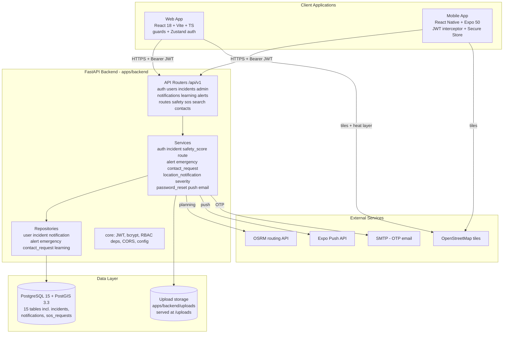

## Figure 2 — Module Architecture

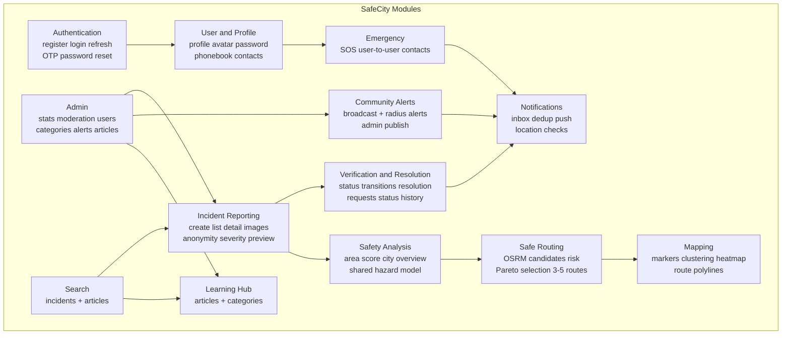

## Figure 3 — Use Case Diagram

```mermaid
flowchart TB
    subgraph SYS["SafeCity System"]
        UC1["Register account"]
        UC2["Login"]
        UC3["Reset password via OTP"]
        UC4["View dashboard"]
        UC5["Report incident<br/>with map location + images"]
        UC6["Report anonymously"]
        UC7["View my incidents"]
        UC8["View live safety map<br/>markers + heatmap + area score"]
        UC9["Plan safe route<br/>compare 3-5 routes"]
        UC10["Receive notifications<br/>nearby incident / unsafe area / alert"]
        UC11["Trigger SOS<br/>notify accepted contacts"]
        UC12["Manage emergency contacts<br/>phonebook + in-app requests"]
        UC13["View community alerts"]
        UC14["Request incident resolution"]
        UC15["Read learning articles"]
        UC16["Approve / reject / resolve incidents"]
        UC17["Publish broadcast or radius alert"]
        UC18["Manage users roles status"]
        UC19["Manage categories and articles"]
        UC20["View platform statistics"]
    end

    CITIZEN(["Citizen - role citizen"]) --> UC1
    CITIZEN --> UC2
    CITIZEN --> UC3
    CITIZEN --> UC4
    CITIZEN --> UC5
    CITIZEN --> UC6
    CITIZEN --> UC7
    CITIZEN --> UC8
    CITIZEN --> UC9
    CITIZEN --> UC10
    CITIZEN --> UC11
    CITIZEN --> UC12
    CITIZEN --> UC13
    CITIZEN --> UC14
    CITIZEN --> UC15

    ADMIN(["Administrator - role admin"]) --> UC2
    ADMIN --> UC16
    ADMIN --> UC17
    ADMIN --> UC18
    ADMIN --> UC19
    ADMIN --> UC20
    ADMIN --> UC8

    MOBILE(["Mobile app user"]) --> UC9
    MOBILE --> UC11
    MOBILE --> UC10
```

## Figure 4 — User Activity Diagram

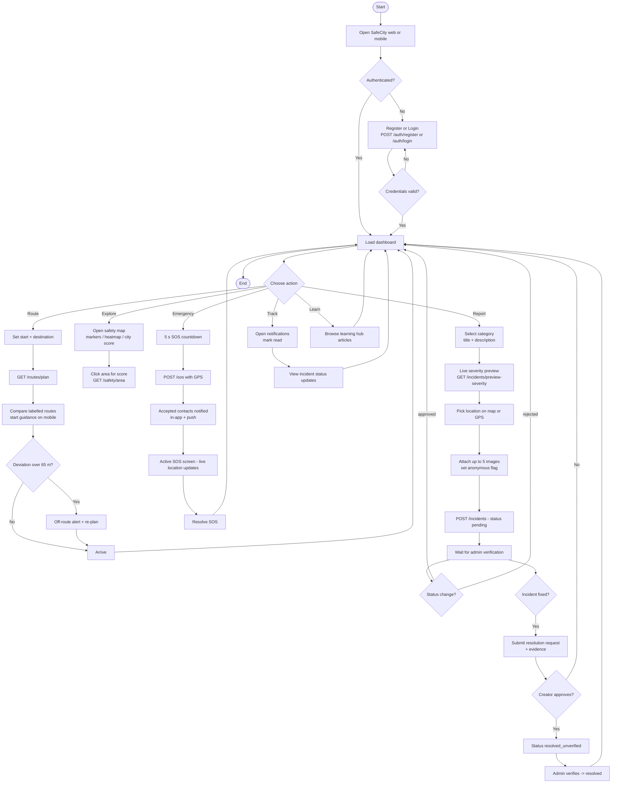

## Figure 5 — Admin Activity Diagram

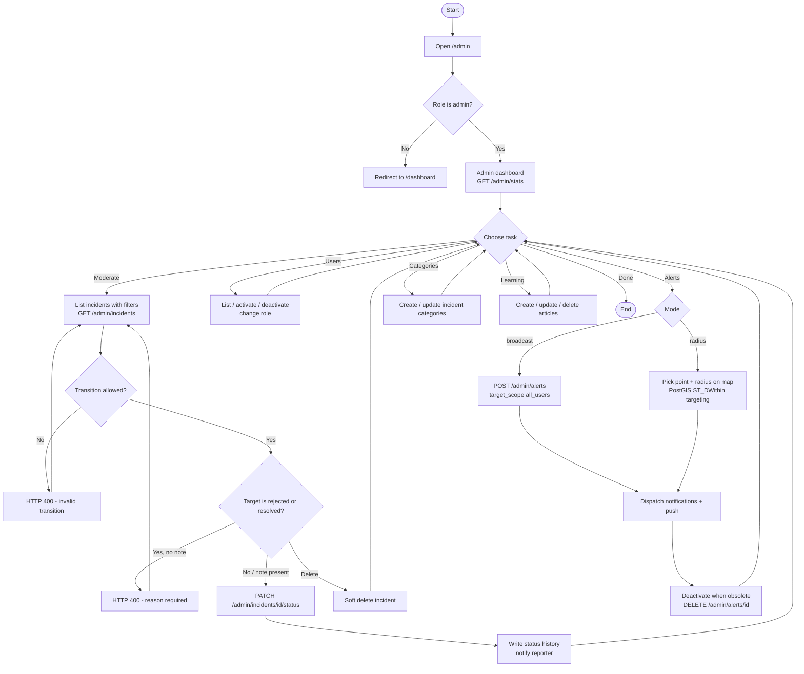

## Figure 6 — Class Diagram

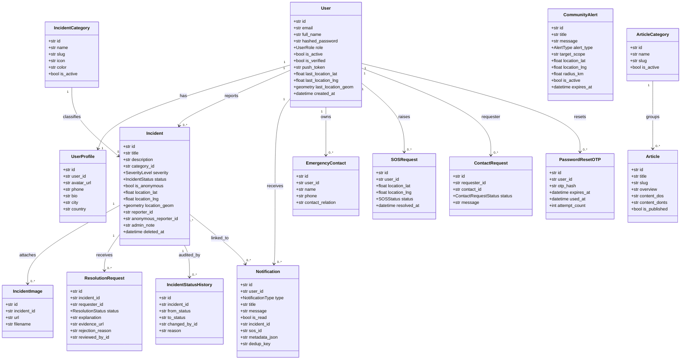

## Figure 7 — Login Sequence

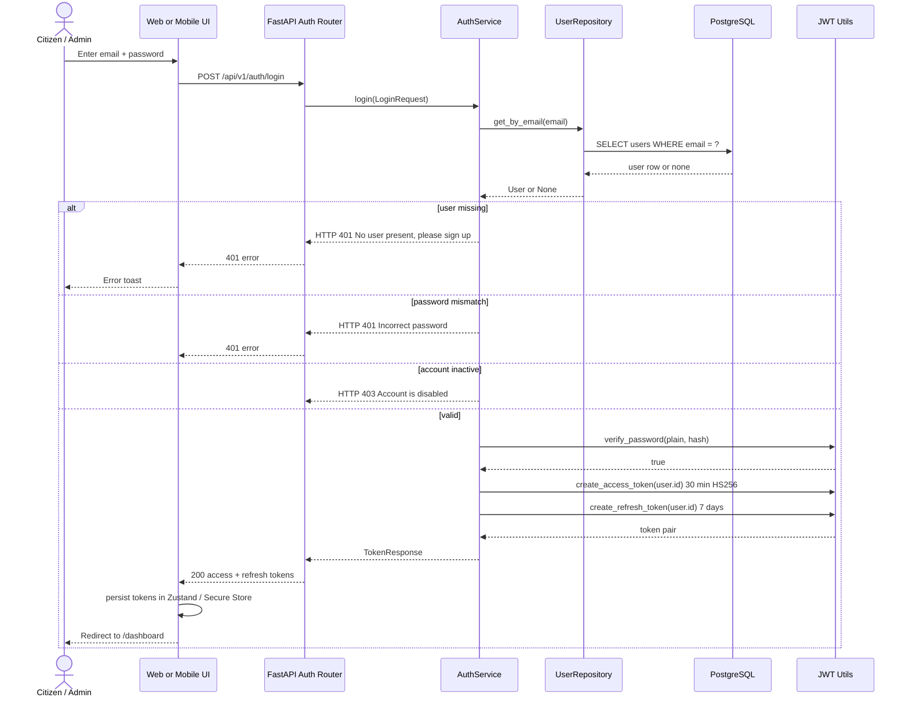

## Figure 8 — Incident Reporting Sequence

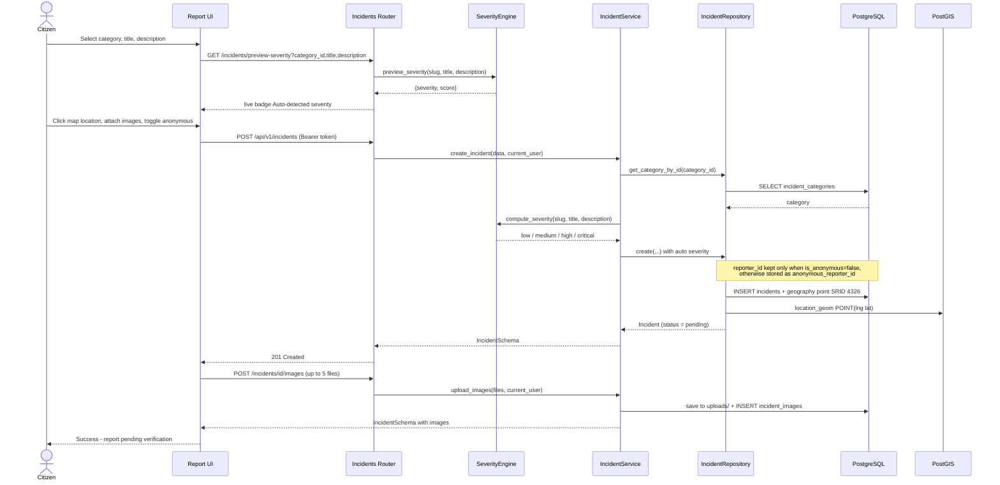

## Figure 9 — Incident Verification Sequence

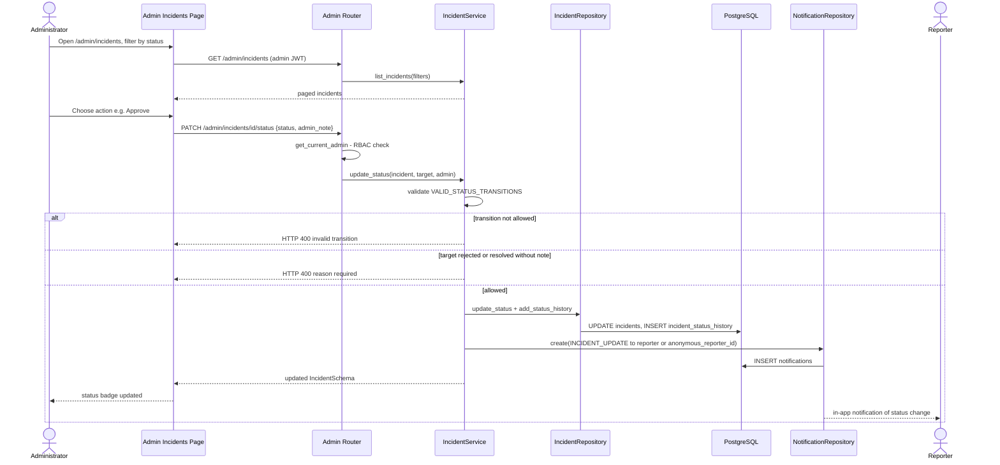

## Figure 10 — Safe Routing Sequence

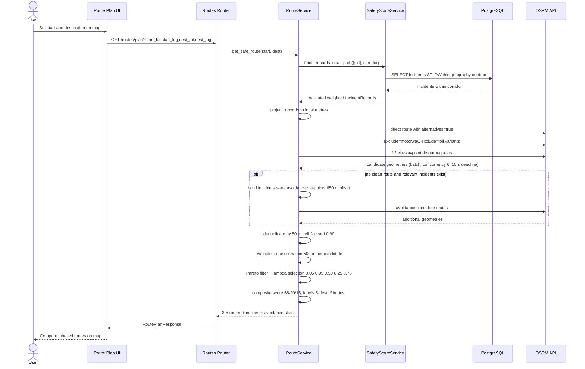

## Figure 11 — Community Alert Sequence

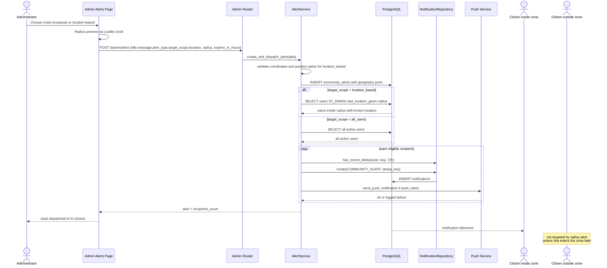

## Figure 12 — Emergency Contact Sequence

```mermaid
sequenceDiagram
    actor A as Requester
    participant UI as Contacts UI
    participant C as Routers contacts and sos
    participant CS as ContactRequestService
    participant NR as NotificationRepository
    participant P as Push Service
    actor B as Recipient
    actor SOS as SOS Caller

    A->>UI: Search users by name or email
    UI->>C: GET /contacts/search?q (min 2 chars)
    C->>CS: search_users
    CS-->>UI: matching citizens
    A->>UI: Send request with optional message
    UI->>C: POST /contacts/requests {contact_id, message}
    C->>CS: send_request(requester, data)
    CS->>CS: block self-request, duplicates; reopen rejected to pending
    CS->>NR: create(EMERGENCY_CONTACT_REQUEST)
    CS->>P: push to recipient
    B->>UI: View incoming request
    B->>C: PATCH /contacts/requests/id/accept
    C->>CS: respond_to_request(accept=true)
    CS->>NR: create(EMERGENCY_CONTACT_ACCEPTED) + push to requester
    Note over A,B: both users now appear in accepted contact lists
    SOS->>C: POST /sos {location_lat, location_lng}
    C->>CS: notify_contacts_of_sos(user, sos_id, lat, lng)
    loop each accepted contact
        CS->>NR: create(SOS_ALERT with metadata lat lng, dedup sos_alert:id:contact)
        CS->>P: push SOS Alert
    end
    CS-->>SOS: contacts notified count
```

## Figure 13 — Registration / Login BPMN

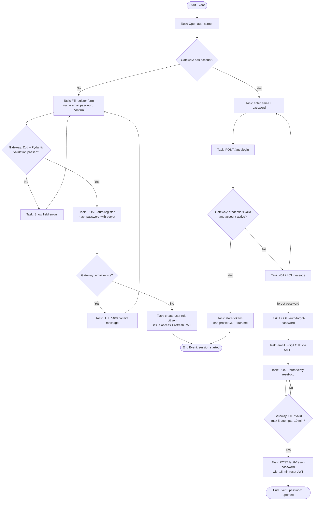

## Figure 14 — Incident Reporting BPMN

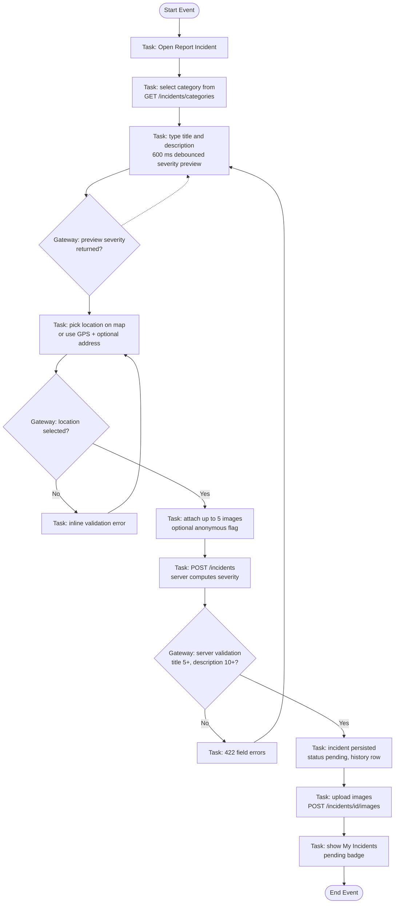

## Figure 15 — Incident Verification BPMN

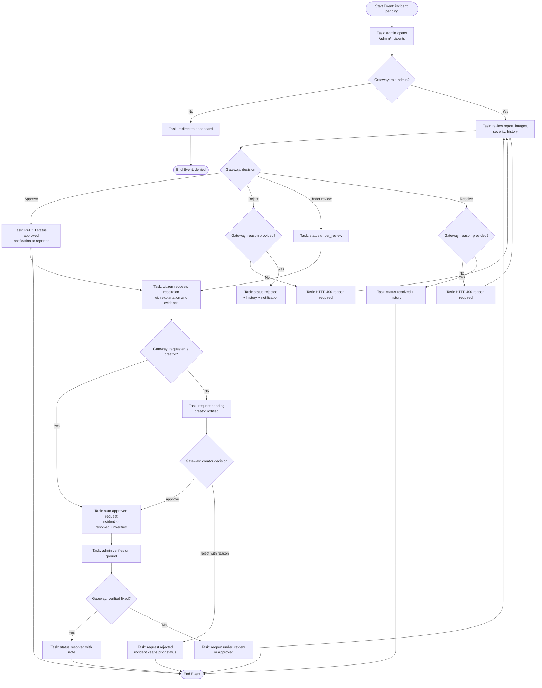

## Figure 16 — Safe Routing BPMN

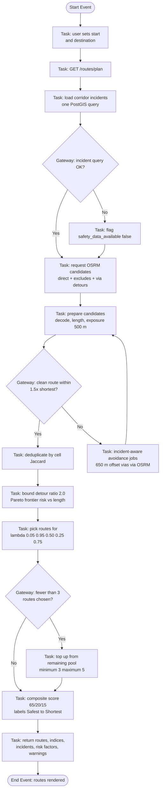

## Figure 17 — Community Alert BPMN

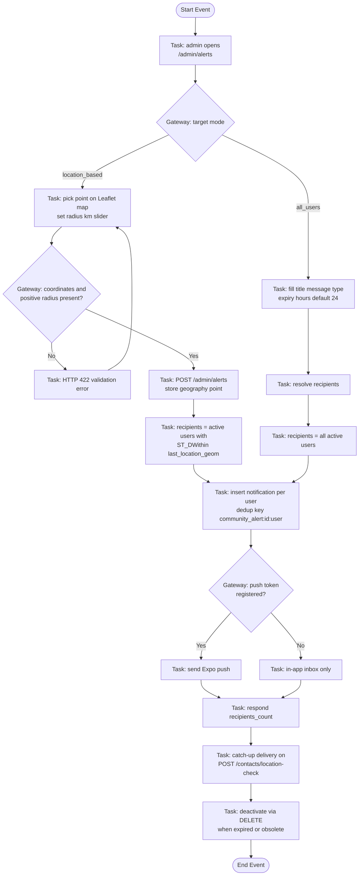

## Figure 18 — Emergency Contact BPMN

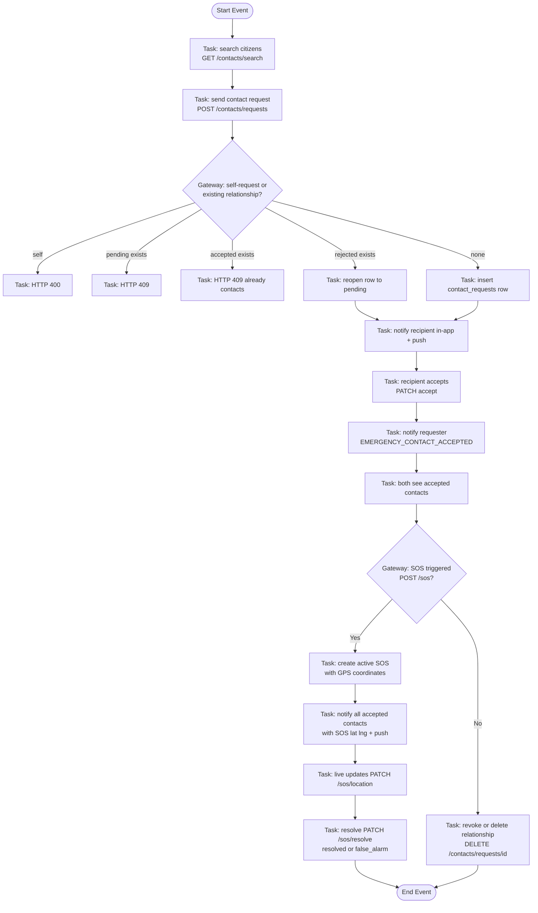

## Figure 19 — Context DFD

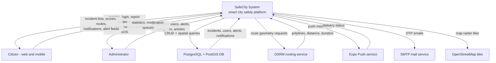

## Figure 20 — Level-1 DFD

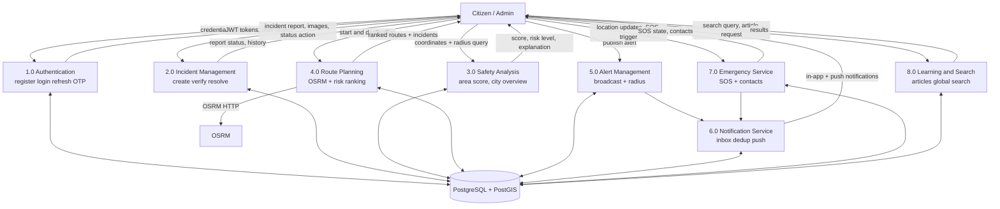

## Figure 21 — Incident Management DFD

```mermaid
flowchart TB
    U["Citizen"]
    AD["Admin"]
    S1["Validate + auto severity<br/>severity_engine"]
    S2["IncidentService"]
    S3["IncidentRepository"]
    DB[("incidents, incident_images,<br/>resolution_requests,<br/>incident_status_history")]
    N["NotificationService"]

    U -- "title, description, category,<br/>location, images, anonymous flag" --> S2
    S2 --> S1 -- "low/medium/high/critical" --> S2
    S2 -- "create with status pending" --> S3
    S3 -- "INSERT + status history" --> DB
    AD -- "PATCH status + admin_note" --> S2
    S2 -- "transition table check" --> S2
    S2 -- "update + history row" --> S3
    U -- "resolution request + evidence" --> S2
    S2 -- "creator auto-approve else pending" --> S3
    AD -- "list with filters, soft delete" --> S2
    S2 -- "status change" --> N -- "incident_update notification" --> U
    DB -- "approved incidents, heatmap points" --> S2 -- "list, detail, nearby, heatmap" --> U
```

## Figure 22 — Safe Routing DFD

```mermaid
flowchart TB
    U["User - web or mobile"]
    R["GET /routes/plan"]
    RS["RouteService"]
    SS["SafetyScoreService"]
    DB[("incidents within corridor<br/>PostGIS ST_DWithin")]
    OSRM["OSRM route API"]
    G["Geometry pipeline<br/>Projection, SegmentIndex,<br/>densify, cells"]

    U -- "start_lat, start_lng,<br/>dest_lat, dest_lng" --> R
    R --> RS
    RS -- "corridor point list" --> SS
    SS -- "weighted IncidentRecords" --> DB
    SS -- "validated records" --> RS
    RS -- "direct, exclude, via, avoidance jobs" --> OSRM
    OSRM -- "candidate polylines" --> RS
    RS -- "decode, length, cells, exposure" --> G
    G -- "risk_index, score per candidate" --> RS
    RS -- "dedup, Pareto, lambda selection" --> RS
    RS -- "3-5 routes + labels + indices" --> R
    R -- "RoutePlanResponse" --> U
```

## Figure 23 — Safety Analysis DFD

```mermaid
flowchart TB
    U["Citizen - map click or dashboard"]
    M["GET /safety/area, /safety/city"]
    SS["SafetyScoreService"]
    DB[("incidents approved + unverified<br/>within radius")]
    W["Weight model<br/>base x recency x verification x resolved"]
    AGG["aggregate_risk<br/>cluster decay + category soft cap"]
    OUT["score = 100 x exp(-risk)"]
    LNS["LocationNotificationService"]

    U -- "lat, lng, radius_km" --> M
    M --> SS
    SS -- "fetch records in radius" --> DB
    DB -- "rows" --> SS
    SS -- "IncidentRecord.hazard_w" --> W
    W -- "w" --> AGG
    SS -- "kernel + area normalisation" --> AGG
    AGG -- "risk" --> OUT
    OUT -- "score, risk_level, confidence,<br/>explanation" --> M
    M -- "score panel" --> U
    LNS -- "user position, radius 1 km" --> SS
    OUT -- "score below 40" --> LNS -- "unsafe_area notification" --> U
```

## Figure 24 — ER Diagram

```mermaid
erDiagram
    USERS ||--o| USER_PROFILES : owns
    USERS ||--o{ INCIDENTS : reports
    USERS ||--o{ NOTIFICATIONS : receives
    USERS ||--o{ EMERGENCY_CONTACTS : saves
    USERS ||--o{ SOS_REQUESTS : raises
    USERS ||--o{ CONTACT_REQUESTS : requester
    USERS ||--o{ CONTACT_REQUESTS : recipient
    USERS ||--o{ PASSWORD_RESET_OTPS : resets
    INCIDENT_CATEGORIES ||--o{ INCIDENTS : classifies
    INCIDENTS ||--o{ INCIDENT_IMAGES : has
    INCIDENTS ||--o{ RESOLUTION_REQUESTS : receives
    INCIDENTS ||--o{ INCIDENT_STATUS_HISTORY : audited_by
    INCIDENTS ||--o{ NOTIFICATIONS : references
    SOS_REQUESTS ||--o{ NOTIFICATIONS : references
    ARTICLE_CATEGORIES ||--o{ ARTICLES : groups

    USERS {
        uuid id PK
        varchar email UK
        varchar full_name
        varchar hashed_password
        enum role
        bool is_active
        bool is_verified
        varchar push_token
        float last_location_lat
        float last_location_lng
        geography last_location_geom
        datetime location_updated_at
        datetime created_at
    }
    USER_PROFILES {
        uuid id PK
        varchar user_id FK
        varchar avatar_url
        varchar phone
        varchar bio
        varchar city
        varchar country
    }
    INCIDENT_CATEGORIES {
        uuid id PK
        varchar name UK
        varchar slug UK
        varchar icon
        varchar color
        bool is_active
    }
    INCIDENTS {
        uuid id PK
        varchar title
        text description
        uuid category_id FK
        enum severity
        enum status
        bool is_anonymous
        float location_lat
        float location_lng
        geography location_geom
        uuid reporter_id FK
        uuid anonymous_reporter_id FK
        text admin_note
        datetime deleted_at
    }
    INCIDENT_IMAGES {
        uuid id PK
        uuid incident_id FK
        varchar url
        varchar filename
    }
    RESOLUTION_REQUESTS {
        uuid id PK
        uuid incident_id FK
        uuid requester_id FK
        enum status
        text explanation
        varchar evidence_url
        text rejection_reason
        uuid reviewed_by_id FK
    }
    INCIDENT_STATUS_HISTORY {
        uuid id PK
        uuid incident_id FK
        varchar from_status
        varchar to_status
        uuid changed_by_id FK
        text reason
    }
    NOTIFICATIONS {
        uuid id PK
        varchar user_id FK
        enum type
        varchar title
        text message
        bool is_read
        uuid incident_id FK
        uuid sos_id FK
        text metadata_json
        varchar dedup_key
    }
    COMMUNITY_ALERTS {
        uuid id PK
        varchar title
        text message
        enum alert_type
        varchar target_scope
        float location_lat
        float location_lng
        float radius_km
        geography location_geom
        bool is_active
        datetime expires_at
    }
    EMERGENCY_CONTACTS {
        uuid id PK
        varchar user_id FK
        varchar name
        varchar phone
        varchar contact_relation
    }
    CONTACT_REQUESTS {
        uuid id PK
        varchar requester_id FK
        varchar contact_id FK
        enum status
        text message
    }
    SOS_REQUESTS {
        uuid id PK
        varchar user_id FK
        float location_lat
        float location_lng
        geography location_geom
        enum status
        datetime resolved_at
    }
    PASSWORD_RESET_OTPS {
        uuid id PK
        varchar user_id FK
        varchar otp_hash
        datetime expires_at
        datetime used_at
        int attempt_count
    }
    ARTICLE_CATEGORIES {
        uuid id PK
        varchar name UK
        varchar slug UK
        bool is_active
    }
    ARTICLES {
        uuid id PK
        varchar title
        varchar slug UK
        text overview
        text content_dos
        text content_donts
        text emergency_steps
        text helpline_numbers
        text legal_info
        uuid category_id FK
        bool is_published
    }
```

## Figure 25 — Database Schema Layout

```mermaid
flowchart TB
    subgraph AUTH["Identity"]
        T1["users<br/>PK id, UK email, role enum<br/>push_token, last_location_geom GiST"]
        T2["user_profiles<br/>PK id, FK user_id unique"]
        T3["password_reset_otps<br/>PK id, FK user_id<br/>otp_hash, attempt_count"]
    end

    subgraph INC["Incidents"]
        T4["incident_categories<br/>PK id, UK name, UK slug"]
        T5["incidents<br/>PK id, FK category_id<br/>severity, status, location_geom GiST<br/>reporter_id, anonymous_reporter_id<br/>deleted_at soft delete"]
        T6["incident_images<br/>PK id, FK incident_id"]
        T7["resolution_requests<br/>PK id, FK incident_id, requester_id<br/>status, explanation, evidence_url"]
        T8["incident_status_history<br/>PK id, FK incident_id<br/>from_status, to_status, changed_by_id"]
    end

    subgraph CM["Communication"]
        T9["notifications<br/>PK id, FK user_id, incident_id, sos_id<br/>type, dedup_key index user_id+dedup_key"]
        T10["community_alerts<br/>PK id, target_scope<br/>location_geom GiST, expires_at"]
    end

    subgraph EM["Emergency"]
        T11["emergency_contacts<br/>PK id, FK user_id"]
        T12["contact_requests<br/>PK id, FK requester_id, contact_id<br/>UK requester_id+contact_id"]
        T13["sos_requests<br/>PK id, FK user_id, location_geom GiST"]
    end

    subgraph LR["Learning"]
        T14["article_categories<br/>PK id, UK name, UK slug"]
        T15["articles<br/>PK id, FK category_id, UK slug"]
    end

    T1 --> T2
    T1 --> T3
    T1 --> T9
    T4 --> T5
    T5 --> T6
    T5 --> T7
    T5 --> T8
    T5 --> T9
    T13 --> T9
    T1 --> T11
    T1 --> T12
    T1 --> T13
    T14 --> T15
```

## Figure 26 — API Architecture

```mermaid
flowchart TB
    subgraph C["Clients"]
        W["Web - axios instance<br/>baseURL /api/v1, Bearer + 401 refresh"]
        M["Mobile - axios instance<br/>Secure Store token, queued refresh"]
    end

    subgraph R["Routers - FastAPI prefix /api/v1"]
        RA["/auth<br/>register login refresh<br/>forgot-password verify-reset-otp<br/>reset-password me"]
        RU["/users<br/>me profile avatar change-password<br/>contacts location"]
        RI["/incidents<br/>categories nearby list heatmap<br/>preview-severity create my detail<br/>images evidence resolution-requests<br/>status-history"]
        RADM["/admin<br/>stats incidents status users<br/>categories alerts articles"]
        RN["/notifications<br/>list read read-all"]
        RL["/learning<br/>categories articles"]
        RAL["/alerts<br/>list active"]
        RR["/routes/plan"]
        RSF["/safety/area /safety/city"]
        RSOS["/sos<br/>active create location resolve"]
        RSE["/search"]
        RC["/contacts<br/>search requests push-token location-check"]
    end

    subgraph MW["Cross-cutting"]
        AUTHMW["HTTPBearer + get_current_user<br/>get_current_admin"]
        VALMW["Pydantic request/response schemas<br/>422 validation errors"]
        CORS["CORSMiddleware allowlist"]
    end

    W --> CORS --> RA
    M --> CORS --> RA
    W --> AUTHMW
    M --> AUTHMW
    AUTHMW --> RU
    AUTHMW --> RI
    AUTHMW --> RN
    AUTHMW --> RR
    AUTHMW --> RSOS
    AUTHMW --> RC
    AUTHMW --> RADM
    RA --> VALMW
    RI --> VALMW
    RADM --> VALMW
    RAL --> RSF
    RL --> RSE
```

## Figure 27 — Security Architecture

```mermaid
flowchart TB
    REQ["Incoming HTTPS request"] --> CORS["CORS origin allowlist"]
    CORS --> ROUTE["Route resolution"]
    ROUTE --> GUARD{"Protected route?"}
    GUARD -- "public" --> PUB["Endpoints<br/>register, login, categories,<br/>incident list/detail, heatmap,<br/>safety scores, routes, search, articles"]
    GUARD -- "authenticated" --> JWT["HTTPBearer: decode JWT<br/>HS256, type=access, exp check"]
    JWT --> ACT{"user.is_active?"}
    ACT -- "no" --> F403["403 Inactive user"]
    ACT -- "yes" --> ROLE{"admin route?"}
    ROLE -- "no" --> HANDLER["Endpoint handler"]
    ROLE -- "yes" --> ADM{"role == admin?"}
    ADM -- "no" --> F403B["403 Admin access required"]
    ADM -- "yes" --> HANDLER
    HANDLER --> SCHEMA["Pydantic validation<br/>length, range, email, OTP format"]
    SCHEMA --> BIZ["Service rules<br/>status transitions, max 5 contacts,<br/>one active SOS, dedup keys"]
    BIZ --> DBW["Repository write<br/>bcrypt hash, soft delete, history rows"]
    DBW --> RESP["JSON response<br/>anonymous reporter fields stripped"]

    subgraph PROTECT["Credential and data protection"]
        P1["bcrypt password hashing<br/>72-byte truncation"]
        P2["JWT access 30 min / refresh 7 d<br/>separate type claims"]
        P3["OTP stored as bcrypt hash<br/>5 attempts, 60 s cooldown, 10 min TTL"]
        P4["Reset token JWT 15 min type password_reset"]
        P5["Generic messages prevent<br/>user enumeration"]
        P6["Expo push tokens validated<br/>prefix ExponentPushToken"]
    end
```

## Figure 28 — Deployment Architecture

```mermaid
flowchart TB
    subgraph DOCKER["Docker Compose - docker-compose.yml"]
        DBX[("db container<br/>postgis/postgis:15-3.3<br/>port 5433 to host, volume postgres_data")]
        BK["backend container<br/>python 3.11-slim, uvicorn :8000<br/>runs python -m app.db.init_db on start<br/>volume uploads_data"]
        WB["web container<br/>node:20-alpine build -> nginx:alpine :80->80<br/>serves dist + SPA fallback"]
    end

    subgraph HOSTED["Hosted targets - DEPLOYMENT_GUIDE.md"]
        VERCEL["Vercel - web SPA<br/>vercel.json rewrites to index.html"]
        RENDER["Render - FastAPI service<br/>EXPO_PUBLIC_API_BASE_URL in eas.json"]
        SUPA["Supabase - PostgreSQL + PostGIS"]
        EC2["AWS EC2 - self-hosted OSRM<br/>Tamil Nadu extract (guide)"]
        GHREL["GitHub Releases - Android APK"]
    end

    subgraph MOB["Mobile delivery"]
        EAS["EAS build profile preview<br/>buildType apk<br/>API https://safecity-k280.onrender.com"]
    end

    DBX --> BK
    BK --> WB
    WB --> USERS["Browser clients"]
    VERCEL --> USERS
    RENDER --> SUPA
    RENDER --> EC2
    EAS --> PHONES["Android devices"]
    PHONES --> RENDER
    GHREL --> PHONES
    USERS --> VERCEL
    USERS --> RENDER
```

## Figure 29 — Safe Routing Flowchart

```mermaid
flowchart TB
    S(["GET /routes/plan"]) --> A1["Validate coordinates"]
    A1 --> A2["Corridor = base 6000 m + 0.25 x trip<br/>cap 25 km; single ST_DWithin query"]
    A2 --> A3["Project records + OSRM jobs to<br/>local equirectangular metres"]
    A3 --> A4["Stage A: direct with alternatives,<br/>exclude motorway, exclude toll,<br/>12 via-waypoint jobs"]
    A4 --> A5["Prepare candidates: decode polyline,<br/>length, duration, densify 500 m,<br/>SegmentIndex exposure"]
    A5 --> B1{"Any candidate with<br/>0 relevant incidents<br/>and length <= 1.5 x shortest?"}
    B1 -- "No and relevant incidents exist" --> A6["Stage B: avoidance vias at<br/>650 m perpendicular to worst clusters<br/>max 10 jobs"]
    A6 --> A5
    B1 -- "Yes" --> C1["Deduplicate: 50 m cells,<br/>drop Jaccard >= 0.90,<br/>keep lambda 0.5 better"]
    C1 --> C2["Detour bound: keep ratio <= 2.0,<br/>else keep 3 shortest"]
    C2 --> C3["Pareto frontier on<br/>risk_index vs length"]
    C3 --> D1["lambda 0.05: prefer clean route<br/>else min cost"]
    D1 --> D2["lambda 0.95 min cost"]
    D2 --> D3["lambda 0.50"]
    D3 --> D4["lambda 0.25"]
    D4 --> D5["lambda 0.75"]
    D5 --> E1{"chosen < 3?"}
    E1 -- "Yes" --> E2["Top up with distinct rest<br/>min 3, max 5"]
    E1 -- "No" --> E3["Sort by lambda"]
    E2 --> E3
    E3 --> F1["Composite = 0.65 safety<br/>+ 0.20 distance + 0.15 duration"]
    F1 --> F2["Labels: Safest, Safer, Balanced,<br/>Shorter, Shortest + role indices"]
    F2 --> F3["Attach up to 50 incidents,<br/>top-3 risk factors, warnings"]
    F3 --> Z(["Response JSON"])
```

## Figure 30 — Area Safety Score Flowchart

```mermaid
flowchart TB
    S(["GET /safety/area?lat,lng,radius_km"]) --> A1{"lat/lng valid?"}
    A1 -- "No" --> X1["Return score 50, moderate,<br/>confidence none, explanation"]
    A1 -- "Yes" --> A2["Clamp radius to 0.05..50 km"]
    A2 --> A3["Fetch incidents within radius<br/>exclude rejected and soft-deleted<br/>limit 20000, newest first"]
    A3 --> B1{"any incident<br/>inside radius?"}
    B1 -- "No" --> X2["Return score 100, safe,<br/>confidence low, note absence of reports"]
    B1 -- "Yes" --> C1["Per incident compute<br/>hazard_w = base x recency x verify<br/>recency = 0.15 + 0.85 x 0.5^(age/60)"]
    C1 --> C2["Kernel = (1 - 0.5 u^2)/0.75<br/>u = d/radius, mean 1 over disc"]
    C2 --> C3["Contribution = hazard_w x kernel<br/>/ (100 x max(area_km2, 0.5))"]
    C3 --> D1["Cluster discount 0.5^rank<br/>in category + 55 m cell"]
    D1 --> D2["Category soft cap<br/>K = 2.0 x crit/maxcrit<br/>cap x (1 - exp(-sum/K))"]
    D2 --> D3["risk = sum of capped categories"]
    D3 --> E1["score = 100 x exp(-risk)"]
    E1 --> E2{"score"}
    E2 -- "below 40" --> E3["risk_level unsafe"]
    E2 -- "40 to 74" --> E4["risk_level moderate"]
    E2 -- "75 and above" --> E5["risk_level safe"]
    E3 --> F1
    E4 --> F1
    E5 --> F1
    F1["Confidence from evidence mass<br/>low < 1 <= medium < 5 <= high"]
    F1 --> G1["Compose explanation,<br/>severity counts, top categories,<br/>recent 7d / 30d, density"]
    G1 --> Z(["JSON response"])
```

## Figure 31 — Incident Risk (Severity) Flowchart

```mermaid
flowchart TB
    S(["Incident submitted or preview requested"]) --> A1["Read category slug"]
    A1 --> A2{"slug in base table?"}
    A2 -- "Yes" --> B1["base = category baseline 0-100<br/>e.g. gas_leak 85, crime 70,<br/>poor_lighting 40, default 40"]
    A2 -- "No" --> B2["base = 40"]
    B1 --> C1["Scan title for keywords"]
    B2 --> C1
    C1 --> C2{"match tier"}
    C2 -- "critical word" --> C3["title boost = 30"]
    C2 -- "high word" --> C4["title boost = 18"]
    C2 -- "medium word" --> C5["title boost = 8"]
    C2 -- "none" --> C6["title boost = 0"]
    C3 --> D1["Scan description, dampened x 0.60"]
    C4 --> D1
    C5 --> D1
    C6 --> D1
    D1 --> E1["total = min(100, base + title_boost + desc_boost)"]
    E1 --> F1{"threshold map"}
    F1 -- "total >= 80" --> G1["severity critical"]
    F1 -- "60 to 79" --> G2["severity high"]
    F1 -- "38 to 59" --> G3["severity medium"]
    F1 -- "below 38" --> G4["severity low"]
    G1 --> H1["Persist severity on incident<br/>or return preview to client"]
    G2 --> H1
    G3 --> H1
    G4 --> H1
    H1 --> Z(["End"])
```

## Figure 32 — Alert Propagation Flowchart

```mermaid
flowchart TB
    S(["Trigger"]) --> T1["Trigger A: admin publishes<br/>POST /admin/alerts"]
    S --> T2["Trigger B: mobile posts<br/>POST /contacts/location-check"]
    S --> T3["Trigger C: admin broadcasts<br/>target_scope all_users"]

    T1 --> A1{"target_scope"}
    A1 -- "location_based" --> A2["Validate lat lng and radius > 0<br/>store geography point"]
    A1 -- "all_users" --> A3["Store without geometry"]
    A2 --> A4["Recipients: active users where<br/>ST_DWithin(last_location_geom, centre, radius)"]
    A3 --> A5["Recipients: all active users"]
    A4 --> B1["For each recipient:<br/>dedup_key community_alert:id:user<br/>skip if seen in 72 h"]
    A5 --> B1
    B1 --> B2["Insert COMMUNITY_ALERT notification<br/>metadata alert_id scope lat lng radius"]
    B2 --> B3{"push_token present?"}
    B3 -- "yes" --> B4["POST Expo push send<br/>icon prefix per scope"]
    B3 -- "no" --> B5["In-app only"]
    B4 --> C1["Return recipients_count"]
    B5 --> C1

    T2 --> D1["Update user last_location_geom"]
    D1 --> D2["Nearby incidents: approved,<br/>last 2 h, 5 km, top 5,<br/>dedup 24 h per incident"]
    D1 --> D3["Unsafe area: area score radius 1 km<br/>score < 40, grid 0.01 degree,<br/>dedup 6 h"]
    D1 --> D4["Catch-up: active location alerts<br/>covering current point<br/>dedup 72 h per alert"]
    D2 --> E1["Notification + push"]
    D3 --> E1
    D4 --> E1
    C1 --> Z(["End - user inbox updated"])
    E1 --> Z
```


