# SafeCity — Smart City Safety Platform

## Academic Project Report

**Title:** SafeCity — An Integrated Platform for Citizen Incident Reporting, Spatial Safety Analytics and Safe Route Planning

**Degree:** Master of Computer Applications (MCA)

**Repository:** `SafeCity` (monorepo: `apps/backend`, `apps/web`, `apps/mobile`, `shared`, `docker`)

**Documentation source:** This report is generated exclusively from the implemented source code of the repository at commit `83f0daf`. Every described feature, formula, weight, threshold, endpoint and workflow has been read from the code base. Items that could not be verified from the repository are explicitly marked **Not implemented / Not verified**.

---

## Acknowledgement

We would like to express our sincere gratitude to our project guide and supervising faculty for their constant encouragement, valuable suggestions and technical guidance throughout the analysis, design and implementation phases of this work. Their feedback shaped the architecture of the safety-scoring and route-evaluation engines that form the technical core of SafeCity.

We thank the Department of Computer Applications for providing the necessary infrastructure, laboratory facilities and software resources required to build and test the platform. We also acknowledge the open-source community — the developers of FastAPI, PostgreSQL/PostGIS, React, React Native/Expo, Leaflet, OSRM and OpenStreetMap — whose high-quality tools made this project possible.

Finally, we thank our parents, friends and classmates for their motivation and support during the course of this project.

---

## Synopsis

SafeCity is a full-stack, geospatial safety platform that allows citizens to report incidents, monitor the safety of their surroundings, compare safe travel routes and raise emergency SOS requests, while giving administrators tools to moderate content, publish community alerts and analyse city-wide safety data.

The system is implemented as a monorepo containing three applications:

1. **Backend (`apps/backend`)** — a Python FastAPI asynchronous REST API (prefix `/api/v1`) with SQLAlchemy 2.0 ORM, PostgreSQL 15 + PostGIS 3.3 spatial database, Alembic migrations, JWT (HS256) authentication with access/refresh tokens, bcrypt password hashing, OTP-based password reset via SMTP, and 12 router modules exposing approximately 90 endpoints.
2. **Web application (`apps/web`)** — React 18 + TypeScript + Vite single-page application using TanStack Query for server state, Zustand for authentication state, Leaflet with marker clustering and `leaflet.heat` for mapping, Recharts for administrative analytics, Zod + React Hook Form for client-side validation, and route guards for citizen/admin access control.
3. **Mobile application (`apps/mobile`)** — React Native (Expo SDK 50) Android application with React Navigation, Expo Secure Store token storage, Expo Location GPS services, Expo push notifications, live safe-route guidance with off-route deviation detection, and SOS emergency workflows.

The technical core of the platform is a deterministic, explainable safety model implemented in `safety_score_service.py` and shared between area scoring and route scoring. Each incident receives a hazard weight computed as the product of a category–severity base weight, an exponential recency factor (60-day half-life, floor 0.15), a verification factor (1.0 verified / 0.2 unverified) and a resolved factor (0.5). Per-incident contributions are geometrically discounted within ~55 m clusters, soft-capped per category, aggregated into a risk index and mapped to a 0–100 score through `score = 100·e^(−risk)`. Route planning extends this model: the `RouteService` requests candidate routes from OSRM, evaluates each candidate's exposure to route-relevant incidents within a 500 m corridor, removes near-duplicate candidates by 50 m cell Jaccard similarity, and selects 3–5 distinct routes along the risk-vs-distance Pareto frontier using a parametrised cost function.

Community alerting supports two delivery modes — city-wide broadcast and PostGIS `ST_DWithin` radius targeting of users' last known locations — with deduplicated in-app notifications and Expo push delivery. Emergency functionality comprises a phonebook-style contact list (maximum 5), a user-to-user contact-request workflow, and SOS requests that notify accepted contacts with live GPS coordinates.

The report documents the complete system analysis, design (including UML, BPMN, DFD and ER notations), implementation of every module actually present in the code, the algorithms with formulas and pseudocode derived from the implementation, a test suite derived from observable behaviour, results, limitations and future enhancements.

**Keywords:** Smart city safety, incident reporting, PostGIS, safety score, safe routing, OSRM, FastAPI, React, React Native, geospatial risk analysis.

---

## List of Figures

| Figure | Title | Report Section |
|---|---|---|
| Figure 1 | System Architecture | §3.2 |
| Figure 2 | Module Architecture | §3.3 |
| Figure 3 | Use Case Diagram | §3.12.1 |
| Figure 4 | User Activity Diagram | §3.12.2 |
| Figure 5 | Admin Activity Diagram | §3.12.3 |
| Figure 6 | Class Diagram | §3.12.4 |
| Figure 7 | Login Sequence Diagram | §3.12.5 |
| Figure 8 | Incident Reporting Sequence Diagram | §3.12.6 |
| Figure 9 | Incident Verification Sequence Diagram | §3.12.7 |
| Figure 10 | Safe Routing Sequence Diagram | §3.12.8 |
| Figure 11 | Community Alert Sequence Diagram | §3.12.9 |
| Figure 12 | Emergency Contact Sequence Diagram | §3.12.10 |
| Figure 13 | Registration / Login BPMN | §3.13.1 |
| Figure 14 | Incident Reporting BPMN | §3.13.2 |
| Figure 15 | Incident Verification BPMN | §3.13.3 |
| Figure 16 | Safe Routing BPMN | §3.13.4 |
| Figure 17 | Community Alert BPMN | §3.13.5 |
| Figure 18 | Emergency Contact BPMN | §3.13.6 |
| Figure 19 | Context Data Flow Diagram | §3.14.1 |
| Figure 20 | Level-1 Data Flow Diagram | §3.14.2 |
| Figure 21 | Incident Management DFD | §3.14.3 |
| Figure 22 | Safe Routing DFD | §3.14.4 |
| Figure 23 | Safety Analysis DFD | §3.14.5 |
| Figure 24 | Entity Relationship Diagram | §3.15.1 |
| Figure 25 | Database Schema Layout | §3.15.2 |
| Figure 26 | API Architecture | §3.17 |
| Figure 27 | Security Architecture | §3.18 |
| Figure 28 | Deployment Architecture | §3.19 |
| Figure 29 | Safe Routing Flowchart | §5.9 |
| Figure 30 | Area Safety Score Flowchart | §5.5 |
| Figure 31 | Incident Risk (Severity) Flowchart | §5.2 |
| Figure 32 | Alert Propagation Flowchart | §5.13 |

All Mermaid sources for the figures above are maintained in `SafeCity_Diagrams.md`; the identical source is embedded at each figure location in this report.

---

## List of Tables

| Table | Title | Section |
|---|---|---|
| Table 1 | Tools and Technologies Used | §1.11 |
| Table 2 | Existing System vs Proposed System | §2.5 |
| Table 3 | Functional Requirements | §2.6 |
| Table 4 | Non-Functional Requirements | §2.7 |
| Table 5 | Hardware Requirements | §2.8 |
| Table 6 | Software Requirements | §2.9 |
| Table 7 | Feasibility Summary | §2.10 |
| Table 8 | Incident Status Transition Matrix | §3.6 |
| Table 9 | Notification Types | §3.9 |
| Table 10 | Database Tables | §3.15 |
| Table 11 | Data Dictionary — Identity and Incident Tables | §3.16 |
| Table 12 | Data Dictionary — Communication, Emergency, Learning Tables | §3.16 |
| Table 13 | Category–Severity Base Weight Excerpt | §5.3 |
| Table 14 | Severity Engine Baseline Scores (excerpt) | §5.2 |
| Table 15 | Keyword Boost Tiers and Thresholds | §5.2 |
| Table 16 | Shared Safety Model Constants | §5.5 |
| Table 17 | Route-Relevant Categories | §5.8 |
| Table 18 | Routing Engine Constants | §5.9 |
| Table 19 | Lambda Selection Order and Route Roles | §5.11 |
| Table 20 | Test Environment | §6.3 |
| Table 21 | Test Cases — Authentication and Profile | §6.18 |
| Table 22 | Test Cases — Incidents and Verification | §6.18 |
| Table 23 | Test Cases — Safety, Routing and Heatmap | §6.18 |
| Table 24 | Test Cases — Alerts, Contacts, SOS and Admin | §6.18 |
| Table 25 | Scripted Verification Assets in Repository | §6.5 |
| Table 26 | Objective Achievement Matrix | §8.3 |
| Table 27 | Complete API Endpoint Inventory | Appendix B |

---

## List of Abbreviations

| Abbreviation | Expansion |
|---|---|
| API | Application Programming Interface |
| BPMN | Business Process Model and Notation |
| CORS | Cross-Origin Resource Sharing |
| CRUD | Create, Read, Update, Delete |
| DFD | Data Flow Diagram |
| EAS | Expo Application Services |
| ER | Entity Relationship |
| FK | Foreign Key |
| GIS | Geographic Information System |
| GPS | Global Positioning System |
| HTTP/HTTPS | Hypertext Transfer Protocol / Secure |
| JWT | JSON Web Token |
| ORM | Object-Relational Mapping |
| OSRM | Open Source Routing Machine |
| OSM | OpenStreetMap |
| OTP | One-Time Password |
| PK | Primary Key |
| RBAC | Role-Based Access Control |
| REST | Representational State Transfer |
| SPA | Single-Page Application |
| SQL | Structured Query Language |
| SRID | Spatial Reference System Identifier (4326 = WGS-84) |
| SMTP | Simple Mail Transfer Protocol |
| TTL | Time To Live |
| UI/UX | User Interface / User Experience |
| UML | Unified Modeling Language |
| UUID | Universally Unique Identifier |
| WGS-84 | World Geodetic System 1984 |

---

# CHAPTER 1 — INTRODUCTION

## 1.1 Project Overview

SafeCity is a smart-city safety platform that connects citizens, administrators and a geospatial analytics engine through a unified data model of city incidents. The platform is delivered through three coordinated applications built from a single monorepo:

- a **FastAPI backend** that owns all business logic, persistence and spatial computation,
- a **React web application** for citizens and administrators, and
- a **React Native (Expo) Android application** for citizens on the move.

The functional centre of the system is the *incident*: a citizen-reported, geotyped event (crime, accident, pothole, gas leak, harassment, and dozens of other categories) that flows through a controlled lifecycle from `pending` through administrative verification (`approved`, `under_review`, `rejected`) to closure (`resolved_unverified`, `resolved`). Every incident carries a PostGIS `geography` point, a machine-assigned severity, an optional anonymity guarantee, optional photographic evidence and a complete status-change audit trail.

From this data layer the platform derives three analysis products:

1. **Area safety scores** — a 0–100 score with a qualitative risk level (`safe`, `moderate`, `unsafe`) computed for any circle of radius 0.05–50 km, together with an English-language explanation, confidence rating and category breakdown.
2. **Heatmap and marker visualisation** — severity-weighted points rendered by `leaflet.heat` and marker clustering over OpenStreetMap tiles.
3. **Safe routes** — for any origin–destination pair, the backend produces 3–5 genuinely distinct road routes obtained from OSRM, each scored for cumulative incident exposure inside a 500 m corridor, and ranked from *Safest* to *Shortest* using Pareto selection and a composite score.

Around this core the platform provides JWT authentication with OTP password reset, community alerts with two targeting modes (broadcast and geographic radius), location-triggered notifications (nearby incidents, unsafe-area warnings), an SOS subsystem that notifies accepted emergency contacts with live coordinates, a user-to-user emergency contact request workflow, a safety Learning Hub of articles, global search, and a full administrative suite (statistics with Recharts, incident moderation, user management, category management, alert publishing, article management).

---

## 1.2 Background and Motivation

Urban safety information is traditionally fragmented: citizens witness hazards but have no structured channel to record them; municipal authorities learn about infrastructure failures long after occurrence; and individuals choosing a route at night have no data-driven basis for preferring one street over another.

Three technological trends make a platform like SafeCity feasible today:

1. **Ubiquitous spatial data.** PostGIS brings industrial-strength spatial indexing (`ST_DWithin`, `ST_Distance`, geography types, GiST indexes) inside the same transactional database that stores business data, so safety analytics and CRUD operations share one source of truth.
2. **Crowdsourced reporting.** Mobile devices with cameras and GPS allow any citizen to become a sensor. The design challenge shifts from *collection* to *trust*: reports must be verified, deduplicated and weighted — which is precisely what the verification workflow and the weighting model in SafeCity address.
3. **Open routing and mapping services.** OSRM and OpenStreetMap provide road-network routing without licence fees, allowing a safety layer to be composed on top of standard route geometry.

The motivation of this project is to combine these trends into one academically rigorous yet practically deployable system whose safety metrics are *deterministic and explainable* — every score can be traced to named incidents, their weights and their distances, rather than opaque machine-learned outputs.

## 1.3 Problem Statement

The problem addressed by SafeCity can be stated as follows:

> Citizens lack a reliable, shared, location-aware mechanism to report safety incidents, to assess how safe a given area or route is at the present time, and to receive timely warnings about hazards around them; administrators lack a moderated workflow to verify such reports and to communicate targeted alerts to the affected population.

Concretely, the system must solve:

- **P1 — Reporting:** provide an authenticated, optionally anonymous, map-based incident reporting channel with photographic evidence.
- **P2 — Trust:** ensure reports are machine-classified for severity, human-verified by an administrator, and audited through a formal state machine with history.
- **P3 — Spatial awareness:** expose area safety scores and heatmaps derived from verified and unverified reports using a documented, deterministic formula.
- **P4 — Route safety:** generate multiple candidate routes and rank them by measured incident exposure rather than distance alone.
- **P5 — Dissemination:** push location-relevant warnings (nearby incidents, unsafe areas, radius-scoped community alerts) to the right users without spamming them.
- **P6 — Emergency response:** allow a citizen to trigger an SOS that immediately informs their pre-approved emergency contacts with GPS coordinates.
- **P7 — Governance:** give administrators statistics, moderation queues, user management and content management over the same data.

---

## 1.4 Need for the System

- **Single source of truth:** reports, verification decisions, alerts and notifications are stored in one PostgreSQL database with spatial indexes, avoiding spreadsheet- or chat-based coordination.
- **Objective severity assignment:** manual severity selection by reporters is unreliable; the implemented system *ignores client-supplied severity* and recomputes it server-side with a deterministic rule engine (see §5.2).
- **Evidence-based safety communication:** the area score, its explanation string and its confidence level give residents a reproducible figure rather than anecdote.
- **Time-critical warnings:** location checks performed by the mobile app trigger proximity-based notifications within a 5 km radius and unsafe-area warnings when the local score drops below 40 (see §5.14).
- **Accountability:** every status change writes an `incident_status_history` row with actor and reason; rejections and resolutions require a written reason.
- **Privacy:** anonymous reporting hides the reporter identity from public *and* administrative views while retaining internal ownership for status notifications (`reporter_id` is nulled; `anonymous_reporter_id` is populated).
- **Offline-to-online emergency bridge:** a phonebook-style emergency contact list (maximum 5) supports users who are not on the platform, while in-app contact requests and SOS notifications cover registered users.

## 1.5 Objectives

1. Design and implement a role-based (citizen/administrator) REST API with JWT access/refresh authentication, bcrypt password hashing and OTP-based password reset.
2. Implement geotyped incident reporting with map-based location selection, image evidence (max. 5), anonymity, and server-side automatic severity classification.
3. Implement an auditable incident verification workflow with a validated status-transition matrix, mandatory reasons for rejection/resolution, and reporter notifications.
4. Implement an explainable area safety score (0–100) combining category–severity weights, exponential recency decay, verification factors, cluster de-duplication and per-category saturation.
5. Implement safe route planning that queries OSRM for multiple candidates, evaluates each against a 500 m incident corridor, and returns 3–5 ranked, labelled, genuinely distinct routes.
6. Implement severity-weighted heatmap rendering and interactive area-score inspection on an interactive map.
7. Implement two-mode community alerts (city-wide broadcast and PostGIS radius targeting) with deduplicated in-app and push notification delivery.
8. Implement location-triggered notifications: nearby recent incidents (5 km), unsafe-area warnings (score < 40) and catch-up delivery of radius alerts.
9. Implement SOS emergency requests with live GPS updates and notification of accepted emergency contacts, plus a user-to-user contact-request lifecycle.
10. Provide administrative analytics, incident moderation, user management, category management, alert publishing and Learning Hub content management.
11. Deliver the citizen experience on web and on Android (Expo) with live route guidance and off-route deviation alerts.
12. Containerise the stack with Docker Compose and document deployment targets.

## 1.6 Scope

**In scope (implemented):**

- Backend: authentication, profiles, emergency contacts, incidents (CRUD, nearby, heatmap, images, resolution requests, status history), safety scores (area, city), safe routing, community alerts, notifications, SOS, Learning Hub, global search, admin suite.
- Web: full citizen and admin SPA with route guards, interactive Leaflet map (markers, clustering, heatmap, polylines), route planner, profile and contacts management.
- Mobile: authentication, home dashboard with safety score, live map, incident reporting with GPS/camera, safe route planner with live guidance and deviation detection, notifications, profile, in-app and phonebook emergency contacts, SOS flow with countdown and active-SOS screen, push registration, location checks.
- Database: 15 tables including four PostGIS `geography` columns (`incidents.location_geom`, `community_alerts.location_geom`, `sos_requests.location_geom`, `users.last_location_geom`), Alembic migrations `001`–`007` plus the learning/alerts/emergency migration.
- Deployment: Docker Compose (PostGIS, backend, nginx web), Vercel SPA rewrites, EAS Android build profile.

**Out of scope / not present in the repository:**

- Native iOS build configuration (Expo scripts exist; only an Android build profile is configured).
- Real-time WebSocket channels (notifications are polled: web 30 s, mobile 15 s).
- Payment, insurance or municipal ticketing integrations.
- Trained machine-learning models — severity and safety scoring are deterministic rule engines (see §5.1).
- Automated CI pipeline definitions (no workflow files found in the repository) — **Not implemented / Not verified**.

---

## 1.7 Target Users

| User Role | Description | Primary Surfaces |
|---|---|---|
| Citizen (role `citizen`) | Resident who reports incidents, consults maps/scores, plans safe routes, manages contacts, triggers SOS, reads alerts and articles | Web `/dashboard`, `/map`, `/route-plan`, `/incidents/*`, `/profile`, `/alerts`, `/learning`; mobile tabs Home, Routes, Map, Report, Notifications, Profile |
| Administrator (role `admin`) | Moderator and analyst who verifies incidents, manages users/categories/articles, publishes alerts and reviews statistics | Web `/admin`, `/admin/incidents`, `/admin/users`, `/admin/categories`, `/admin/alerts`, `/admin/learning` |
| Anonymous reporter | A citizen acting with `is_anonymous = true`; identity withheld from all API consumers including administrators, still receives status notifications | Same as citizen |
| Platform (system actor) | Backend processes: location-check handling, alert dispatch, push delivery, OTP e-mail | `LocationNotificationService`, `AlertService`, `push_service`, `email_service` |

## 1.8 Key Features

- JWT authentication with refresh-token rotation; OTP password reset (6-digit, bcrypt-hashed, 5-attempt limit, 60 s cooldown, e-mailed via SMTP).
- Role-based access control: `get_current_user` and `get_current_admin` FastAPI dependencies plus web `ProtectedRoute`/`AdminRoute` guards.
- Incident reporting with searchable category selection (50+ seeded categories), live server-side severity preview (debounced 600 ms on web), map or GPS location selection, up to 5 images, optional anonymity.
- Controlled incident lifecycle: `pending → approved/rejected`; `approved → under_review/resolved_unverified/resolved/rejected`; `under_review → approved/resolved_unverified/resolved/rejected`; `resolved_unverified → resolved/under_review/approved/rejected`; `resolved → under_review/approved`; `rejected → pending/approved` — enforced server-side and mirrored in the admin UI.
- Resolution workflow: any logged-in user may submit a resolution request with explanation and evidence; the incident creator approves (→ `resolved_unverified`) or rejects with a reason; the administrator performs final verification to `resolved`.
- Area safety score with explanation, confidence, severity counts, top categories, 7-day/30-day counts and density; city overview with top category and recent activity.
- Severity-weighted heatmap (`low=1, medium=2, high=3, critical=4`) and clustered markers with pending/unverified incidents shown distinctly on the map.
- Safe route planning returning 3–5 labelled routes (Safest, Safer, Balanced, Shorter, Shortest) with distance, ETA, safety score, risk level, incident list, per-incident penalty impacts, top risk factors, detour ratio and composite score; avoidance statistics and warnings.
- Mobile live guidance: GPS watch (2 s / 5 m interval), off-route detection at more than 65 m cross-track distance with re-planning.
- Community alerts: broadcast to all active users or radius-targeted using PostGIS `ST_DWithin` on users' last known location; Leaflet radius preview; expiry; deactivation; recipient-count reporting.
- Location notifications: nearby approved incidents (last 2 h, 5 km, max 5, 24 h dedup), unsafe-area warning (1 km score < 40, 6 h cooldown, 0.01° grid key), radius-alert catch-up (72 h dedup).
- SOS: 5-second cancellation countdown on mobile, one active SOS per user, live `PATCH /sos/location` updates, resolution to `resolved` or `false_alarm`, coordinates sent to accepted contacts.
- Emergency contacts: phonebook list (max. 5) and in-app contact requests (search ≥ 2 characters, unique pair constraint, accept/reject/revoke, push + inbox notifications).
- Learning Hub articles with do's/don'ts, emergency steps, helplines and legal information; admin article CRUD with slug generation.
- Global search across incidents and articles; notifications inbox with unread counts, mark-one and mark-all read; admin analytics (status/category/severity breakdowns, 7-day trend, recent incidents) rendered with Recharts.

---

## 1.9 Advantages

- **Explainable analytics:** every score returns a human-readable `explanation`, a `risk_index`, and per-incident `penalty_impact` values that represent the share of lost points attributable to each incident.
- **Determinism:** identical inputs always yield identical severity and safety scores (no model runtime and no randomness at scoring time).
- **Spatial accuracy in SQL:** proximity logic uses PostGIS geography operations (metre-accurate on the spheroid) instead of degree approximations.
- **Anti-spam design:** geometric cluster discounting (`0.5^rank` within ~55 m cells) and per-category soft caps prevent duplicate reports or one nuisance category from dominating a score.
- **Trust workflow:** mandatory reasons, transition validation and immutable status history make moderation auditable.
- **Privacy by construction:** anonymity is enforced in the serialiser (`_serialize` strips reporter fields for *all* callers, including administrators).
- **Dual-channel delivery:** in-app inbox plus Expo push, both deduplicated by explicit keys with time windows.
- **Cross-platform parity:** web and mobile call the same `/api/v1` endpoints and share the same backend state.
- **Deployable:** one-command Docker Compose stack; documented hosted targets (Vercel, Render, Supabase, EC2-hosted OSRM).

## 1.10 Limitations

The following limitations are observable in the current implementation:

- **Absence of data reads as safety:** an empty radius returns score 100 with the caveat text *“absence of reports is not proof of safety”* — the model cannot distinguish an unmonitored area from a genuinely safe one.
- **Public OSRM dependency:** the default `OSRM_BASE_URL` is the public `router.project-osrm.org` demo server; rate limits or downtime degrade route planning (the API then returns HTTP 400 with the service error message).
- **Polling rather than streaming for the inbox:** the web client refetches notifications every 30 s and the mobile client every 15 s; there is no WebSocket channel.
- **Push requires Expo:** only tokens prefixed `ExponentPushToken[` are accepted; web users receive in-app inbox notifications only.
- **Uploads stored on local disk** (`apps/backend/uploads`) — no object storage; horizontal scaling would require shared storage.
- **Seed data volume:** seeding creates 130 incidents and 25 citizen accounts by default, so scores on a fresh instance reflect demo data.
- **`new_users_this_month` statistic is hard-coded to 0** in `admin_stats` (`# can be enhanced later`).
- **Mobile LAN fallback:** without `EXPO_PUBLIC_API_BASE_URL` the client falls back to a hard-coded LAN IP (`10.89.126.243`) — environment-specific.
- **Web `SafetyMapPage.tsx` exists but is not routed:** `/safety-map` redirects to `/map`; the live map page in use is `MapPage.tsx`.
- **No automated CI configuration found**; verification relies on manual scripts (see §6.5) — **Not implemented / Not verified**.

---

# CHAPTER 2 — SYSTEM ANALYSIS

## 2.1 Existing System

Prior to SafeCity, urban incident communication in the studied context relies on a combination of:

1. **Telephone hotlines and municipal complaint registers** — citizens call a control room or submit written complaints; the record is unstructured, non-spatial and difficult to aggregate.
2. **General-purpose social media and messaging groups** — hazard reports are posted informally; there is no verification, no severity model and no geographic indexing.
3. **Existing commercial map applications** — provide routing and traffic layers but do not incorporate citizen-verified local incident reports, and do not expose an explainable safety score derived from local reports.
4. **Standalone emergency diallers** — dialling a national emergency number connects the caller to authorities but does not inform the caller's own trusted contacts with live coordinates, nor build a reusable safety data set.

Characteristics common to these alternatives: manual routing of information, no audit trail of verification, no personalisation by location, no route-level risk computation, and no feedback loop that converts a complaint into a publicly visible, verified status.

## 2.2 Existing System Limitations

- **No structured reporting schema:** incidents are described free-form; categorisation and severity are subjective and inconsistent between reporters.
- **No verification state machine:** reports cannot be tracked from submission to resolution; duplicates and false reports are indistinguishable from genuine ones.
- **No spatial indexing:** proximity queries (“incidents near me”) are impossible without geographic coordinates stored in a queryable form.
- **No quantitative safety metric:** residents cannot obtain an objective, reproducible score for an area or a route; decisions are based on perception.
- **No route-level risk:** existing routers optimise time/distance only; they cannot rank alternatives by exposure to recent hazards.
- **Broadcast-only warnings:** authorities cannot target a warning to users inside a hazard radius; everyone is either over- or under-informed.
- **No trusted-contact notification:** in an emergency, a victim must manually call each contact; contacts do not automatically receive the victim's live location.
- **No accountability:** decisions by authorities on a complaint are rarely recorded with actor, timestamp and reason.
- **Privacy either absent or total:** systems either expose the reporter's identity (deterring reporting) or provide no way to report anonymously while still receiving updates.

## 2.3 Proposed System

SafeCity proposes an integrated platform in which:

1. Every incident is a **typed, geotyped, timestamped record** created through a validated API, with optional anonymity and photographic evidence.
2. Severity is **computed server-side** by a deterministic rule engine combining category baselines and keyword signals (§5.2), so reports are comparable.
3. Incidents move through a **validated state machine** with mandatory reasons and an immutable history table, and reporters receive notifications on every change.
4. **Spatial analytics** over PostGIS produce an area safety score with explanation and confidence, plus a severity-weighted heatmap.
5. **Safe routing** composes OSRM candidates with an incident-exposure evaluation inside a 500 m corridor and returns 3–5 ranked, labelled alternatives.
6. **Targeted dissemination** is achieved through two alert modes (broadcast / geographic radius using `ST_DWithin` on users' last known locations) plus location-check triggered notifications (nearby incidents, unsafe-area warnings, catch-up delivery).
7. **Emergency assistance** is provided through a phonebook contact list, a user-to-user contact-request network, and an SOS request that notifies accepted contacts with live GPS coordinates.
8. Administrators operate a **moderation and analytics console** over the same data (statistics, incident queue, users, categories, alerts, articles).

---

## 2.4 Proposed Features

- Authentication: register, login, refresh, three-step OTP forgot-password, `GET /auth/me`.
- Profiles: view/update profile, avatar upload (≤ 5 MB; jpg/jpeg/png/webp), change password, soft account deletion.
- Incidents: categories, create, list with filters/sort/search/date range, nearby (PostGIS), heatmap, detail, my-incidents (including anonymous ownership), image upload (≤ 5), evidence upload.
- Verification: status transitions with validation and reasons, status history, resolution requests (create/list/review/approve/reject) with creator and admin gates.
- Safety: area score (0.05–50 km radius), city overview (default centre 11.0168, 76.9558; 20 km radius), explanation, confidence, severity counts.
- Routing: `GET /routes/plan` returning 3–5 scored routes with incidents, risk factors, avoidance statistics and role labels.
- Alerts: admin publish (broadcast or radius), list active for citizens, admin list and deactivation; recipient count in the response.
- Notifications: list with unread count, mark read, mark all read; 13 notification types; dedup keys.
- Location services: `POST /users/me/location`, `POST /contacts/location-check` (nearby incidents, unsafe area, alert catch-up).
- Emergency: SOS active/create/location/resolve; phonebook contacts CRUD (max. 5); contact-request search/send/incoming/outgoing/accept/reject/delete/accepted; push-token registration.
- Learning Hub: categories, articles (paginated, filterable, searchable), article by slug or id.
- Search: global search across incidents and articles.
- Admin: stats, incident list/status/delete, user list/activate/deactivate/role, category list/create/update, alert list/create/delete, article list/create/update/delete.

## 2.5 Existing vs Proposed System

**Table 2: Existing System vs Proposed System**

| Aspect | Existing System | Proposed System (SafeCity) |
|---|---|---|
| Report format | Free-form complaint | Validated schema: title ≥ 5, description ≥ 10, category, coordinates, ≤ 5 images |
| Severity | Subjective / absent | Deterministic server-side engine (category baseline + keyword boosts) |
| Verification | Verbal or paper | State machine with validated transitions, mandatory reasons, history table |
| Location handling | Address text only | WGS-84 point + PostGIS geography column, spatial indexes |
| Proximity queries | Not possible | `ST_DWithin` nearby incidents, radius scoring, radius alert targeting |
| Safety metric | Perception-based | Explainable 0–100 score with risk level, confidence and narrative explanation |
| Routing | Time/distance only | 3–5 candidates ranked by incident exposure + Pareto/composite scoring |
| Warnings | City-wide broadcast | Broadcast **and** radius-scoped alerts; automatic nearby/unsafe-area notifications |
| Emergency contacts | Manual dialling | Phonebook (max 5) + in-app contact requests + SOS with live coordinates |
| Privacy | Identity exposed | Optional anonymity enforced in serialiser for all API consumers |
| Accountability | No audit trail | `incident_status_history` with actor, reason, timestamp |
| Citizen feedback | None | In-app notifications for status changes, resolution outcomes, alerts |
| Analytics | Manual counts | Live stats: status/category/severity breakdowns, 7-day trend, recent items |
| Access control | None | JWT + RBAC (citizen/admin) on API and UI routes |

---

## 2.6 Functional Requirements

**Table 3: Functional Requirements (part 1 of 2)**

| ID | Requirement | Implemented As |
|---|---|---|
| FR-01 | Register with e-mail, full name and password (≥ 8 chars) | `POST /auth/register`, Zod `registerSchema` |
| FR-02 | Authenticate and issue access + refresh JWTs | `POST /auth/login`, `create_access_token`, `create_refresh_token` |
| FR-03 | Refresh expired access tokens | `POST /auth/refresh`; axios interceptors (web and mobile) |
| FR-04 | Password reset by e-mailed 6-digit OTP with attempt and cooldown limits | `POST /auth/forgot-password`, `/verify-reset-otp`, `/reset-password`; `PasswordResetService` |
| FR-05 | Distinguish citizen and admin roles; protect admin endpoints | `UserRole`, `get_current_admin`, web `AdminRoute` |
| FR-06 | View and update profile data and avatar | `GET/PUT /users/me`, `POST /users/me/avatar` |
| FR-07 | Authenticated password change | `POST /users/me/change-password` |
| FR-08 | Account deactivation (soft delete) | `DELETE /users/me` sets `is_active = false` |
| FR-09 | List active incident categories; seed defaults on demand | `GET /incidents/categories`, `seed_categories()` |
| FR-10 | Create incidents with automatic severity assignment | `POST /incidents` + `compute_severity` |
| FR-11 | Preview severity while typing | `GET /incidents/preview-severity` (debounced 600 ms) |
| FR-12 | Anonymous reports while still notifying the owner | `anonymous_reporter_id` + serialiser stripping |
| FR-13 | Attach up to 5 images per incident | `POST /incidents/{id}/images` (extension and size checks) |
| FR-14 | List incidents with filters, sorting and pagination | `GET /incidents` with `IncidentFilters` |
| FR-15 | Return incidents within a radius | `GET /incidents/nearby` (`ST_DWithin`) |
| FR-16 | Provide heatmap points weighted by severity | `GET /incidents/heatmap` (weights 1/2/3/4) |
| FR-17 | List a user's own incidents including anonymous ones | `GET /incidents/my` |
| FR-18 | Administrator status changes with validation | `PATCH /admin/incidents/{id}/status` + transition matrix |
| FR-19 | Require reasons for rejection/resolution | `update_status` validation (HTTP 400) |
| FR-20 | Record status history | `incident_status_history` + `GET /incidents/{id}/status-history` |
| FR-21 | Resolution-request workflow with evidence | `POST /incidents/{id}/resolution-requests` and review endpoints |
| FR-22 | Notify reporters of status changes | `NotificationType.INCIDENT_UPDATE` on every transition |

**Table 3 (continued): Functional Requirements (part 2 of 2)**

| ID | Requirement | Implemented As |
|---|---|---|
| FR-23 | Compute an area safety score with explanation | `GET /safety/area` |
| FR-24 | Compute a city-level overview | `GET /safety/city` |
| FR-25 | Plan safe routes between two points | `GET /routes/plan` |
| FR-26 | Publish broadcast alerts to all active users | `POST /admin/alerts`, `target_scope = all_users` |
| FR-27 | Publish radius alerts to users inside a circle | `target_scope = location_based` + `ST_DWithin` |
| FR-28 | Prevent duplicate alert deliveries | dedup key `community_alert:{alert}:{user}`, 72 h window |
| FR-29 | List active, non-expired alerts | `GET /alerts` with expiry filter |
| FR-30 | Deliver in-app notifications with unread counts | `GET /notifications`, mark read, mark all read |
| FR-31 | Push notifications via Expo for registered tokens | `push_service.send_push_notification` |
| FR-32 | Trigger nearby-incident and unsafe-area notifications on location checks | `POST /contacts/location-check` |
| FR-33 | Store a user's last known location for targeting | `POST /users/me/location`, `last_location_geom` |
| FR-34 | Manage phonebook emergency contacts (max. 5) | `GET/POST/PATCH/DELETE /users/me/contacts` |
| FR-35 | Implement user-to-user contact requests | `/contacts/requests*` endpoints + unique pair constraint |
| FR-36 | Trigger SOS and notify accepted contacts with coordinates | `POST /sos` + `notify_contacts_of_sos` |
| FR-37 | Track an active SOS with location updates and resolution | `PATCH /sos/location`, `PATCH /sos/resolve` |
| FR-38 | Serve Learning Hub categories and articles | `/learning/*` endpoints |
| FR-39 | Provide global search over incidents and articles | `GET /search` |
| FR-40 | Expose admin statistics | `GET /admin/stats` |
| FR-41 | Manage users (activate, deactivate, change role) | `/admin/users/*` endpoints |
| FR-42 | Manage categories and articles | `/admin/categories`, `/admin/articles` |
| FR-43 | Serve uploaded files statically | `app.mount("/uploads", ...)` |
| FR-44 | Provide a health endpoint for monitors | `GET /health` |

## 2.7 Non-Functional Requirements

**Table 4: Non-Functional Requirements**

| ID | Category | Requirement | Evidence in implementation |
|---|---|---|---|
| NFR-01 | Performance | Area score served from a single bounded spatial query (≤ 20 000 rows) | `MAX_RECORDS = 20000` in `safety_score_service.py` |
| NFR-02 | Performance | Route planning bounded by an OSRM stage deadline (15 s) and 8 s per request, concurrency 6 | `STAGE_DEADLINE_S`, `OSRM_TIMEOUT_S`, `OSRM_CONCURRENCY` |
| NFR-03 | Performance | Spatial joins executed in-database with GiST indexes | `ST_DWithin` predicates; migration `007` adds GiST index |
| NFR-04 | Reliability | Graceful degradation when incident data or OSRM is unavailable | `data_ok` flag; neutral scores and explanatory notes |
| NFR-05 | Reliability | Malformed rows must never crash scoring | `try/except` in `build_incident_record` loop with logging |
| NFR-06 | Scalability | Async I/O end-to-end (async SQLAlchemy, httpx, aiofiles) | `core/database.py`, `route_service.py` |
| NFR-07 | Scalability | Connection pooling (`pool_size 10`, `max_overflow 20`, `pool_pre_ping`) | `create_async_engine(...)` |
| NFR-08 | Security | Passwords stored only as bcrypt hashes; 72-byte truncation guard | `core/security.py` |
| NFR-09 | Security | Short-lived access tokens (default 30 min) and 7-day refresh tokens with type claims | `ACCESS_TOKEN_EXPIRE_MINUTES`, `REFRESH_TOKEN_EXPIRE_DAYS` |
| NFR-10 | Security | Admin endpoints protected by role check returning 403 | `get_current_admin` |
| NFR-11 | Security | CORS restricted to an explicit origin allowlist | `BACKEND_CORS_ORIGINS` |
| NFR-12 | Security | OTP hashed at rest; max 5 attempts; 60 s resend cooldown; 10 min validity | `PasswordResetOTP`, `PasswordResetService` |
| NFR-13 | Security | Reset step uses a separate 15-minute JWT of type `password_reset` | `RESET_TOKEN_EXPIRE_MINUTES` |
| NFR-14 | Privacy | Anonymous incidents stripped of reporter fields for every consumer | `_serialize()` in `incident_service.py` |
| NFR-15 | Privacy | SOS coordinates shared only with accepted contacts | `notify_contacts_of_sos` scope |
| NFR-16 | Usability | Client-side validation mirrors server rules (Zod) with inline errors | `src/lib/schemas.ts` |
| NFR-17 | Usability | Explainable outputs: English explanations and confidence for scores | `calculate_area_score_detailed` |
| NFR-18 | Maintainability | Layered architecture (router → service → repository) with Pydantic schemas | `app/api`, `app/services`, `app/repositories`, `app/schemas` |
| NFR-19 | Maintainability | Alembic migrations for every schema change | `migrations/versions/001…007` |
| NFR-20 | Portability | Fully containerised stack | `docker-compose.yml`, `Dockerfile`s |
| NFR-21 | Availability | Health endpoint that does not touch the database | `GET /health` |
| NFR-22 | Integrity | Unique constraints (e-mail, category slug, contact pair) and FK cascade rules | model definitions, `uq_contact_request_pair` |

## 2.8 Hardware Requirements

**Table 5: Hardware Requirements**

| Component | Minimum | Recommended | Rationale |
|---|---|---|---|
| Developer machine | 4 GB RAM, dual-core CPU, 10 GB free disk | 16 GB RAM, quad-core SSD, 20 GB free disk | Docker Compose runs PostGIS + backend + nginx build simultaneously |
| Database server | 2 GB RAM, 2 vCPU, 10 GB SSD | 4 GB RAM, 4 vCPU, 50 GB SSD | PostGIS spatial indexes and `ST_DWithin` scans benefit from RAM/disk |
| API server | 512 MB RAM, 1 vCPU (documented free-tier shape) | 1 GB+ RAM, 2 vCPU | FastAPI + asyncpg are lightweight; OSRM calls are proxied, not executed locally |
| Web server | 256 MB RAM (static nginx) | 512 MB RAM | SPA is pre-built; nginx serves static assets |
| Client (web) | 1366×768 display, modern browser | 1920×1080, Chrome/Edge/Firefox latest | Leaflet and Recharts rendering |
| Client (mobile) | Android 8+ device, GPS, 2 GB RAM | Android 12+ device | `expo-location`, `react-native-maps`, push notifications |
| Network | 1 Mbps | 5 Mbps+ | Map tiles, OSRM responses (polylines), push API |

## 2.9 Software Requirements

**Table 6: Software Requirements**

| Layer | Requirement |
|---|---|
| Operating system | Windows 10/11, macOS or Linux (development on `win32`; containers abstract the runtime) |
| Runtime (backend) | Python 3.11+ (Docker image `python:3.11-slim`; local venvs observed on 3.12) |
| Runtime (web) | Node.js 18+ (Docker build uses `node:20-alpine`) |
| Runtime (mobile) | Node.js 18+, Expo CLI ≥ 7 (EAS) |
| Database | PostgreSQL 15 with PostGIS 3.3 (`postgis/postgis:15-3.3`) |
| Backend packages | fastapi 0.111.0, uvicorn 0.29.0, sqlalchemy 2.0.30, asyncpg 0.29.0, alembic 1.13.1, geoalchemy2 0.14.7, python-jose 3.3.0, passlib 1.7.4, pydantic 2.7.1, httpx 0.27.0, aiosmtplib 3.0.1, shapely 2.0.4, polyline 2.0.2, aiofiles 23.2.1 |
| Web packages | react 18.3.1, react-router-dom 6.23, @tanstack/react-query 5.40, zustand 4.5.2, leaflet 1.9.4, leaflet.heat, leaflet.markercluster, recharts 2.12.7, zod 3.23, tailwindcss 3.4, vite 5.3.1 |
| Mobile packages | expo ~50.0.14, react-native 0.73.6, @react-navigation 6, @tanstack/react-query 5.17, axios 1.6.5, zustand 4.5, expo-location ~16.5, expo-notifications 0.27, expo-secure-store ~12.8, react-native-maps 1.10 |
| Tooling | Docker + Docker Compose, Git, Alembic (`python -m alembic upgrade head`) |
| External services | OSRM endpoint, OpenStreetMap tile server, Expo Push API, SMTP server (e.g. Gmail app password) |

---

## 2.10 Feasibility Study

### 2.10.1 Technical Feasibility

All required technologies are open-source or free-tier and are already integrated in the repository:

- **Backend:** FastAPI + SQLAlchemy async + GeoAlchemy2 provide proven spatial ORM support; PostGIS supplies the required operators (`ST_DWithin`, `ST_Distance`, `ST_GeogFromText`, `ST_MakePoint`) executed as plain SQL by repositories and services.
- **Routing:** OSRM exposes a documented HTTP API supporting `alternatives=true`, `exclude=`, via-waypoints (multi-coordinate paths) and encoded-polyline geometry — exactly the capabilities the `RouteService` consumes.
- **Clients:** React + Leaflet and React Native + Expo are mature frameworks with the required libraries (`leaflet.heat`, marker clustering, `expo-location`) already vendored in `package.json`.
- **Push/OTP:** Expo Push API and SMTP are reachable over HTTPS/SMTP with `httpx` and `aiosmtplib` respectively.

Risk points identified and mitigated in code: OSRM failures are contained (retries, stage deadline, `data_ok = False` neutral scoring); spatial query failures roll back the session and log warnings; malformed incident rows are skipped rather than raised.

### 2.10.2 Economic Feasibility

The entire stack can be operated at zero or near-zero cost: PostgreSQL+PostGIS (Supabase free tier per the deployment guide), FastAPI on a 512 MB free web service, static SPA on Vercel free tier, OSRM either public (default) or on an AWS `t2.micro` free-tier instance with a Tamil Nadu OSM extract, and APK distribution via GitHub Releases. No commercial licences are required — every pinned dependency in `requirements.txt` and `package.json` is permissive/OSS. Development hardware is a standard personal computer.

### 2.10.3 Operational Feasibility

- **One-command startup:** `docker-compose up --build -d` brings up database, backend (running `python -m app.db.init_db` before Uvicorn) and web.
- **Self-explanatory UI:** forms carry inline validation, severity preview, legends and empty states; Swagger UI at `/docs` documents every endpoint for operators.
- **Role separation:** administrators operate entirely within `/admin/*` routes; citizens never receive admin API access (403 enforced server-side).
- **Observability:** `GET /health` for uptime monitors, structured `logging` in services (scoring skips, OSRM deadline warnings, push failures).

### 2.10.4 Schedule Feasibility

The system was built incrementally over seven recorded schema migrations (`001` initial → `007` location alerts) and multiple documented releases in `PRODUCTION_LOG.md` (through v1.7.1), indicating a phased schedule: core CRUD/auth → safety scoring → routing → alerts/contacts → SOS/push → polish. The phased design with a stable API contract allowed web and mobile to be developed in parallel against the same backend.

**Table 7: Feasibility Summary**

| Dimension | Verdict | Key evidence |
|---|---|---|
| Technical | Feasible | OSS stack fully integrated; failure paths handled in code |
| Economic | Feasible | Zero-licence stack; free-tier hosting targets documented |
| Operational | Feasible | Docker one-shot start, RBAC, health endpoint, Swagger docs |
| Schedule | Feasible | Incremental migrations/releases; parallel client development |

## 2.11 Constraints

- Route planning depends on an external OSRM endpoint; the default is the public demo server (rate-limited).
- Map visuals depend on OpenStreetMap raster tile availability and usage policy.
- Push notifications require the Expo-built mobile app and notification permission; web has no push channel.
- Location-based alert targeting only reaches users who granted location permission at least once (`last_location_geom IS NULL` otherwise).
- Unsafe-area and nearby-incident checks are client-triggered (`POST /contacts/location-check`); the server does not poll user positions.
- Image evidence is limited to 5 images per incident and 10 MB per file (`MAX_UPLOAD_SIZE_MB`), stored on the host filesystem.
- The safety model is only as good as the reported data: sparse regions trend to score 100 by design.
- Anonymous reports cannot be edited or withdrawn through any endpoint (no such route exists).
- Only two roles exist (`citizen`, `admin`); there is no moderator/verifier tier.

---

## 2.12 Assumptions and Dependencies

**Assumptions**

- Users report truthful incidents; the platform mitigates but cannot eliminate false reports (verification is human-in-the-loop).
- Incident coordinates are entered in WGS-84 (SRID 4326); no coordinate-transform pipeline is required.
- A single-city deployment centre (Coimbatore: 11.0168 N, 76.9558 E) is used for the city-overview defaults; other cities work by passing coordinates.
- Time is stored and compared in UTC (`utcnow()` helpers; `datetime.now(timezone.utc)`).

**Dependencies**

- Backend runtime depends on PostgreSQL/PostGIS being reachable through `DATABASE_URL` (a Pydantic validator rewrites `postgresql://` to `postgresql+asyncpg://`).
- `init_db` runs Alembic migrations, then seeds categories, an administrator account, 25 citizens, 130 incidents and notifications.
- Mobile builds depend on EAS with `EXPO_PUBLIC_API_BASE_URL` pointing to the hosted API (`https://safecity-k280.onrender.com` in `eas.json`).
- Web production hosting depends on `VITE_API_BASE_URL` at build time and CORS allowlisting of the hosting origin.
- Forgot-password depends on SMTP credentials; without them OTP dispatch fails at runtime — **delivery not verified in this documentation run**.

---

# CHAPTER 3 — SYSTEM DESIGN

## 3.1 System Architecture

The system follows a classical three-tier architecture with a shared REST contract:

1. **Presentation tier** — React SPA (citizen + admin) and React Native app (citizen), both rendering maps client-side and consuming JSON over HTTPS.
2. **Application tier** — FastAPI processes requests through layered modules: *routers* (HTTP concerns, dependencies, response models) → *services* (business rules, workflows, algorithms) → *repositories* (queries, persistence), with `core` modules for configuration, security, session management and dependency injection.
3. **Data tier** — PostgreSQL 15 + PostGIS for relational and spatial data, plus a filesystem store for uploaded images served as static files.

External integrations (OSRM, Expo Push, SMTP, OSM tiles) are accessed from the application tier or the browser, never from the database.

## 3.2 High-Level Architecture

**Figure 1 — System Architecture**

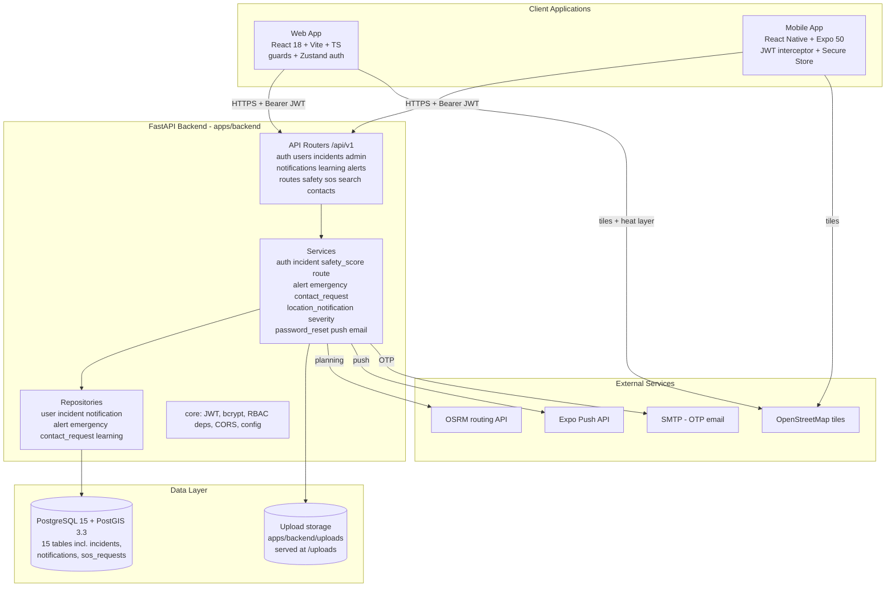

---

## 3.3 Module Architecture

**Figure 2 — Module Architecture**

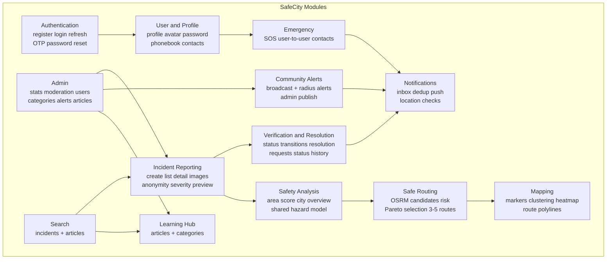

Each backend module maps to concrete files: `auth` → `auth_service.py` + `password_reset_service.py`; `incident` → `incident_service.py` + `severity_engine.py`; `safety` → `safety_score_service.py`; `routing` → `route_service.py`; `alerts` → `alert_service.py`; `notifications` → `notification_repository.py` + `push_service.py` + `location_notification_service.py`; `emergency` → `emergency_service.py` + `contact_request_service.py`; `learning` → `learning_service.py`; `admin` → `admin.py` router; `search` → `search.py` router.

## 3.4 User Module

The user module covers registration, login, token refresh, profile management and self-service account operations.

- **Identity:** `users` stores e-mail (unique), full name, bcrypt hash, role, active/verified flags and a nullable Expo `push_token`. A one-to-one `user_profiles` row stores avatar URL, phone, bio, city, country and legacy profile-level emergency contact fields.
- **Session:** access token (default 30 minutes, claim `type: access`) and refresh token (7 days, `type: refresh`), both HS256 JWTs with `sub = user.id`. Clients attach `Authorization: Bearer` on every request; a 401 triggers one refresh attempt (web interceptor; mobile interceptor with a queue to de-duplicate concurrent refreshes).
- **Profile:** `PUT /users/me` updates the user's `full_name` and/or profile fields; `POST /users/me/avatar` accepts jpg/jpeg/png/webp ≤ 5 MB, stores as `avatar_{user_id}{ext}` under `/uploads`; `POST /users/me/change-password` verifies the current password before hashing the new one; `DELETE /users/me` performs a soft delete (`is_active = false`), which subsequently blocks login (403) and token use (403 in `get_current_user`).
- **Location:** `POST /users/me/location` writes `last_location_lat/lng`, `last_location_geom` (PostGIS point) and `location_updated_at` — consumed by radius alert targeting.
- **Emergency contacts (phonebook):** `GET/POST/PATCH/DELETE /users/me/contacts` with a service-level cap of 5 contacts.

## 3.5 Admin Module

Admin capabilities are gated by `get_current_admin` (HTTP 403 unless `role == admin`) and by the web `AdminRoute` guard. The admin surface comprises:

- **Dashboard (`/admin`):** `GET /admin/stats` aggregates incident counts by status, category and severity, last-30-day count, 7-day daily trend, five most recent incidents, plus `total_users` and `active_users`; the page renders stat cards, a category bar chart, a severity breakdown and a trend chart with Recharts.
- **Incident moderation (`/admin/incidents`):** full list with filters (category, severity, status, search, sort) and per-row actions limited to the server's transition matrix; each action opens a modal that demands a note for `rejected`/`resolved`; soft delete available (`DELETE /admin/incidents/{id}` sets `deleted_at`); status history and resolution requests are inspectable per incident.
- **User management (`/admin/users`):** paginated list with search and role filter; `PATCH /admin/users/{id}/activate`, `/deactivate` and `/role`.
- **Categories (`/admin/categories`):** list, create (name, slug, description, icon, colour), update incl. `is_active` toggle — no delete endpoint (deletion is prevented by the `RESTRICT` FK from incidents).
- **Alerts (`/admin/alerts`):** list, create (two modes with Leaflet radius preview and draggable marker), deactivate (soft: `is_active = false`).
- **Learning (`/admin/learning`):** list, create (auto-slug `title-slug8`), update, delete of articles.

---

## 3.6 Incident Management

The incident aggregate is the heart of the platform. Design decisions:

- **Creation:** `POST /incidents` validates category existence, recomputes severity (client value ignored), writes `location_geom = SRID=4326;POINT(lng lat)`, sets `status = pending`, and — for anonymous reports — stores `reporter_id = NULL` with `anonymous_reporter_id = reporter`.
- **Read models:** list endpoints always exclude soft-deleted rows (`deleted_at IS NULL`), eager-load category/images/reporter/resolution/history relations, and support sorting by severity (default), status, date or category.
- **State machine:** all transitions pass through `IncidentService.update_status`, which rejects no-op changes, validates against `VALID_STATUS_TRANSITIONS`, and demands a non-empty `admin_note` for `rejected` or `resolved` targets.

**Table 8: Incident Status Transition Matrix** (as implemented in `IncidentService.VALID_STATUS_TRANSITIONS`)

| From \ To | pending | approved | under_review | rejected | resolved_unverified | resolved |
|---|---|---|---|---|---|---|
| `pending` | — | ✔ | — | ✔ | — | — |
| `approved` | — | — | ✔ | ✔ | ✔ | ✔ |
| `under_review` | — | ✔ | — | ✔ | ✔ | ✔ |
| `rejected` | ✔ | ✔ | — | — | — | — |
| `resolved_unverified` | — | ✔ | ✔ | ✔ | — | ✔ |
| `resolved` | — | ✔ | ✔ | — | — | — |

- **Audit:** every accepted transition inserts an `incident_status_history` row (`from_status`, `to_status`, `changed_by_id`, `reason`).
- **Resolution requests:** only allowed for `approved` or `under_review` incidents; only one pending request at a time; a creator-submitted request is auto-approved and moves the incident to `resolved_unverified`; a third-party request stays `pending` until the creator approves (→ `resolved_unverified`) or rejects with a reason (incident keeps its previous status).
- **Notifications:** status changes notify `reporter_id or anonymous_reporter_id`; resolution outcomes notify the requester.

## 3.7 Safety Analysis

Two public endpoints expose the shared hazard model:

- `GET /safety/area?lat&lng&radius_km` → `calculate_area_score_detailed`: score, risk level, incident count, density per km², top-5 categories, 7-day/30-day counts, severity counts, confidence, risk index and a composed English explanation.
- `GET /safety/city?city_lat&city_lng&radius_km` → `get_city_overview`: reuses the area score, plus total approved incidents in radius, category breakdown with icons, top category, and the 10 most recent approved incidents from the last 7 days.

Design points: rejected and soft-deleted incidents are excluded; unverified (pending/under_review) incidents contribute at 20 % weight; resolved incidents contribute at 50 % of full weight (verified 1.0 × resolved factor 0.5); scores are computed in Python from a single spatial query so the same code path serves web, mobile and the location-notification service.

## 3.8 Safe Routing

`GET /routes/plan` orchestrates `RouteService.get_safe_route` (detailed in §5.8–§5.12). The response contract contains `routes[]` (geometry, distance, duration, safety score, risk level, incidents, risk factors, detour ratio, composite, labels), four index fields (`recommended_route_idx`, `shortest_route_idx`, `safest_route_idx`, `clean_route_idx`), avoidance statistics (`avoidance_zone_count`, `avoidance_filtered_count`, `avoidance_warning`), `safety_data_available`, `candidates_evaluated` and an optional `note`. Failures surface as HTTP 400 with the service's `error` text.

---

## 3.9 Alerts / Notifications

**Alerts.** `CommunityAlert` rows carry title, message, `alert_type` (one of `nearby_incident`, `high_risk_area`, `emergency_notice`, `system_announcement`), `target_scope` (`all_users` | `location_based`), optional centre coordinates + `radius_km` + geography point, `is_active` and `expires_at` (derived from `expires_in_hours`, default 24). Creation dispatches notifications immediately (see §5.13); citizen listing returns only active, non-expired alerts ordered by recency.

**Notifications.** A single `notifications` table backs the inbox for the typed events below; `dedup_key` (indexed together with `user_id`) prevents repeats within the repository's time window (24 h default in `create`; explicit 6/24/72 h checks via `has_recent_dedup`). Push delivery reuses the same payloads through `push_service.send_push_notification`.

**Table 9: Notification Types** (`models/notification.py`)

| Type | Trigger |
|---|---|
| `incident_update` | Any incident status change or resolution review outcome |
| `system` | Default/system messages |
| `alert` | Alert-class notifications |
| `admin_message` | Admin-originated messages |
| `emergency_contact_request` | Incoming contact request |
| `emergency_contact_accepted` | Recipient accepted a request |
| `emergency_contact_rejected` | Recipient rejected a request |
| `sos_alert` | SOS triggered (sent to accepted contacts with lat/lng metadata) |
| `sos_resolved` | SOS resolution |
| `nearby_incident` | Location check found approved incident ≤ 5 km created within 2 h |
| `unsafe_area` | Location check: area score < 40 |
| `resolution_request` | Resolution request submitted |
| `resolution_approved` / `resolution_rejected` | Enum members for resolution outcomes; current delivery in `incident_service.py` uses `incident_update` messages |
| `community_alert` | Community alert delivery (publish-time or catch-up) |

## 3.10 Emergency Contacts

Two complementary mechanisms are designed:

1. **Phonebook contacts** (`emergency_contacts`): up to 5 name/phone/relation records belonging to the user; surfaced on the web Profile page and in the mobile SOS “legacy” screen for direct dialling of non-app users.
2. **In-app contact network** (`contact_requests`): a directed request between two platform users with statuses `pending → accepted | rejected`, a unique `(requester_id, contact_id)` constraint, optional 500-character message, and lifecycle operations search / send / list incoming / list outgoing / accept / reject / revoke-or-delete / list accepted. Acceptance creates mutual visibility; SOS notifications target accepted contacts in both directions (`get_accepted_contacts_for_sos`).

## 3.11 GIS / Mapping

- **Storage:** four `Geography(POINT, 4326)` columns — incidents, community alerts, SOS requests, user last location — queried with `ST_DWithin(…::geography, ST_SetSRID(ST_MakePoint(lng, lat), 4326)::geography, metres)`.
- **Query patterns:** point-with-radius (`/incidents/nearby`, area score), polyline-with-corridor (`fetch_records_near_path` builds a `LINESTRING` WKT), circle-with-circle (radius alert targeting of users).
- **Web rendering:** `IncidentMap` (Leaflet + OpenStreetMap tiles) supports clustered markers (markerClusterGroup with CDN/fallback loading), severity-coloured pins, unverified overlays, `leaflet.heat` layers fed by `/incidents/heatmap`, click-to-select coordinates, start/destination markers and multi-route polylines with a shared palette (`#6366F1, #10B981, #F59E0B, #EF4444, #8B5CF6`).
- **Mobile rendering:** `MapScreen` builds an HTML/JavaScript Leaflet instance with a user pulse marker, incident pins with callouts and a city safety score card; the admin alert editor uses plain Leaflet with an `L.circle` radius preview.
- **Projection:** analytics convert to local metres around a reference point (`Projection`, equirectangular; <0.5 % scale error at city scale) — used only in memory, never for storage.

---

## 3.12 UML Design

Three UML views are used: use case/activity relationships, the static class model, and ten interaction/BPMN-style sequential views. All diagrams use the real actors (Citizen, Administrator, Mobile user), the real entities and the real endpoints.

### 3.12.1 Use Case Diagram

**Figure 3 — Use Case Diagram**

```mermaid
flowchart TB
    subgraph SYS["SafeCity System"]
        UC1["Register account"]
        UC2["Login"]
        UC3["Reset password via OTP"]
        UC4["View dashboard"]
        UC5["Report incident<br/>with map location + images"]
        UC6["Report anonymously"]
        UC7["View my incidents"]
        UC8["View live safety map<br/>markers + heatmap + area score"]
        UC9["Plan safe route<br/>compare 3-5 routes"]
        UC10["Receive notifications<br/>nearby incident / unsafe area / alert"]
        UC11["Trigger SOS<br/>notify accepted contacts"]
        UC12["Manage emergency contacts<br/>phonebook + in-app requests"]
        UC13["View community alerts"]
        UC14["Request incident resolution"]
        UC15["Read learning articles"]
        UC16["Approve / reject / resolve incidents"]
        UC17["Publish broadcast or radius alert"]
        UC18["Manage users roles status"]
        UC19["Manage categories and articles"]
        UC20["View platform statistics"]
    end

    CITIZEN(["Citizen - role citizen"]) --> UC1
    CITIZEN --> UC2
    CITIZEN --> UC3
    CITIZEN --> UC4
    CITIZEN --> UC5
    CITIZEN --> UC6
    CITIZEN --> UC7
    CITIZEN --> UC8
    CITIZEN --> UC9
    CITIZEN --> UC10
    CITIZEN --> UC11
    CITIZEN --> UC12
    CITIZEN --> UC13
    CITIZEN --> UC14
    CITIZEN --> UC15

    ADMIN(["Administrator - role admin"]) --> UC2
    ADMIN --> UC16
    ADMIN --> UC17
    ADMIN --> UC18
    ADMIN --> UC19
    ADMIN --> UC20
    ADMIN --> UC8

    MOBILE(["Mobile app user"]) --> UC9
    MOBILE --> UC11
    MOBILE --> UC10
```

### 3.12.2 User Activity Diagram

**Figure 4 — User Activity Diagram**

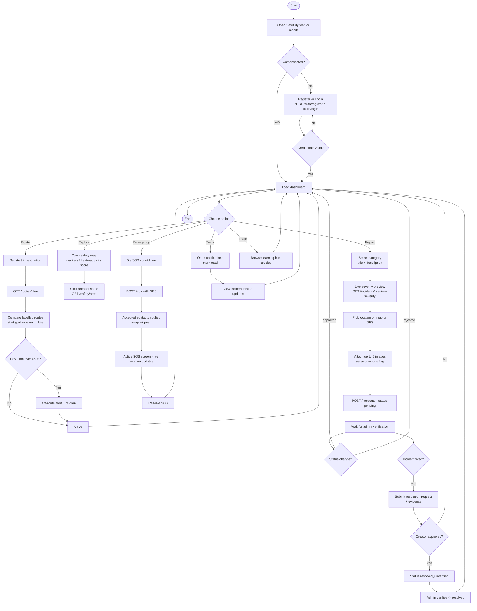

### 3.12.3 Admin Activity Diagram

**Figure 5 — Admin Activity Diagram**

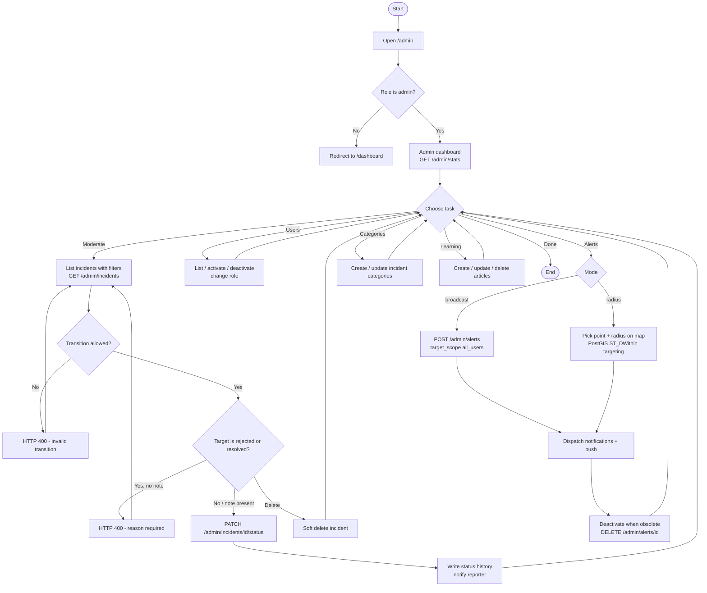

### 3.12.4 Class Diagram

The class diagram maps directly to the SQLAlchemy models in `apps/backend/app/models/`.

**Figure 6 — Class Diagram**

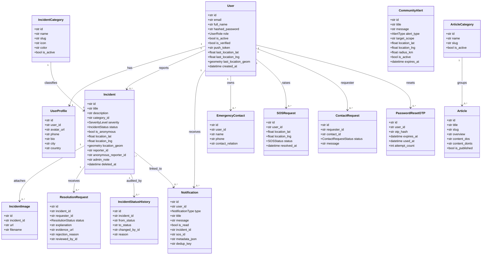

### 3.12.5 Login Sequence

**Figure 7 — Login Sequence**

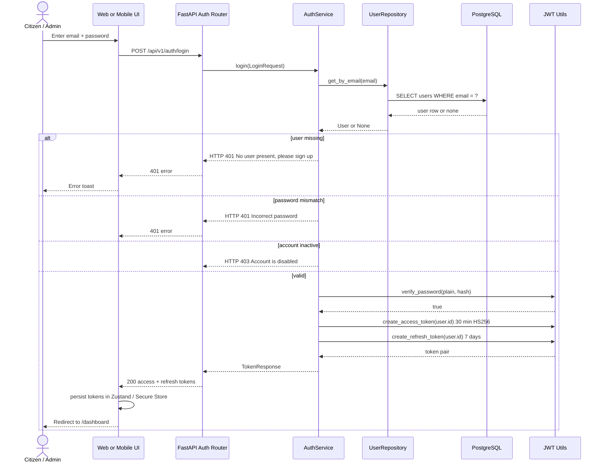

### 3.12.6 Incident Reporting Sequence

**Figure 8 — Incident Reporting Sequence**

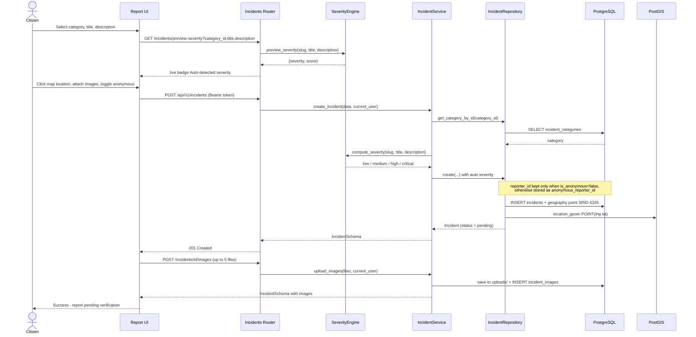

### 3.12.7 Incident Verification Sequence

**Figure 9 — Incident Verification Sequence**

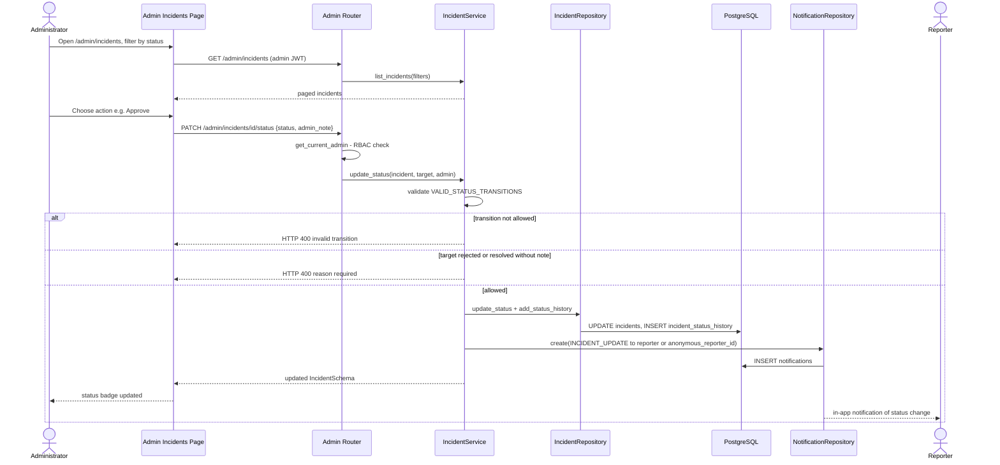

### 3.12.8 Safe Routing Sequence

**Figure 10 — Safe Routing Sequence**

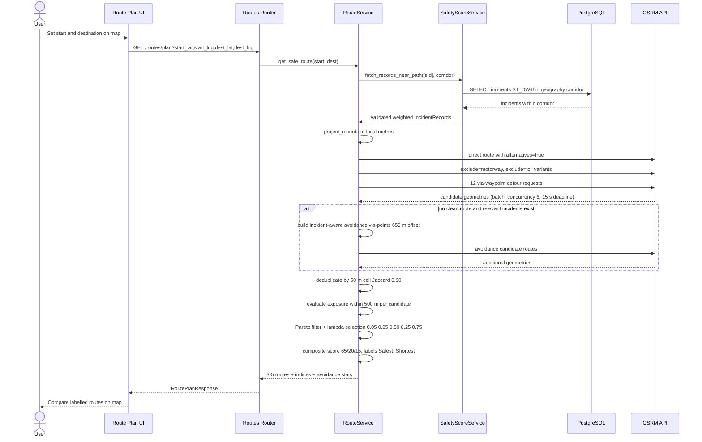

### 3.12.9 Community Alert Sequence

**Figure 11 — Community Alert Sequence**

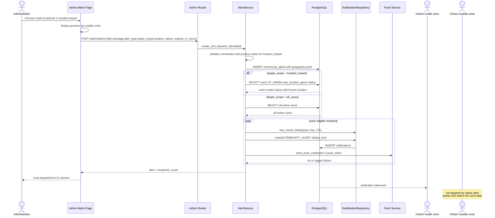

### 3.12.10 Emergency Contact Sequence

**Figure 12 — Emergency Contact Sequence**

```mermaid
sequenceDiagram
    actor A as Requester
    participant UI as Contacts UI
    participant C as Routers contacts and sos
    participant CS as ContactRequestService
    participant NR as NotificationRepository
    participant P as Push Service
    actor B as Recipient
    actor SOS as SOS Caller

    A->>UI: Search users by name or email
    UI->>C: GET /contacts/search?q (min 2 chars)
    C->>CS: search_users
    CS-->>UI: matching citizens
    A->>UI: Send request with optional message
    UI->>C: POST /contacts/requests {contact_id, message}
    C->>CS: send_request(requester, data)
    CS->>CS: block self-request, duplicates; reopen rejected to pending
    CS->>NR: create(EMERGENCY_CONTACT_REQUEST)
    CS->>P: push to recipient
    B->>UI: View incoming request
    B->>C: PATCH /contacts/requests/id/accept
    C->>CS: respond_to_request(accept=true)
    CS->>NR: create(EMERGENCY_CONTACT_ACCEPTED) + push to requester
    Note over A,B: both users now appear in accepted contact lists
    SOS->>C: POST /sos {location_lat, location_lng}
    C->>CS: notify_contacts_of_sos(user, sos_id, lat, lng)
    loop each accepted contact
        CS->>NR: create(SOS_ALERT with metadata lat lng, dedup sos_alert:id:contact)
        CS->>P: push SOS Alert
    end
    CS-->>SOS: contacts notified count
```

## 3.13 BPMN Workflows

The six BPMN diagrams below use explicit start/end events and decision gateways to describe the same workflows that the sequence diagrams present as message exchanges.

### 3.13.1 Registration / Login BPMN

**Figure 13 — Registration / Login BPMN**

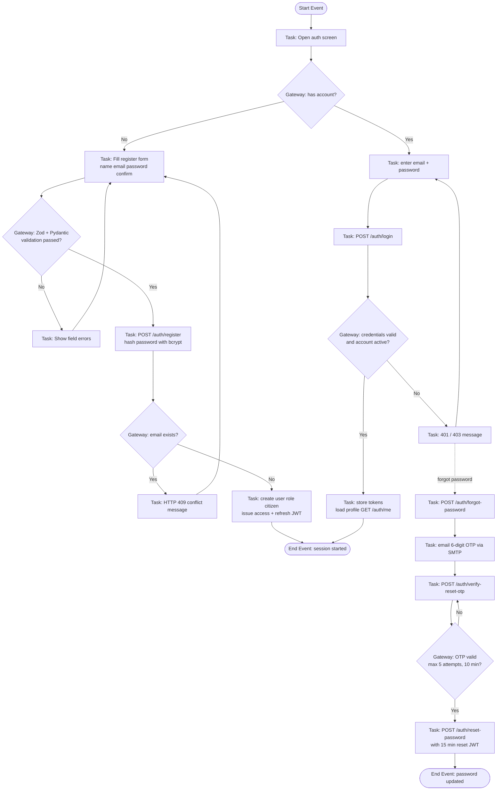

### 3.13.2 Incident Reporting BPMN

**Figure 14 — Incident Reporting BPMN**

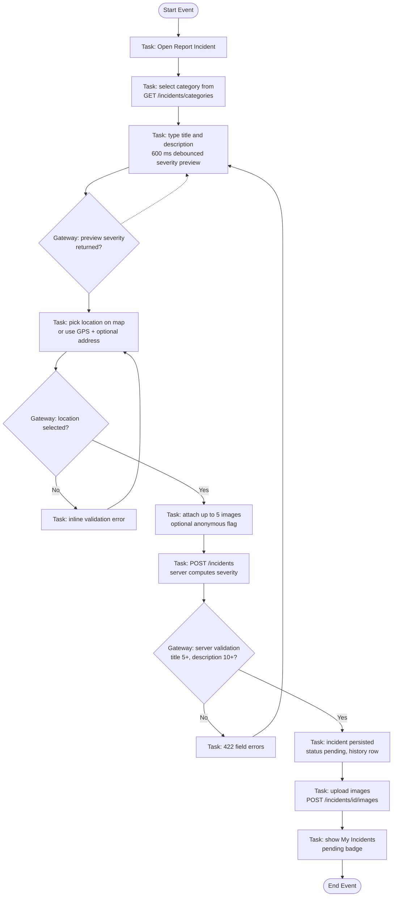

### 3.13.3 Incident Verification BPMN

**Figure 15 — Incident Verification BPMN**

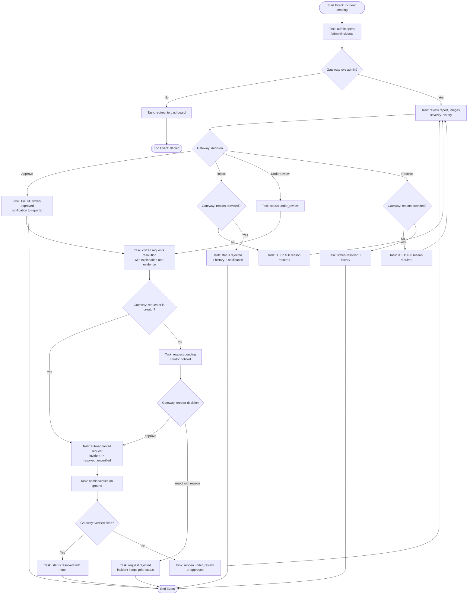

### 3.13.4 Safe Routing BPMN

**Figure 16 — Safe Routing BPMN**

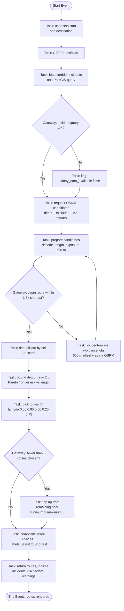

### 3.13.5 Community Alert BPMN

**Figure 17 — Community Alert BPMN**

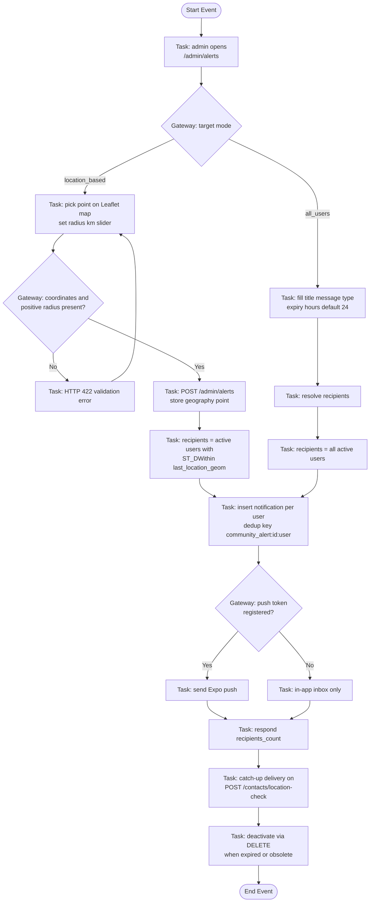

### 3.13.6 Emergency Contact BPMN

**Figure 18 — Emergency Contact BPMN**

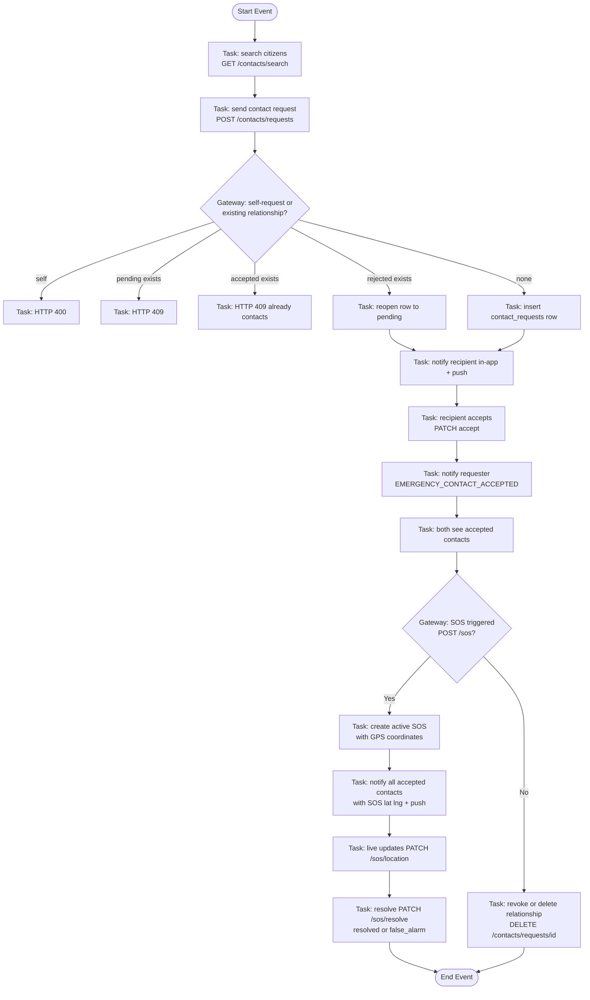

## 3.14 Data Flow Diagrams

The context diagram places SafeCity as a single process surrounded by real external entities (citizen, administrator, PostGIS store, OSRM, Expo Push, SMTP mail, OSM tiles). The Level-1 diagram decomposes the system into eight processes that map one-to-one to the backend routers and services.

### 3.14.1 Context DFD

**Figure 19 — Context Data Flow Diagram**

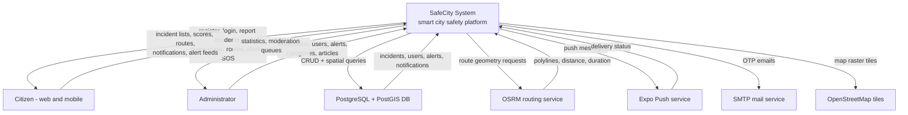

### 3.14.2 Level-1 DFD

**Figure 20 — Level-1 Data Flow Diagram**

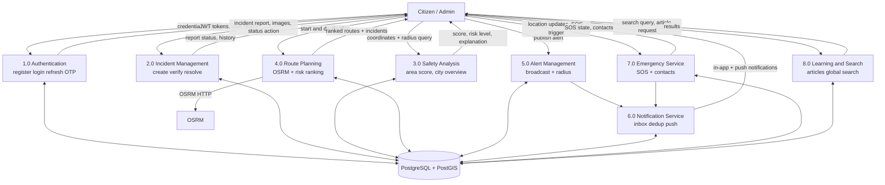

### 3.14.3 Incident Management DFD

**Figure 21 — Incident Management DFD**

```mermaid
flowchart TB
    U["Citizen"]
    AD["Admin"]
    S1["Validate + auto severity<br/>severity_engine"]
    S2["IncidentService"]
    S3["IncidentRepository"]
    DB[("incidents, incident_images,<br/>resolution_requests,<br/>incident_status_history")]
    N["NotificationService"]

    U -- "title, description, category,<br/>location, images, anonymous flag" --> S2
    S2 --> S1 -- "low/medium/high/critical" --> S2
    S2 -- "create with status pending" --> S3
    S3 -- "INSERT + status history" --> DB
    AD -- "PATCH status + admin_note" --> S2
    S2 -- "transition table check" --> S2
    S2 -- "update + history row" --> S3
    U -- "resolution request + evidence" --> S2
    S2 -- "creator auto-approve else pending" --> S3
    AD -- "list with filters, soft delete" --> S2
    S2 -- "status change" --> N -- "incident_update notification" --> U
    DB -- "approved incidents, heatmap points" --> S2 -- "list, detail, nearby, heatmap" --> U
```

### 3.14.4 Safe Routing DFD

**Figure 22 — Safe Routing DFD**

```mermaid
flowchart TB
    U["User - web or mobile"]
    R["GET /routes/plan"]
    RS["RouteService"]
    SS["SafetyScoreService"]
    DB[("incidents within corridor<br/>PostGIS ST_DWithin")]
    OSRM["OSRM route API"]
    G["Geometry pipeline<br/>Projection, SegmentIndex,<br/>densify, cells"]

    U -- "start_lat, start_lng,<br/>dest_lat, dest_lng" --> R
    R --> RS
    RS -- "corridor point list" --> SS
    SS -- "weighted IncidentRecords" --> DB
    SS -- "validated records" --> RS
    RS -- "direct, exclude, via, avoidance jobs" --> OSRM
    OSRM -- "candidate polylines" --> RS
    RS -- "decode, length, cells, exposure" --> G
    G -- "risk_index, score per candidate" --> RS
    RS -- "dedup, Pareto, lambda selection" --> RS
    RS -- "3-5 routes + labels + indices" --> R
    R -- "RoutePlanResponse" --> U
```

### 3.14.5 Safety Analysis DFD

**Figure 23 — Safety Analysis DFD**

```mermaid
flowchart TB
    U["Citizen - map click or dashboard"]
    M["GET /safety/area, /safety/city"]
    SS["SafetyScoreService"]
    DB[("incidents approved + unverified<br/>within radius")]
    W["Weight model<br/>base x recency x verification x resolved"]
    AGG["aggregate_risk<br/>cluster decay + category soft cap"]
    OUT["score = 100 x exp(-risk)"]
    LNS["LocationNotificationService"]

    U -- "lat, lng, radius_km" --> M
    M --> SS
    SS -- "fetch records in radius" --> DB
    DB -- "rows" --> SS
    SS -- "IncidentRecord.hazard_w" --> W
    W -- "w" --> AGG
    SS -- "kernel + area normalisation" --> AGG
    AGG -- "risk" --> OUT
    OUT -- "score, risk_level, confidence,<br/>explanation" --> M
    M -- "score panel" --> U
    LNS -- "user position, radius 1 km" --> SS
    OUT -- "score below 40" --> LNS -- "unsafe_area notification" --> U
```

## 3.15 Database Design

The database contains 15 tables. Primary keys are UUID strings (`String(36)` with `uuid4` default). Foreign keys use `ondelete="CASCADE"` for owned children (profiles, contacts, SOS, notifications, images, status history, resolution requests) and `ondelete="RESTRICT"` / `SET NULL` for classification and reporter links. Soft deletion (`incidents.deleted_at`) preserves scoring history. Enumerated columns are stored via SQLAlchemy `Enum` mappings for roles, severities, incident statuses, SOS statuses, contact statuses, alert types and notification types; the citizen-facing listing sorts by severity using the custom order in the repository `CASE` expression.

**Table 10: Database Tables**

| # | Table | Purpose | Spatial column |
|---|---|---|---|
| 1 | `users` | Identity, role, push token, last known location | `last_location_geom` (Geography POINT 4326) |
| 2 | `user_profiles` | Avatar, phone, bio, city, country (one-to-one) | — |
| 3 | `incident_categories` | 50+ named categories with icon and colour | — |
| 4 | `incidents` | Reports with severity, status, location, anonymity fields | `location_geom` (Geography POINT 4326) |
| 5 | `incident_images` | Photographic evidence rows (URL + filename) | — |
| 6 | `resolution_requests` | Fix claims with explanation, evidence, review state | — |
| 7 | `incident_status_history` | Immutable audit rows for every transition | — |
| 8 | `notifications` | Inbox rows with dedup keys and deep-link metadata | — |
| 9 | `community_alerts` | Published alerts with scope and optional zone | `location_geom` (Geography POINT 4326) |
| 10 | `emergency_contacts` | Phonebook entries (max. 5 per user) | — |
| 11 | `contact_requests` | In-app contact workflow with unique pair guard | — |
| 12 | `sos_requests` | Active/historical SOS events with coordinates | `location_geom` (Geography POINT 4326) |
| 13 | `password_reset_otps` | OTP hashes with expiry, usage and attempt counters | — |
| 14 | `article_categories` | Learning Hub groupings | — |
| 15 | `articles` | Safety guides with structured content sections | — |

### 3.15.1 ER Diagram

**Figure 24 — Entity Relationship Diagram**

```mermaid
erDiagram
    USERS ||--o| USER_PROFILES : owns
    USERS ||--o{ INCIDENTS : reports
    USERS ||--o{ NOTIFICATIONS : receives
    USERS ||--o{ EMERGENCY_CONTACTS : saves
    USERS ||--o{ SOS_REQUESTS : raises
    USERS ||--o{ CONTACT_REQUESTS : requester
    USERS ||--o{ CONTACT_REQUESTS : recipient
    USERS ||--o{ PASSWORD_RESET_OTPS : resets
    INCIDENT_CATEGORIES ||--o{ INCIDENTS : classifies
    INCIDENTS ||--o{ INCIDENT_IMAGES : has
    INCIDENTS ||--o{ RESOLUTION_REQUESTS : receives
    INCIDENTS ||--o{ INCIDENT_STATUS_HISTORY : audited_by
    INCIDENTS ||--o{ NOTIFICATIONS : references
    SOS_REQUESTS ||--o{ NOTIFICATIONS : references
    ARTICLE_CATEGORIES ||--o{ ARTICLES : groups

    USERS {
        uuid id PK
        varchar email UK
        varchar full_name
        varchar hashed_password
        enum role
        bool is_active
        bool is_verified
        varchar push_token
        float last_location_lat
        float last_location_lng
        geography last_location_geom
        datetime location_updated_at
        datetime created_at
    }
    USER_PROFILES {
        uuid id PK
        varchar user_id FK
        varchar avatar_url
        varchar phone
        varchar bio
        varchar city
        varchar country
    }
    INCIDENT_CATEGORIES {
        uuid id PK
        varchar name UK
        varchar slug UK
        varchar icon
        varchar color
        bool is_active
    }
    INCIDENTS {
        uuid id PK
        varchar title
        text description
        uuid category_id FK
        enum severity
        enum status
        bool is_anonymous
        float location_lat
        float location_lng
        geography location_geom
        uuid reporter_id FK
        uuid anonymous_reporter_id FK
        text admin_note
        datetime deleted_at
    }
    INCIDENT_IMAGES {
        uuid id PK
        uuid incident_id FK
        varchar url
        varchar filename
    }
    RESOLUTION_REQUESTS {
        uuid id PK
        uuid incident_id FK
        uuid requester_id FK
        enum status
        text explanation
        varchar evidence_url
        text rejection_reason
        uuid reviewed_by_id FK
    }
    INCIDENT_STATUS_HISTORY {
        uuid id PK
        uuid incident_id FK
        varchar from_status
        varchar to_status
        uuid changed_by_id FK
        text reason
    }
    NOTIFICATIONS {
        uuid id PK
        varchar user_id FK
        enum type
        varchar title
        text message
        bool is_read
        uuid incident_id FK
        uuid sos_id FK
        text metadata_json
        varchar dedup_key
    }
    COMMUNITY_ALERTS {
        uuid id PK
        varchar title
        text message
        enum alert_type
        varchar target_scope
        float location_lat
        float location_lng
        float radius_km
        geography location_geom
        bool is_active
        datetime expires_at
    }
    EMERGENCY_CONTACTS {
        uuid id PK
        varchar user_id FK
        varchar name
        varchar phone
        varchar contact_relation
    }
    CONTACT_REQUESTS {
        uuid id PK
        varchar requester_id FK
        varchar contact_id FK
        enum status
        text message
    }
    SOS_REQUESTS {
        uuid id PK
        varchar user_id FK
        float location_lat
        float location_lng
        geography location_geom
        enum status
        datetime resolved_at
    }
    PASSWORD_RESET_OTPS {
        uuid id PK
        varchar user_id FK
        varchar otp_hash
        datetime expires_at
        datetime used_at
        int attempt_count
    }
    ARTICLE_CATEGORIES {
        uuid id PK
        varchar name UK
        varchar slug UK
        bool is_active
    }
    ARTICLES {
        uuid id PK
        varchar title
        varchar slug UK
        text overview
        text content_dos
        text content_donts
        text emergency_steps
        text helpline_numbers
        text legal_info
        uuid category_id FK
        bool is_published
    }
```

### 3.15.2 Database Schema Layout

**Figure 25 — Database Schema Layout**

```mermaid
flowchart TB
    subgraph AUTH["Identity"]
        T1["users<br/>PK id, UK email, role enum<br/>push_token, last_location_geom GiST"]
        T2["user_profiles<br/>PK id, FK user_id unique"]
        T3["password_reset_otps<br/>PK id, FK user_id<br/>otp_hash, attempt_count"]
    end

    subgraph INC["Incidents"]
        T4["incident_categories<br/>PK id, UK name, UK slug"]
        T5["incidents<br/>PK id, FK category_id<br/>severity, status, location_geom GiST<br/>reporter_id, anonymous_reporter_id<br/>deleted_at soft delete"]
        T6["incident_images<br/>PK id, FK incident_id"]
        T7["resolution_requests<br/>PK id, FK incident_id, requester_id<br/>status, explanation, evidence_url"]
        T8["incident_status_history<br/>PK id, FK incident_id<br/>from_status, to_status, changed_by_id"]
    end

    subgraph CM["Communication"]
        T9["notifications<br/>PK id, FK user_id, incident_id, sos_id<br/>type, dedup_key index user_id+dedup_key"]
        T10["community_alerts<br/>PK id, target_scope<br/>location_geom GiST, expires_at"]
    end

    subgraph EM["Emergency"]
        T11["emergency_contacts<br/>PK id, FK user_id"]
        T12["contact_requests<br/>PK id, FK requester_id, contact_id<br/>UK requester_id+contact_id"]
        T13["sos_requests<br/>PK id, FK user_id, location_geom GiST"]
    end

    subgraph LR["Learning"]
        T14["article_categories<br/>PK id, UK name, UK slug"]
        T15["articles<br/>PK id, FK category_id, UK slug"]
    end

    T1 --> T2
    T1 --> T3
    T1 --> T9
    T4 --> T5
    T5 --> T6
    T5 --> T7
    T5 --> T8
    T5 --> T9
    T13 --> T9
    T1 --> T11
    T1 --> T12
    T1 --> T13
    T14 --> T15
```

## 3.16 Data Dictionary

**Table 11: Data Dictionary — Identity and Incident Tables**

| Table.Column | Type / Length | Null | Key / Default | Notes |
|---|---|---|---|---|
| `users.id` | String(36) | No | PK, uuid4 | — |
| `users.email` | String(255) | No | UK, indexed | Exact login match |
| `users.full_name` | String(255) | No | — | >= 2 chars at registration |
| `users.hashed_password` | String(255) | No | — | bcrypt hash |
| `users.role` | Enum(UserRole) | No | default CITIZEN | citizen / admin |
| `users.is_active` | Boolean | No | default true | Soft-delete flag |
| `users.is_verified` | Boolean | No | default false | Reserved |
| `users.push_token` | String(512) | Yes | — | Expo token |
| `users.last_location_lat/lng` | Float | Yes | — | Targeting cache |
| `users.last_location_geom` | Geography(POINT,4326) | Yes | GiST | Targeting |
| `users.location_updated_at` | DateTime(tz) | Yes | — | — |
| `users.created_at/updated_at` | DateTime(tz) | No | utcnow | — |
| `user_profiles.id` | String(36) | No | PK | — |
| `user_profiles.user_id` | String(36) | No | UK FK CASCADE | One-to-one |
| `user_profiles.avatar_url` | String(512) | Yes | — | `/uploads/...` |
| `user_profiles.phone` | String(50) | Yes | — | — |
| `user_profiles.bio` | Text | Yes | — | — |
| `user_profiles.emergency_contact_name/phone` | String | Yes | — | legacy profile fields |
| `user_profiles.city/country` | String(100) | Yes | — | — |
| `incident_categories.*` | — | — | — | id PK; name UK; slug UK indexed; icon default; color default #6B7280; is_active; created_at |
| `incidents.id` | String(36) | No | PK uuid4 | — |
| `incidents.title` | String(255) | No | — | >= 5 chars |
| `incidents.description` | Text | No | — | >= 10 chars |
| `incidents.category_id` | String(36) | No | FK RESTRICT | — |
| `incidents.severity` | Enum(SeverityLevel) | No | default MEDIUM | computed server-side |
| `incidents.status` | Enum(IncidentStatus) | No | default PENDING | six states |
| `incidents.is_anonymous` | Boolean | No | default false | — |
| `incidents.location_address` | String(512) | Yes | — | free text |
| `incidents.location_lat/lng` | Float | No | — | WGS-84 |
| `incidents.location_geom` | Geography | Yes | GiST | POINT(lng lat) |
| `incidents.reporter_id` | String(36) | Yes | FK SET NULL | NULL when anonymous |
| `incidents.anonymous_reporter_id` | String(36) | Yes | — | owner for anonymous |
| `incidents.admin_note` | Text | Yes | — | required for reject/resolve |
| `incidents.deleted_at` | DateTime(tz) | Yes | — | soft delete |

**Table 12: Data Dictionary — Communication, Emergency, Learning Tables**

| Table.Column | Type / Length | Null | Key / Default | Notes |
|---|---|---|---|---|
| `notifications.id` | String(36) | No | PK uuid4 | — |
| `notifications.user_id` | String(36) | No | FK CASCADE, indexed | — |
| `notifications.type` | Enum(NotificationType) | No | default SYSTEM | 15 typed values |
| `notifications.title/message` | String(255)/Text | No | — | inbox copy |
| `notifications.is_read` | Boolean | No | default false | — |
| `notifications.incident_id/sos_id` | String(36) | Yes | FK SET NULL | deep links |
| `notifications.metadata_json` | Text | Yes | — | JSON context incl. lat/lng |
| `notifications.dedup_key` | String(255) | Yes | idx(user_id, dedup_key) | anti-spam |
| `community_alerts` | — | — | — | title; message; alert_type default SYSTEM_ANNOUNCEMENT; target_scope default all_users; optional lat/lng + radius_km + geom; is_active; expires_at |
| `emergency_contacts` | — | — | — | id PK; user_id FK CASCADE; name(255); phone(50); contact_relation(100) |
| `contact_requests` | — | — | — | id PK; requester_id/contact_id FK CASCADE; status default PENDING; message; UK(requester_id, contact_id) |
| `sos_requests` | — | — | — | id PK; user_id FK CASCADE; lat/lng Float; location_geom Geography; status default ACTIVE; audio/video_recording_url nullable; resolved_at |
| `password_reset_otps` | — | — | — | id PK; user_id FK CASCADE; otp_hash(255); expires_at; used_at; attempt_count default 0 |
| `article_categories` | — | — | — | id PK; name UK; slug UK indexed; icon; is_active |
| `articles` | — | — | — | id PK; title; slug UK indexed; overview; content_dos/donts; emergency_steps; helpline_numbers; legal_info; category_id FK RESTRICT; is_published |

## 3.17 API Architecture

The API is a versioned FastAPI application (`/api/v1`) composed of 12 routers plus a health endpoint. Routers validate inputs with Pydantic schemas, resolve authentication/authorization via shared dependencies, delegate to services, and serialize responses with `response_model`.

**Figure 26 — API Architecture**

```mermaid
flowchart TB
    subgraph C["Clients"]
        W["Web - axios instance<br/>baseURL /api/v1, Bearer + 401 refresh"]
        M["Mobile - axios instance<br/>Secure Store token, queued refresh"]
    end

    subgraph R["Routers - FastAPI prefix /api/v1"]
        RA["/auth<br/>register login refresh<br/>forgot-password verify-reset-otp<br/>reset-password me"]
        RU["/users<br/>me profile avatar change-password<br/>contacts location"]
        RI["/incidents<br/>categories nearby list heatmap<br/>preview-severity create my detail<br/>images evidence resolution-requests<br/>status-history"]
        RADM["/admin<br/>stats incidents status users<br/>categories alerts articles"]
        RN["/notifications<br/>list read read-all"]
        RL["/learning<br/>categories articles"]
        RAL["/alerts<br/>list active"]
        RR["/routes/plan"]
        RSF["/safety/area /safety/city"]
        RSOS["/sos<br/>active create location resolve"]
        RSE["/search"]
        RC["/contacts<br/>search requests push-token location-check"]
    end

    subgraph MW["Cross-cutting"]
        AUTHMW["HTTPBearer + get_current_user<br/>get_current_admin"]
        VALMW["Pydantic request/response schemas<br/>422 validation errors"]
        CORS["CORSMiddleware allowlist"]
    end

    W --> CORS --> RA
    M --> CORS --> RA
    W --> AUTHMW
    M --> AUTHMW
    AUTHMW --> RU
    AUTHMW --> RI
    AUTHMW --> RN
    AUTHMW --> RR
    AUTHMW --> RSOS
    AUTHMW --> RC
    AUTHMW --> RADM
    RA --> VALMW
    RI --> VALMW
    RADM --> VALMW
    RAL --> RSF
    RL --> RSE
```

## 3.18 Security Architecture

Security is defence-in-depth across transport, identity, authorization, input handling, business rules and storage. Key mechanisms found in `core/security.py`, `core/deps.py`, the services and the client interceptors:

**Figure 27 — Security Architecture**

```mermaid
flowchart TB
    REQ["Incoming HTTPS request"] --> CORS["CORS origin allowlist"]
    CORS --> ROUTE["Route resolution"]
    ROUTE --> GUARD{"Protected route?"}
    GUARD -- "public" --> PUB["Endpoints<br/>register, login, categories,<br/>incident list/detail, heatmap,<br/>safety scores, routes, search, articles"]
    GUARD -- "authenticated" --> JWT["HTTPBearer: decode JWT<br/>HS256, type=access, exp check"]
    JWT --> ACT{"user.is_active?"}
    ACT -- "no" --> F403["403 Inactive user"]
    ACT -- "yes" --> ROLE{"admin route?"}
    ROLE -- "no" --> HANDLER["Endpoint handler"]
    ROLE -- "yes" --> ADM{"role == admin?"}
    ADM -- "no" --> F403B["403 Admin access required"]
    ADM -- "yes" --> HANDLER
    HANDLER --> SCHEMA["Pydantic validation<br/>length, range, email, OTP format"]
    SCHEMA --> BIZ["Service rules<br/>status transitions, max 5 contacts,<br/>one active SOS, dedup keys"]
    BIZ --> DBW["Repository write<br/>bcrypt hash, soft delete, history rows"]
    DBW --> RESP["JSON response<br/>anonymous reporter fields stripped"]

    subgraph PROTECT["Credential and data protection"]
        P1["bcrypt password hashing<br/>72-byte truncation"]
        P2["JWT access 30 min / refresh 7 d<br/>separate type claims"]
        P3["OTP stored as bcrypt hash<br/>5 attempts, 60 s cooldown, 10 min TTL"]
        P4["Reset token JWT 15 min type password_reset"]
        P5["Generic messages prevent<br/>user enumeration"]
        P6["Expo push tokens validated<br/>prefix ExponentPushToken"]
    end
```

Security notes verifiable from code:

- Passwords are hashed with passlib `CryptContext(schemes=["bcrypt"], deprecated="auto")`; a compatibility shim in `security.py` truncates inputs beyond 72 bytes. No plaintext password is persisted or logged.
- JWTs carry `sub`, `exp` and `type`. `get_current_user` accepts only `type == access`; `refresh()` accepts only `type == refresh`.
- Forgot-password messages are deliberately generic (“If your email is registered…”) to prevent user enumeration, even when the e-mail does not exist.
- Server-side rule checks that cannot be bypassed by clients: the transition matrix, the 5-contact cap, the single-active-SOS rule, the single-pending-resolution rule, coordinate/radius validation on alerts, and notification dedup windows.
- The contact search intentionally exposes only `id`, `full_name`, `email` (no hashes, no tokens), and requires at least 2 query characters.

## 3.19 Deployment Architecture

**Figure 28 — Deployment Architecture**

```mermaid
flowchart TB
    subgraph DOCKER["Docker Compose - docker-compose.yml"]
        DBX[("db container<br/>postgis/postgis:15-3.3<br/>port 5433 to host, volume postgres_data")]
        BK["backend container<br/>python 3.11-slim, uvicorn :8000<br/>runs python -m app.db.init_db on start<br/>volume uploads_data"]
        WB["web container<br/>node:20-alpine build -> nginx:alpine :80->80<br/>serves dist + SPA fallback"]
    end

    subgraph HOSTED["Hosted targets - DEPLOYMENT_GUIDE.md"]
        VERCEL["Vercel - web SPA<br/>vercel.json rewrites to index.html"]
        RENDER["Render - FastAPI service<br/>EXPO_PUBLIC_API_BASE_URL in eas.json"]
        SUPA["Supabase - PostgreSQL + PostGIS"]
        EC2["AWS EC2 - self-hosted OSRM<br/>Tamil Nadu extract (guide)"]
        GHREL["GitHub Releases - Android APK"]
    end

    subgraph MOB["Mobile delivery"]
        EAS["EAS build profile preview<br/>buildType apk<br/>API https://safecity-k280.onrender.com"]
    end

    DBX --> BK
    BK --> WB
    WB --> USERS["Browser clients"]
    VERCEL --> USERS
    RENDER --> SUPA
    RENDER --> EC2
    EAS --> PHONES["Android devices"]
    PHONES --> RENDER
    GHREL --> PHONES
    USERS --> VERCEL
    USERS --> RENDER
```

Local deployment (`docker-compose up --build -d`): the `db` service starts with a healthcheck; `backend` mounts `./apps/backend` for live reload, runs `python -m app.db.init_db` (PostGIS enable → Alembic `upgrade head` → seed), then serves Uvicorn with `--reload`; `web` builds the Vite SPA inside a multi-stage Dockerfile and serves it from nginx with an SPA fallback (`try_files … /index.html`). Hosted deployment follows the documented free-tier topology above; the mobile APK compiled by EAS is pinned at build time to the Render API URL.

---

# CHAPTER 4 — SYSTEM IMPLEMENTATION

Only modules and screens present in the repository are documented here. Each item names the real files, routes and API calls behind it.

## 4.1 Home / Dashboard

- **Web `/dashboard` (`DashboardPage.tsx`).** Personalised greeting (`Good day, {first name}`), four stat cards (Total Reports, Pending, Approved — computed from `useMyIncidents`; “This Month” reuses the total), a *My Recent Reports* column (`IncidentCard compact`, limit 5) with *View all* linking to `/incidents/my`, a *Notifications* column (top 3 after client-side id-dedup, unread badge, *Mark all read*), and four quick-action cards linking to `/map`, `/incidents/new`, `/alerts`, `/learning`. Notifications refetch every 30 s.
- **Mobile Home (`HomeScreen.tsx`).** Safety score card fed by `SafetyApi.getCityOverview(user.lat, user.lng, 20.0)`, recent alerts card, quick actions grid, SOS button opening `SOSCountdownModal`, an active-SOS floating banner navigating to `ActiveSOS`, GPS acquisition on mount plus periodic location reporting, and an unread badge.

## 4.2 Registration / Login

- **Web** `/login` (`LoginPage.tsx`), `/register` (`RegisterPage.tsx`) and `/forgot-password` (`ForgotPasswordPage.tsx`) inside `AuthLayout`; Zod schemas `loginSchema`, `registerSchema` (confirm-password refinement), `forgotPasswordSchema`, `otpSchema`, `resetPasswordSchema` enforced via `zodResolver`.

- **Mobile** `LoginScreen.tsx` / `RegisterScreen.tsx` in `AuthNavigator`; tokens persisted in `expo-secure-store` through `utils/storage.ts`; the axios request interceptor attaches `Authorization: Bearer`; 401 triggers the queued token refresh in `api/client.ts`.
- Backend endpoints are `POST /auth/register` (409 on duplicate e-mail), `POST /auth/login` (401 unknown e-mail / bad password; 403 inactive account), `POST /auth/refresh` (rotates both tokens), and the three OTP steps covered in §3.12.1.

## 4.3 Profile

- **Web `/profile` (`ProfilePage.tsx`).** Header with `Avatar`/`AvatarFallback`, avatar upload (`accept="image/*"`), personal information form (full name, phone, bio, city, country), change-password form (`current_password`, `new_password` ≥ 8), soft account deletion, an offline phone-contacts manager (add form with name/phone/relation, delete button; add form hidden when 5 contacts exist), and the in-app contacts section handled by `EmergencyContactsManager`.
- **Mobile Profile (`ProfileScreen.tsx`, 678 lines).** View/edit profile, avatar, theme switch (Light/Dark/System via `themeStore`), push-token status, emergency-contacts navigation (`SafeCityContacts`), My Incidents, logout and account deletion flows.

## 4.4 Emergency Contacts

- **Web (`EmergencyContactsManager.tsx`, 435 lines).** Debounced citizen search (`useDebounce`), send-request with message, incoming/outgoing lists with accept/reject/cancel actions, and the accepted-contacts hub. Served on the Profile page. API: `src/api/contacts.ts`.
- **Mobile.** Two screens: `profile/EmergencyContactsScreen.tsx` (in-app network mirroring the web manager) and `sos/EmergencyContactsScreen.tsx` (legacy phonebook list calling `GET /users/me/contacts`, selection persisted by `sosStore` under `SELECTED_SOS_CONTACTS`).
- Backend rules: unique pair, self-request blocked (400), duplicate pending/accepted blocked (409), rejected re-opens to pending, either party may delete.

## 4.5 Incident Reporting / Verification

- **Web `/incidents/new` (`ReportIncidentPage.tsx`).** Three-step card form (1 details with `SearchableCategorySelect` + live `previewSeverity` badge; 2 location with `IncidentMap` click selection, GPS locate button, optional address, deep-link `?lat=&lng=` support from the map page; 3 evidence/options with 5-image picker with previews and the anonymous checkbox). Submit: `POST /incidents` → `POST /incidents/{id}/images`.
- **Web browse/detail.** `/incidents` (`IncidentsPage.tsx`) with `IncidentFilters`; `/incidents/my` with ownership view; `/incidents/:id` (`IncidentDetailPage.tsx`) with severity badges, image gallery, Leaflet mini-map, admin note, share button, resolution-request button/modal with explanation + evidence upload (`POST /upload-evidence`), pending-state handling (`isEligibleForResolution`, `hasPendingRequest`), approve/reject review actions for the creator, and the status-history timeline.
- **Mobile Report (`ReportScreen.tsx`).** GPS via `expo-location` (`requestForegroundPermissionsAsync` + `getCurrentPositionAsync` with Balanced accuracy + `reverseGeocodeAsync` address line), `SearchableCategoryPicker` (400 lines) + legacy `CategorySelect`, camera and gallery via `expo-image-picker`, debounced backend severity preview, anonymous toggle, and image multipart upload.
- **Verification (admin).** `/admin/incidents` shows the moderation queue with severity-sorted rows, filter chips and per-row action buttons generated from the `VALID_NEXT_STATUSES` UI mirror, note-enforcing modals, resolution-request review panels and soft delete. Server enforcement lives in `IncidentService.update_status` (§3.6, Table 8).

## 4.6 Live Safety Map

- **Web `/map` (`MapPage.tsx`, 519 lines).** Top section: city score ring with risk colours (green ≥ 75, amber ≥ 40, red below 40), incident counts by severity, and 7-day recent activity panel, all fed by `useCitySafetyOverview`. Map section: view-mode toggle (Markers / Heatmap / Both), category and severity filters, and click-to-select that raises a floating action card offering *Report Incident at this Location* (deep-links `/incidents/new?lat=&lng=`). `IncidentMap` renders approved markers and pending/unverified markers in separate layers plus a `leaflet.heat` overlay from `useHeatmap` (backend weights, client `max(0.5, weight)`). `/safety-map` redirects here; `SafetyMapPage.tsx` (444 lines, same structure, adds radius slider and score-ring panel) exists in the tree but is **not imported by `App.tsx` and therefore not reachable** — documented here for completeness.
- **Mobile Map (`MapScreen.tsx`, 1100 lines).** WebView-hosted Leaflet: user pulse marker, incident pins with callouts (`selectedIncident` panel with category, severity, distance), city-safety header (`cityOverview.score` with fallback display 85), and incident-detail sheets. Location updates feed the same targeting surfaces as the web.

## 4.7 Incident Visualization

Severity → colour mapping used consistently in web and mobile legends: Low = green, Medium = yellow/amber, High = orange, Critical = red; pending/unverified markers are drawn distinctly from approved ones. Markers are clustered (`leaflet.markercluster` on web) so city-scale views remain readable; the heatmap layer aggregates per-point severity weights on the client via `leaflet.heat` using server weights (`low=1, medium=2, high=3, critical=4`).

## 4.8 Community / Location Alerts

- **Citizen surfaces.** Web `/alerts` (`AlertsPage.tsx`) lists `useActiveAlerts` with per-type icons/colours and timestamps; home Recent Alerts cards on both clients; mobile Notifications tab shows alert-type inbox rows.
- **Admin composer (`AdminAlertsPage.tsx`, 472 lines).** Two-mode toggle (`all_users` / `location_based`), title/message/type fields, `expires_in_hours`, live Leaflet map with click-to-set centre, draggable marker and an `L.circle` radius overlay driven by the `radiusKm` slider (default 5.0), stats (broadcast vs location counts) and a history table with deactivate actions. Success toasts report the backend `recipients_count` (“Location alert dispatched to N nearby citizens!” / “Broadcast alert dispatched to N citizens!”).

## 4.9 Area Safety Score

- The click-selected score panel on the web map calls `useAreaSafetyScore(lat, lng, radiusKm)` (stale-time 30 s); the panel shows the score ring, risk label, incident count, severity chips, top categories, and the server `explanation` text.
- The mobile `SafetyScoreCard` (194 lines) shows the 1 km score for the current GPS position with the same risk colour semantics.
- City-level context comes from `useCitySafetyOverview(cityLat=11.0168, cityLng=76.9558, radiusKm=20.0)` (stale-time 60 s).

## 4.10 Safety Heatmap

End-to-end chain: `GET /incidents/heatmap` (up to 5000 approved points with optional category/severity/date filters; weights 1/2/3/4) → `useHeatmap` hook → `IncidentMap` `heatmapData` prop (`{lat, lng, weight}[]`) → `L.heatLayer(pts, {radius, blur, maxZoom, gradient blue→green→yellow→red})`. The legend maps the gradient to “Low Risk … High Risk”. Points with missing coordinates are excluded client-side.

## 4.11 Safe Route Generation

- **Web `/route-plan` (`RoutePlanPage.tsx`, 536 lines).** Start/destination pickers (map-click in selecting mode, typing presets), React Query fetch of `/routes/plan`, auto-selection of `recommended_route_idx`, route cards showing label, score bar, distance, ETA, risk level, detour ratio, incident count and expandable incident list with per-incident `penalty_impact` (−pts), top-3 risk-factor pills, OSRM error toasts, multi-route legend with per-route safety values, and map rendering of all routes via `IncidentMap` (`allRoutes`, `selectedRouteIdx`).
- **Mobile Safe Route (`SafeRouteScreen.tsx`, 1349 lines).** `DestinationSearchModal` (Coimbatore presets from `utils/places.ts`), `RouteSafetyModal` (per-route safety breakdown, 640 lines), live GPS guidance (`Location.watchPositionAsync`, 2 s / 5 m), on-map progress, and the off-route banner: when `isDeviatedFromRoute` reports distance > `OFF_ROUTE_THRESHOLD_METERS` (65 m), an “OFF ROUTE DETECTED — You are {deviationMeters}m away from the safe path corridor” banner appears with one-tap `refetchRoutes()` re-plan.

## 4.12 Route Safety / Comparison

Each route card/modal shows (all values from `RoutePlanResponse.routes[i]`):

- `label` (Safest / Safer / Balanced / Shorter / Shortest / Safest & Shortest) with `is_safest` / `is_shortest` badges and `route_rank`;
- `safety_score` (0–100, one decimal) with score bar and `route_risk_level` chip;
- `distance_m` (formatted km), `duration_s` / `eta_minutes`;
- `relevant_incident_count` / `incidents_within_500m`, `incident_free` flag, `avoidance_warning` banner when no clean route exists;
- `incidents[]` (up to 50 per route: title, severity, distance in metres, verified/unverified, `penalty_impact` points) and `risk_factors[]` (top-3 categories with icon, name, count, total penalty);
- `composite_score` (65 % safety / 20 % distance / 15 % duration) and `detour_ratio`.
- Header indices identify the recommended / shortest / safest / clean routes; `note` explains degenerate cases (“Fewer than 3 genuinely distinct valid routes exist…”, “Incident data unavailable…”).

## 4.13 Emergency Assistance

- **Mobile SOS flow.** `HomeScreen` SOS button → `SOSCountdownModal` (363 lines): 5-second animated countdown with progressive vibration (`Vibration.vibrate([0,150,100,150])`), cancellable before expiry, then `sosStore.triggerSOS(lat, lng)` → `POST /sos`. `ActiveSOSScreen` (791 lines) shows the live event with ticking location updates (`updateSOSLocation` → `PATCH /sos/location`), emergency-contact quick-call rows, and resolve actions (`resolveSOS('resolved' | 'false_alarm')` → `PATCH /sos/resolve`); on resolve the store clears `activeSOS`.
- **Accepted-contact notification** happens server-side inside `POST /sos` via `notify_contacts_of_sos` (inbox + push with sos_id + coordinates); router failures are swallowed so SOS creation itself never fails for a notification problem.
- **Web.** SOS endpoints are available to any web client through the same API, but no dedicated web SOS screen exists — the mobile app is the SOS surface.

## 4.14 Admin Dashboard

`/admin` (`AdminDashboardPage.tsx`, 259 lines): six `StatCard`s (Total Users, Total Incidents, Pending, Approved, Rejected, Resolved), a category-wise bar chart (`by_category`), a severity distribution, a 7-day activity trend (`daily_trend`) and a recent-incidents list — all from `useAdminStats()` → `GET /admin/stats`. Sub-pages: `AdminIncidentsPage` (828 lines — the moderation workbench), `AdminUsersPage` (276 lines — search/role/activate/deactivate with confirmations), `AdminCategoriesPage` (146 lines), `AdminAlertsPage` (472 lines), `AdminLearningPage` (323 lines — article editor with category picker, publish toggle).

## 4.15 User / Incident / Alert Management

Backend grouping (all admin-only): stats aggregation (`get_stats` combining counts by status/category/severity, last-30-day, totals, recent-5, daily-7), incident listing with admin-specific default sort (`severity`), status patch, incident soft delete, user activation toggles and role changes, category create/update, alert publish/deactivate, and article publish/update/delete. The citizen-side management surfaces are My Incidents, profile contacts, and the notification inbox (§4.3–4.4).

## 4.16 Backend / APIs

Routers are thin: they declare `response_model`s, inject `db` and the current user/admin, and call one service method per operation. A representative example is the incidents router (224 lines total): public `GET /categories` with lazy seeding (`seed_categories()` when empty), `GET /nearby`, `GET ""`, `GET /heatmap`, `GET /preview-severity`, `POST ""`, `GET /my`, `GET /{incident_id}` and the image/resolution/history sub-resources; plus `POST /upload-evidence` supporting resolution evidence files. Repositories encapsulate every query (e.g. `IncidentRepository.list_incidents` with dynamic `WHERE` clauses, the `CASE` severity sort, `is_(None)` deleted-guard consistent everywhere). Database sessions commit-on-return inside the `get_db` dependency and roll back on exceptions. CORS allows credentials with an explicit origin list (defaults include the two Vercel production domains). OpenAPI documentation is auto-generated (`/docs`, `/redoc`, `/openapi.json`).

## 4.17 Database

Created by Alembic (`001_initial_schema`, `003_add_password_reset_otp`, `004_status_workflow`, `005_anonymous_reporter_severity`, `006_contact_requests`, `007_location_alerts`, plus the `cd468bd26fdd` learning/alerts/emergency revision) or, in dev/Docker, by lifespan `create_tables()` + `init_db` seeding. Seed content (`seed_db.py`, 503 lines): 50+ `CATEGORIES_DATA`, weighted `INCIDENT_SPECS` with per-category severity distributions and approval ratios, 14 Coimbatore `ZONES` with radii/weights (e.g. Gandhipuram 11.0168/76.9558 r 0.012 w 3; RS Puram; Town Hall; Singanallur; Ramanathapuram; Ukkadam; Trichy/Avinashi/Mettupalayam Roads; Saravanampatti; Peelamedu; Ganapathy; Podanur; Vadavalli), road-vs-hotspot zone biasing per category, 130 incidents, an administrator account (`SafeCity Central Administration`), 25 citizen users and notification rows. A sample `uploads/` directory (sample_accident/hazard/infrastructure/lighting/pothole images) supports demo rendering.

## 4.18 Mapping / Geolocation

- `IncidentMap.tsx` (427 lines) is the shared web map: props for `incidents`, `unverifiedIncidents`, `heatmapData`, `center/zoom/height`, `onLocationSelect`, `selectedLocation`, `startLocation/destLocation`, `allRoutes/selectedRouteIdx`; lifecycle-managed Leaflet instance (created once via `mapRef`, CDN `markerClusterGroup` detection with graceful fallback), severity legend overlay, and decoded-polyline rendering (`@mapbox/polyline`) with white casing + coloured line per route.
- Geolocation sources: browser Geolocation API (Report page locate button, map-centre fallback 11.0168/76.9558), `expo-location` with explicit permission status handling on mobile (`granted/denied`), and reverse-geocoded addresses on the mobile Report screen.

## 4.19 Routing Engine

OSRM geometry + SafeCity safety: `route_service.py` (581 lines) owns candidate fetching (shared `httpx.AsyncClient`, semaphore 6, 8 s timeouts, stage deadline 15 s), candidate preparation (polyline decode once, haversine length, fallback duration from `FALLBACK_SPEED_MPS` = 8.33 m/s ≈ 30 km/h, densification, exposure evaluation), Jaccard dedup, Pareto selection (`_pareto`, `_distinct` with 3 % deltas, per-lambda `_cost`), top-up to ≥ 3 routes, composite scoring, labelling (`Safest…Shortest`, `Safest & Shortest`), and the formatting of the full `RoutePlanResponse` payload. OSRM itself handles road-network geometry; SafeCity never modifies geometry — it only selects, scores and explains.

## 4.20 Safety Score

`SafetyScoreService` (§3.7, §5.4–§5.6) is stateless per request: one spatial query (`ST_DWithin` on a point or corridor LINESTRING, excluding rejected/soft-deleted, newest-first, capped at `MAX_RECORDS` = 20000), conversion to validated `IncidentRecord`s (dropping invalid/zero coordinates, dedup by id), the shared weighting/pipeline, and a response dict. Radius discipline: route radius clamped 50–2000 m; area radius clamped 0.05–50 km with `MIN_AREA_KM2` = 0.5 density floor.

## 4.21 Notifications

- **Inbox.** Web `/notifications` (`NotificationsPage.tsx`, 172 lines) and mobile `NotificationsScreen` (304 lines: pull-to-refresh, type-coloured icons, read-state styles, deep links from `metadata_json` / `sos_id`). Web polls every 30 s (`useNotifications`), mobile every 15 s (`refetchInterval` in `MainTabNavigator` driving the tab badge up to “99+”).
- **Engine.** `NotificationRepository.create` (with `has_recent_dedup` 24 h guard, JSON-serialised metadata, flush+refresh) + `list_for_user` (50 latest) + `count_unread` + `mark_read`/`mark_all_read` + `has_recent_dedup(user, key, hours)`; push fan-out via `push_service` (single `send_push_notification` with `ExponentPushToken[` prefix check, timeout 10 s, result logging; batch helper `send_push_to_users`).

## 4.22 Authentication / Authorization

Server: `HTTPBearer` scheme → `decode_token` (jose, HS256) → user lookup → `is_active` check → role check for admin routes. OTP flow: `secrets.randbelow` 6-digit code (`f"{…:06d}"`), bcrypt hash stored, prior OTP rows deleted per user, aiosmtplib e-mail via `email_service.send_otp_email`, verification increments `attempt_count` (5 max), success stamps `used_at` and mints the 15-minute reset JWT, reset hashes the new password and deletes all OTP rows. Client: persisted auth stores (Zustand `persist` on web as `safecity-auth`; Secure Store on mobile), route guards (`ProtectedRoute`, `AdminRoute`, `GuestRoute` on web; stack/tab composition on mobile), single-flight refresh with queueing on mobile.

## 4.23 Validation / Error Handling

Backend: Pydantic v2 schemas with `field_validator`s (title ≥ 5, description ≥ 10, lat/lng ranges, password ≥ 8, OTP 6 digits, contact message trimmed to ≤ 500 chars, push-token prefix), `EmailStr` for e-mails, `Query(...)` bounds on coordinates/radii/pagination (e.g. `ge=-90, le=90`, `limit le=1000`), `HTTPException` with precise statuses (400/401/403/404/409/422), and commit/rollback session semantics in `get_db`. Web: `useDebounce`, inline field errors, sonner toasts for every mutation result, skeleton loaders, empty states (“You’re in a safe zone.”, “All caught up!”), `NotFoundPage` for unknown routes. Mobile: permission-denied messaging, location-error states, countdown cancellation, offline-graceful SOS store error capture.

## 4.24 Deployment

- `docker-compose.yml`: `db` (healthchecked), `backend` (bind-mount `./apps/backend`, `DATABASE_URL`/`DATABASE_URL_SYNC` wired to `db`, `init_db` pre-command + `--reload` Uvicorn on :8000), `web` (built from the repo root, served on :8080).
- `apps/backend/Dockerfile`: two-stage (`python:3.11-slim` builder with `libpq-dev`/`gcc`; runtime copying site-packages), `EXPOSE 8000`, Uvicorn CMD.
- `docker/web/Dockerfile`: `node:20-alpine` builder (`npm ci` from workspace manifests, `VITE_API_BASE_URL=http://localhost:8000` build arg, `npm run build`), `nginx:alpine` runtime with `docker/nginx/nginx.conf` (gzip, SPA fallback, optional commented API proxy).
- `vercel.json`: single rewrite `/(.*)` → `/index.html`. `eas.json`: `preview` profile (`distribution internal`, `buildType apk`) with `EXPO_PUBLIC_API_BASE_URL`/`EXPO_PUBLIC_API_URL` env pointing at the Render API. Nginx exposes only the SPA; API traffic goes directly to the backend origin allowed by CORS.

---

# CHAPTER 5 — ALGORITHMS AND CORE LOGIC

## 5.1 Algorithm Overview

SafeCity deliberately uses deterministic, explainable algorithms — no trained ML model exists in the codebase. The pipeline is:

1. **Severity assignment** (§5.2): category baseline (0–100) + keyword boosts → tier thresholds. Used at report creation and live preview.
2. **Incident risk weighting** (§5.3–§5.4): category×severity table lookup → recency decay → verification/resolved factors → per-incident hazard weight `w`.
3. **Area scoring** (§5.5–§5.6): kernel-weighted contributions normalised by area, cluster-discounted, category-capped → `risk` → `score = 100·e^(−risk)` → risk level + explanation + confidence.
4. **Heatmap** (§5.7): severity weights 1/2/3/4 → client density rendering.
5. **Route safety** (§5.8–§5.12): corridor exposure per candidate (quadratic distance falloff) → dedup → Pareto/lambda selection → composite scoring → labelling.
6. **Alert propagation** (§5.13–§5.15): publish-time dispatch (broadcast or `ST_DWithin` targeting) + location-check triggers (nearby / unsafe / catch-up) with dedup keys → inbox + push.

## 5.2 Incident Risk Classification

Implemented in `services/severity_engine.py` (131 lines). Same input → same output, always (pure function of three strings).

**Inputs:** category slug, title, description. **Output:** one of `low | medium | high | critical`, plus the integer `score` in the preview path.

**Step 1 — category baseline.** A 25-entry lookup `_CATEGORY_BASE` (0–100); unknown categories default to 40.

**Table 14: Severity Engine Baseline Scores (excerpt)**

| Slug | Base | Slug | Base |
|---|---|---|---|
| `gas_leak` | 85 | `harassment` | 50 |
| `assault_violence` | 80 | `pedestrian_safety` | 50 |
| `missing_person`, `animal_bite` | 75 | `traffic_signal_malfunction` | 48 |
| `crime`, `accident` | 70 | `suspicious_activity`, `construction_hazard` | 45 |
| `theft_robbery` | 60 | `public_health_concern` | 43 |
| `drainage_flooding`, `electrical_outage`, `road_hazard` | 55 | `poor_lighting`, `traffic_violation`, `fallen_tree_branch` | 40 |
| `water_leakage`, `sewage_issue`, `public_infrastructure` | 35 | `illegal_dumping`, `vandalism` | 28 |
| (unmapped) | 40 | `lost_and_found` | 15 |

**Step 2 — keyword boosts.** `_keyword_boost(text)` scans the lowercased text: +30 if any critical keyword matches (fire, explosion, murder, gunshot, stabbing, gas leak, toxic, fatal, unconscious, …), else +18 if any high keyword matches (injured, assault, robbery, weapon, crash, hospital, …), else +8 if any medium keyword matches (accident, suspicious, pothole, unsafe, dark, missing, …), else 0. The title boost is taken at full value; the description boost is dampened: `desc_boost = int(keyword(description) × 0.60)`.

**Step 3 — tier mapping.**

**Table 15: Keyword Boost Tiers and Thresholds**

| Tier | Boost | Score threshold → severity |
|---|---|---|
| Critical keywords | +30 | total ≥ 80 → `critical` |
| High keywords | +18 | 60 ≤ total < 80 → `high` |
| Medium keywords | +8 | 38 ≤ total < 60 → `medium` |
| None | +0 | total < 38 → `low` |

Total: `total = min(100, base + title_boost + desc_boost)`; `_score_to_severity` applies the thresholds above (checked in descending order).

**Pseudocode (from implementation):**

```
base = CATEGORY_BASE.get(slug, 40)
t = keyword_boost(title); d = int(keyword_boost(description) * 0.60)
total = min(100, base + t + d)
return "critical" if total >= 80 else "high" if total >= 60
       else "medium" if total >= 38 else "low"
```

**Figure 31 — Incident Risk (Severity) Flowchart**

```mermaid
flowchart TB
    S(["Incident submitted or preview requested"]) --> A1["Read category slug"]
    A1 --> A2{"slug in base table?"}
    A2 -- "Yes" --> B1["base = category baseline 0-100<br/>e.g. gas_leak 85, crime 70,<br/>poor_lighting 40, default 40"]
    A2 -- "No" --> B2["base = 40"]
    B1 --> C1["Scan title for keywords"]
    B2 --> C1
    C1 --> C2{"match tier"}
    C2 -- "critical word" --> C3["title boost = 30"]
    C2 -- "high word" --> C4["title boost = 18"]
    C2 -- "medium word" --> C5["title boost = 8"]
    C2 -- "none" --> C6["title boost = 0"]
    C3 --> D1["Scan description, dampened x 0.60"]
    C4 --> D1
    C5 --> D1
    C6 --> D1
    D1 --> E1["total = min(100, base + title_boost + desc_boost)"]
    E1 --> F1{"threshold map"}
    F1 -- "total >= 80" --> G1["severity critical"]
    F1 -- "60 to 79" --> G2["severity high"]
    F1 -- "38 to 59" --> G3["severity medium"]
    F1 -- "below 38" --> G4["severity low"]
    G1 --> H1["Persist severity on incident<br/>or return preview to client"]
    G2 --> H1
    G3 --> H1
    G4 --> H1
    H1 --> Z(["End"])
```

## 5.3 Incident Severity

Severity as stored on the incident is *only* the engine output: `create_incident` calls `compute_severity(category.slug, title, description)` and passes the result into `IncidentRepository.create`, ignoring the schema's `severity` field (which defaults to `MEDIUM` and therefore reaches the server but is discarded). This guarantees comparability across clients. The heatmap reuses the same vocabulary with scalar weights (`low=1, medium=2, high=3, critical=4`) and the list endpoints expose a `severity` filter plus the repository's `CASE`-based severity ordering (critical first).

## 5.4 Distance-Based Incident Impact

The per-incident hazard weight is location-independent; distance enters later through kernels:

```
hazard_w = base_weight(slug, severity)
           × recency_factor(age_days)
           × verification_factor
           × resolved_factor
```

- `base_weight`: `CATEGORY_SEVERITY_WEIGHTS[slug][severity]` (see Table 13); unknown slugs use `DEFAULT_SEVERITY_WEIGHTS` = {low 1.0, medium 3.0, high 6.0, critical 10.0}.
- `recency_factor(age) = 0.15 + 0.85 × 0.5^(age/60)`: half-life 60 days, floor 0.15 (chronic-hotspot evidence never fully expires); missing timestamps use `DEFAULT_AGE_DAYS` = 90.
- `verification_factor`: 1.0 for `approved`/`resolved`, 0.2 otherwise.
- `resolved_factor`: ×0.5 additionally when status is `resolved` (verified 1.0 × resolved 0.5 = 0.5 of full weight) — the code multiplies `ver_f` by `RESOLVED_FACTOR` only in the resolved branch.
- Incidents with unusable coordinates (missing, non-finite, or exactly 0,0) are discarded at record-building time and never influence scores.

**Table 13: Category–Severity Base Weight Excerpt** (`CATEGORY_SEVERITY_WEIGHTS`)

| Category (slug) | low | medium | high | critical |
|---|---|---|---|---|
| `assault_violence` | 6.0 | 14.0 | 22.0 | 30.0 |
| `gas_leak`, `chemical_spill` | 6.0 | 14.0 | 24.0 | 32.0 |
| `crime`, `theft_robbery`, `harassment`, `missing_person` … | 5.0 | 12.0 | 20.0 | 28.0 |
| `accident`, `animal_bite` … | 4.0 | 10.0 | 18.0 | 25.0 |
| `road_hazard`, `poor_lighting`, `drainage_flooding`, `traffic_violation`, `pedestrian_safety` … | 3.0 | 8.0 | 15.0 | 22.0 |
| `blocked_footpath`, `suspicious_activity`, `public_disturbance`, `tree_vegetation_hazard`, `fallen_tree_branch` … | 2.0 | 5.0 | 10.0 | 14.0–15.0 |
| (unmapped slug) | 1.0 | 3.0 | 6.0 | 10.0 |

The 22 route-relevant slugs (Table 17) always resolve to explicit rows; predominantly municipal-nuisance categories fall back to the default row.

## 5.5 Area Safety Score

**Inputs:** `lat, lng` (validated; invalid → fixed `{score: 50, risk_level: moderate, confidence: none}`), `radius_km` clamped to [0.05, 50].

**Step 1 — retrieval.** One spatial query (`fetch_records_near_path([(lat,lng)], radius_m)`, Section 4.20), then a Python-side re-filter `d ≤ radius_m × 1.001` using exact haversine distance. Let `area_km² = π·radius_km²`, `n` = inside count.

**Step 2 — per-incident contribution.** For incident *i* at normalised distance `uᵢ = dᵢ/radius` (u ∈ [0,1]):

```
kernelᵢ  = (1 − 0.5·uᵢ²) / 0.75        (centre-weighted; mean 1 over the disc)
contribᵢ = hazard_wᵢ × kernelᵢ / (S_AREA × max(area_km², MIN_AREA_KM2))
```

with `S_AREA = 100.0`, `MIN_AREA_KM2 = 0.5`. Units: hazard-points per km². The kernel re-weights but never inflates in expectation (its disc mean is 1 by construction).

**Step 3 — cluster discounting then category saturation** (`aggregate_risk`): contributions are grouped by `(slug, ~55 m cell)` where `cell = (⌊lat/0.0005⌋, ⌊lng/0.0005⌋)`; within a cluster, members sorted by contribution receive geometrically decaying effective values `eff = r × 0.5^rank`, so a cluster is worth at most twice its worst member. Per category, raw sums saturate: `capped = K × (1 − e^(−raw/K))` with `K(slug) = 2.0 × crit(slug)/maxcrit` (`maxcrit` = 32.0 for gas_leak/chemical_spill, so caps range from 2.0 for the most severe categories down to ≈0.6 for the default row). Individual `eff` values are rescaled by `capped/raw` so per-incident penalty impacts stay consistent with the capped risk.

**Step 4 — score and labels:**

```
risk  = Σ capped category risks
score = round(100 × e^(−risk), 1)        S_AREA calibrates: risk=1 → score ≈ 36.8
level = unsafe if score < 40 else moderate if score < 75 else safe
```

**Step 5 — diagnostics.** `density = n/area_km²`; `severity_counts`; verified count; 7-day/30-day counts; `evidence = Σ recency(age) × (1.0 if verified else 0.2)`; `confidence = low if evidence < 1 else medium if evidence < 5 else high`; top-5 categories by count; a 2–5-sentence `explanation`. Empty radius → `{score: 100, safe, confidence: low}` with the absence-of-reports caveat.

**Table 16: Shared Safety Model Constants** (`safety_score_service.py` lines 126–140)

| Constant | Value | Role |
|---|---|---|
| `S_AREA` | 100.0 | Hazard-points per km² mapping risk 1 → score 100/e ≈ 36.8 |
| `MIN_AREA_KM2` | 0.5 | Area normaliser floor |
| `ROUTE_RADIUS_M` | 500.0 | Exposure window around routes |
| `S_ROUTE` | 50.0 (= S_AREA × 0.5) | Route-risk scale |
| `RECENCY_HALF_LIFE_DAYS` | 60.0 | Exponential decay half-life |
| `RECENCY_FLOOR` | 0.15 | Decay floor |
| `DEFAULT_AGE_DAYS` | 90.0 | Fallback age |
| `UNVERIFIED_FACTOR` | 0.2 | Unverified weight |
| `RESOLVED_FACTOR` | 0.5 | Resolved weight |
| `CLUSTER_DECAY` | 0.5 | Intra-cluster geometric discount |
| `CLUSTER_CELL_DEG` | 0.0005 (≈ 55 m) | Cluster grid |
| `CATEGORY_RISK_CAP_MAX` | 2.0 | Reference cap for worst category |
| `MAX_RECORDS` | 20000 | Row ceiling per query |
| `MAX_INCIDENTS_IN_PAYLOAD` | 100 | Default incident-row cap in `summarize_exposure` (the route path passes `INCIDENTS_PER_ROUTE_PAYLOAD` = 50) |

**Figure 30 — Area Safety Score Flowchart**

```mermaid
flowchart TB
    S(["GET /safety/area?lat,lng,radius_km"]) --> A1{"lat/lng valid?"}
    A1 -- "No" --> X1["Return score 50, moderate,<br/>confidence none, explanation"]
    A1 -- "Yes" --> A2["Clamp radius to 0.05..50 km"]
    A2 --> A3["Fetch incidents within radius<br/>exclude rejected and soft-deleted<br/>limit 20000, newest first"]
    A3 --> B1{"any incident<br/>inside radius?"}
    B1 -- "No" --> X2["Return score 100, safe,<br/>confidence low, note absence of reports"]
    B1 -- "Yes" --> C1["Per incident compute<br/>hazard_w = base x recency x verify<br/>recency = 0.15 + 0.85 x 0.5^(age/60)"]
    C1 --> C2["Kernel = (1 - 0.5 u^2)/0.75<br/>u = d/radius, mean 1 over disc"]
    C2 --> C3["Contribution = hazard_w x kernel<br/>/ (100 x max(area_km2, 0.5))"]
    C3 --> D1["Cluster discount 0.5^rank<br/>in category + 55 m cell"]
    D1 --> D2["Category soft cap<br/>K = 2.0 x crit/maxcrit<br/>cap x (1 - exp(-sum/K))"]
    D2 --> D3["risk = sum of capped categories"]
    D3 --> E1["score = 100 x exp(-risk)"]
    E1 --> E2{"score"}
    E2 -- "below 40" --> E3["risk_level unsafe"]
    E2 -- "40 to 74" --> E4["risk_level moderate"]
    E2 -- "75 and above" --> E5["risk_level safe"]
    E3 --> F1
    E4 --> F1
    E5 --> F1
    F1["Confidence from evidence mass<br/>low < 1 <= medium < 5 <= high"]
    F1 --> G1["Compose explanation,<br/>severity counts, top categories,<br/>recent 7d / 30d, density"]
    G1 --> Z(["JSON response"])
```

## 5.6 Score Normalization

`score_from_risk` implements `max(0, min(100, 100·e^(−max(0,risk))))`: bounded to (0, 100], smooth, strictly monotone decreasing in risk, no hard clipping, and stable under small data changes (documented design properties in the module header). Derived properties:

- `risk = 0` → 100 (no report evidence).
- `risk = 1` → 36.8; `risk = 2` → 13.5 (the per-category caps bound any single category's risk at `K ≤ 2.0`, so no single category can drive the score below `100·e^(−2)` ≈ 13.5 on its own).
- Risk levels reuse the client thresholds: `< 40` unsafe, `< 75` moderate, else safe.
- Invalid coordinates short-circuit to score 50 (neutral), not 0 — a deliberate choice so malformed input cannot manufacture panic.

## 5.7 Heatmap Generation

There is no server-side density algorithm: the backend returns discrete severity-weighted points (`low=1, medium=2, high=3, critical=4`) for up to 5000 approved incidents honouring category/severity/date filters, and the client renders density with `leaflet.heat` (radius/blur/maxZoom + a 4-stop blue→green→yellow→red gradient). The design rationale visible in the code: keep clustering server-cheap (one query) and leave visual smoothing to the proven Leaflet plugin.

## 5.8 Route Safety Evaluation

Only the 22 category slugs in `ROUTE_RELEVANT_CATEGORIES` contribute to route risk; all other incidents are loaded but contribute 0 to the route sum (they are still listed in `incidents_all`).

**Table 17: Route-Relevant Categories** (22 slugs)

| Group | Slugs |
|---|---|
| Road & traffic | `accident`, `road_hazard`, `traffic_signal_malfunction`, `poor_lighting`, `pedestrian_safety`, `blocked_footpath`, `traffic_violation`, `drainage_flooding` |
| Hazardous | `gas_leak`, `chemical_spill`, `fallen_tree_branch`, `tree_vegetation_hazard`, `construction_hazard`, `unsafe_construction_site` |
| Personal safety | `crime`, `theft_robbery`, `assault_violence`, `harassment`, `suspicious_activity`, `public_disturbance` |
| Animals | `animal_bite`, `animal_hazard` |

For a densified candidate polyline (points projected to local metres, segments ≤ 500 m via `densify`), exposure is evaluated by `evaluate_route_exposure`:

```
for each incident within the corridor bounding box (+R margin):
    d = nearest point-to-polyline distance (via the SegmentIndex grid)
    if d ≤ R (= 500 m):
        contrib = hazard_w × (1 − d/R)² / S_ROUTE    (only if route-relevant)
risk, eff, per_cat = aggregate_risk(contribs)        (same §5.5 machinery)
score = 100 × e^(−risk)
```

The quadratic kernel gives full weight at the road centreline and zero at the corridor edge. Route risk is deliberately **not** divided by route length: passing one critical incident is the same exposure on a 5 km or 15 km route (module-header rationale). Performance: the uniform `SegmentIndex` grid makes evaluation `O(route points + incidents)` instead of `O(points × incidents)`.

`penalty_impact` per incident = `lost_points × effᵢ/risk` where `lost_points = 100 − score`; these sum (over exposed incidents) to the lost points and are what the UI renders as “−x pts”.

## 5.9 Safe Route Generation

Candidate generation (`RouteService._collect_candidates` + `_avoidance_jobs`), evaluated one by one in `_prepare_candidate`:

**Stage A — direct and geometric detours.** One OSRM job with `alternatives=true` (plus one retry), single-route jobs with `exclude=motorway` and `exclude=toll` (silently empty when the server ignores them), and 12 via-waypoint jobs: fractions {0.25, 0.50, 0.75} × sides {left, right} × magnitudes {0.45, 0.85} (clamped to 0.003–0.040 degrees). Short trips (straight-line < 50 m) skip the exclude/via stages.

**Stage B — incident-aware avoidance (conditional).** Run only when no candidate is *clean* (0 relevant incidents within 500 m and length ≤ 1.5 × shortest) and route-relevant incidents exist: for the shortest and lowest-risk reference routes, take up to 2 worst incident clusters (≥ 800 m apart), and place vias 650 m (= 500 m avoidance radius + 150 m margin) perpendicular to the route at each cluster, on both sides; plus one multi-via route using each route's current side. Capped at `MAX_AVOID_JOBS` = 10.

All OSRM jobs run concurrently under a semaphore (6), an 8 s per-request timeout, and a hard 15 s stage deadline; late tasks are cancelled and logged. Raw candidates with duplicate geometries are skipped before preparation (`seen_geo`).

**Preparation** decodes geometry once, validates ≥ 2 points, measures haversine length (OSRM distance only when the decoded length ≤ 10 m), derives duration (OSRM duration, else length / 8.33 m/s), densifies at 500 m, projects to metres, and evaluates exposure. Unusable geometries return `None` and vanish from the pool. Corridor loading: trips fetch incidents within `min(25000, 6000 + 0.25 × trip_length)` metres of the start–destination segment.

**Table 18: Routing Engine Constants** (`route_service.py` lines 67–98)

| Constant | Value | Role |
|---|---|---|
| `JACCARD_DUPLICATE_THRESHOLD` | 0.90 | Near-duplicate route cutoff |
| `CELL_M` | 50.0 | Road-cell size for dedup |
| `MAX_ROUTES` / `MIN_ROUTES` | 5 / 3 | Output cardinality bounds |
| `VIA_FRACTIONS` | 0.25 / 0.50 / 0.75 | Detour waypoint positions |
| `VIA_SIDE_MAGNITUDE` / `VIA_WIDE_MAGNITUDE` | 0.45 / 0.85 | Perpendicular offsets |
| `AVOIDANCE_RADIUS_M` | 500.0 (= ROUTE_RADIUS_M) | Exposure window |
| `AVOID_VIA_MARGIN_M` | 150.0 | Avoidance offset margin |
| `MAX_AVOID_JOBS` | 10 | Avoidance job cap |
| `CORRIDOR_BASE_M` | 6000.0 | Corridor base width |
| `MAX_DETOUR_RATIO` | 2.0 | Detour bound |
| `CLEAN_DETOUR_CAP` | 1.5 | “Reasonably short” clean-route cap |
| `KAPPA` | 3.0 | Distance-vs-risk trade-off weight |
| `LAMBDAS` | (0.05, 0.95, 0.50, 0.25, 0.75) | Selection order |
| `DISTINCT_RISK_DELTA` / `DISTINCT_LOG_LEN_DELTA` | 0.03 / 0.03 | Distinctness deltas |
| `OSRM_CONCURRENCY` / `OSRM_TIMEOUT_S` / `STAGE_DEADLINE_S` | 6 / 8.0 / 15.0 | Fetch budget |
| `FALLBACK_SPEED_MPS` | 8.33 (≈ 30 km/h) | Duration fallback |
| `INCIDENTS_PER_ROUTE_PAYLOAD` | 50 | Incident rows per route |

**Figure 29 — Safe Routing Flowchart**

```mermaid
flowchart TB
    S(["GET /routes/plan"]) --> A1["Validate coordinates"]
    A1 --> A2["Corridor = base 6000 m + 0.25 x trip<br/>cap 25 km; single ST_DWithin query"]
    A2 --> A3["Project records + OSRM jobs to<br/>local equirectangular metres"]
    A3 --> A4["Stage A: direct with alternatives,<br/>exclude motorway, exclude toll,<br/>12 via-waypoint jobs"]
    A4 --> A5["Prepare candidates: decode polyline,<br/>length, duration, densify 500 m,<br/>SegmentIndex exposure"]
    A5 --> B1{"Any candidate with<br/>0 relevant incidents<br/>and length <= 1.5 x shortest?"}
    B1 -- "No and relevant incidents exist" --> A6["Stage B: avoidance vias at<br/>650 m perpendicular to worst clusters<br/>max 10 jobs"]
    A6 --> A5
    B1 -- "Yes" --> C1["Deduplicate: 50 m cells,<br/>drop Jaccard >= 0.90,<br/>keep lambda 0.5 better"]
    C1 --> C2["Detour bound: keep ratio <= 2.0,<br/>else keep 3 shortest"]
    C2 --> C3["Pareto frontier on<br/>risk_index vs length"]
    C3 --> D1["lambda 0.05: prefer clean route<br/>else min cost"]
    D1 --> D2["lambda 0.95 min cost"]
    D2 --> D3["lambda 0.50"]
    D3 --> D4["lambda 0.25"]
    D4 --> D5["lambda 0.75"]
    D5 --> E1{"chosen < 3?"}
    E1 -- "Yes" --> E2["Top up with distinct rest<br/>min 3, max 5"]
    E1 -- "No" --> E3["Sort by lambda"]
    E2 --> E3
    E3 --> F1["Composite = 0.65 safety<br/>+ 0.20 distance + 0.15 duration"]
    F1 --> F2["Labels: Safest, Safer, Balanced,<br/>Shorter, Shortest + role indices"]
    F2 --> F3["Attach up to 50 incidents,<br/>top-3 risk factors, warnings"]
    F3 --> Z(["Response JSON"])
```

## 5.10 Incident Avoidance

Avoidance is a *second chance*, not a guarantee: Stage B only fires when Stage A produced no reasonably short clean route. Its via-points target the actual blocking geometry — the perpendicular of the reference route at the worst exposed clusters — at 650 m offset (500 m corridor + 150 m margin). The multi-via variant chains the side the route already lies on, hedging single-point detours. Because OSRM snaps vias to the road network, the returned geometry may still clip a corridor edge; such candidates then lose in scoring honestly (their `relevant` count is non-zero) rather than being silently trusted.

## 5.11 Route Ranking

**Dedup.** `_deduplicate`: candidates are sorted by the neutral cost `cost(λ=0.5)` then length; each candidate is kept only if its 50 m road-cell Jaccard similarity with all kept routes is < 0.90. The high threshold is deliberate (module comment): a short detour around an incident must *not* collapse into the direct route.

**Pareto filter.** `_pareto`: a route survives iff no other route is simultaneously no-worse in risk and no-longer in length with a strict improvement (≥ 0.01 risk or ≥ 1 % shorter) — a small margin prevents hair-splitting.

**Lambda selection.** `_select_routes` walks the frontier in order λ = 0.05, 0.95, 0.50, 0.25, 0.75 with the cost

```
cost(λ) = (1 − λ)·risk_index + λ·KAPPA·ln(length/shortest),  KAPPA = 3.0
```

At λ = 0.05 the cleanest route within 1.5× shortest wins if one exists; otherwise the cost minimum for that λ. Each pick must be *distinct* from already chosen routes (risk delta ≥ 0.03 or log-length delta ≥ 0.03). If fewer than 3 (3 exactly when incident data is fine; up to 5 when data is degraded — `want = MIN_ROUTES if data_ok else MAX_ROUTES`) are chosen, the pool tops up by neutral cost, strict distinctness first, then relaxed. Output is sorted by λ, giving the safety-first → distance-first ordering the UI presents as Route 1…N.

**Table 19: Lambda Selection Order and Route Roles**

| Order | λ | Intent | Practical winner |
|---|---|---|---|
| 1st | 0.05 | Safest-first | Cleanest route ≤ 1.5× shortest, else minimum risk |
| 2nd | 0.95 | Shortest-first | Minimum distance with token risk weight |
| 3rd | 0.50 | Neutral trade-off | Balanced minimum of both terms |
| 4th | 0.25 | Safety-leaning | Low-risk route accepting moderate detour |
| 5th | 0.75 | Distance-leaning | Short route accepting moderate risk |

**Composite and labels.** `composite = 0.65·safety + 0.20·(1 − dist/maxdist)·100 + 0.15·(1 − dur/maxdur)·100` drives `recommended_route_idx` (index of max, earlier routes win ties via `-i`). Role names by rank position are Safest/Safer/Balanced/Shorter/Shortest; the factual extremes then override: the min-risk route becomes `Safest` (or `Safest & Shortest` when it is also shortest), the min-distance route becomes `Shortest`; stray extremes on middle routes are renamed `Balanced`.

## 5.12 Distance Optimization

Distance is handled in three distinct places, never conflated:

1. **Geometry truth:** candidate length is the haversine sum over the decoded OSRM polyline (`_path_length_m`); the OSRM-reported distance is used only when the decoded geometry is degenerate (≤ 10 m). ETA likewise prefers OSRM duration, falling back to length/8.33.
2. **Selection penalty:** `λ·KAPPA·ln(length/shortest)` penalises *relative* detour logarithmically, so a 10 % detour costs the same trade-off whether the trip is 2 km or 20 km.
3. **Detour bounds:** `MAX_DETOUR_RATIO` = 2.0 drops candidates more than twice the shortest (relaxed to the 3 shortest when the pool is thin); `CLEAN_DETOUR_CAP` = 1.5 defines the “reasonably short” clean route for λ = 0.05; the composite's distance term is normalised against the *selected-set* maximum.

Haversine (R = 6 371 000 m, `asin(min(1,√a))` clamped form) is also the exact distance used for corridor membership, kernel `u`, penalty display (`distance_meters` rounded to 1 m), and mobile deviation math (`haversineMeters` + `pointToSegmentDistanceMeters` against 65 m).

## 5.13 Alert Propagation

Publish-time dispatch (`AlertService.create_and_dispatch_alert`):

1. Normalise `target_scope` to `all_users` unless exactly `location_based`.
2. For `location_based`, demand coordinates and `radius_km > 0` (422 otherwise); build the geography point with shapely/`from_shape`.
3. Insert the alert row (`is_active=True`, `expires_at = now + expires_in_hours`, default 24).
4. Resolve recipients: broadcast → all active users; radius → active users with `last_location_geom` inside `radius_m` via `ST_DWithin` (raw SQL `text()` query against `users`).
5. Per recipient: skip if `has_recent_dedup(user, "community_alert:{alert}:{user}", 72h)`; insert `COMMUNITY_ALERT` notification with metadata `{alert_id, alert_type, target_scope, lat, lng, radius_km}`; if `push_token`, send Expo push with scope-dependent icon (📍 radius / 📢 broadcast).
6. Commit and report `recipients_count` (attached dynamically to the response model). Dispatch exceptions are logged, not raised — the alert row survives.

**Figure 32 — Alert Propagation Flowchart**

```mermaid
flowchart TB
    S(["Trigger"]) --> T1["Trigger A: admin publishes<br/>POST /admin/alerts"]
    S --> T2["Trigger B: mobile posts<br/>POST /contacts/location-check"]
    S --> T3["Trigger C: admin broadcasts<br/>target_scope all_users"]

    T1 --> A1{"target_scope"}
    A1 -- "location_based" --> A2["Validate lat lng and radius > 0<br/>store geography point"]
    A1 -- "all_users" --> A3["Store without geometry"]
    A2 --> A4["Recipients: active users where<br/>ST_DWithin(last_location_geom, centre, radius)"]
    A3 --> A5["Recipients: all active users"]
    A4 --> B1["For each recipient:<br/>dedup_key community_alert:id:user<br/>skip if seen in 72 h"]
    A5 --> B1
    B1 --> B2["Insert COMMUNITY_ALERT notification<br/>metadata alert_id scope lat lng radius"]
    B2 --> B3{"push_token present?"}
    B3 -- "yes" --> B4["POST Expo push send<br/>icon prefix per scope"]
    B3 -- "no" --> B5["In-app only"]
    B4 --> C1["Return recipients_count"]
    B5 --> C1

    T2 --> D1["Update user last_location_geom"]
    D1 --> D2["Nearby incidents: approved,<br/>last 2 h, 5 km, top 5,<br/>dedup 24 h per incident"]
    D1 --> D3["Unsafe area: area score radius 1 km<br/>score < 40, grid 0.01 degree,<br/>dedup 6 h"]
    D1 --> D4["Catch-up: active location alerts<br/>covering current point<br/>dedup 72 h per alert"]
    D2 --> E1["Notification + push"]
    D3 --> E1
    D4 --> E1
    C1 --> Z(["End - user inbox updated"])
    E1 --> Z
```

## 5.14 Location / Radius Alert Distribution

Location-check dispatch (`LocationNotificationService.check_and_notify`, triggered by `POST /contacts/location-check`):

1. **Position update:** write the posted lat/lng into `users.last_location_lat/lng/geom` (+ `location_updated_at`); failures are logged as warnings and do not abort the checks.
2. **Nearby incidents** (`_check_nearby_incidents`): raw SQL selects approved, non-deleted, geometry-bearing incidents within 5000 m created in the last 2 hours, ordered by distance, `LIMIT 5`; each creates a `NEARBY_INCIDENT` notification (`"nearby_incident:{incident_id}"`, 24 h dedup) + push. Query failure rolls back and returns 0.
3. **Unsafe area** (`_check_unsafe_area`): grid key `unsafe_area:{round(lat,2)}:{round(lng,2)}` (≈ 1.1 km cells), 6 h dedup; computes the 1 km area score and, only when `score < 40`, inserts an `UNSAFE_AREA` notification with `{lat, lng, safety_score}` + push.
4. **Alert catch-up** (`_check_active_location_alerts`): selects active, non-expired `location_based` alerts whose `ST_DWithin(location_geom, user_point, radius_km × 1000)`; each inserts a `COMMUNITY_ALERT` notification (`community_alert:{alert}:{user}`, 72 h dedup) + push. This is the “dynamic catch-up” — users who enter a zone *after* publication still get warned.
5. Commit once and return `{nearby_incidents, unsafe_area, community_alerts}`.

## 5.15 Emergency Contact Workflow

Contact requests (`ContactRequestService`): `search_users` (≥ 2 chars, excludes self); `send_request` (self-request → 400; existing pending → 409; existing accepted → 409; existing rejected → reopen to pending with the new message; new row otherwise) followed by an `EMERGENCY_CONTACT_REQUEST` notification + push to the recipient; `respond_to_request` (only the contact; accept/reject) followed by an `EMERGENCY_CONTACT_ACCEPTED/REJECTED` notification + push to the requester; `revoke_or_delete` (either party); three listers (incoming/outgoing/accepted) that include eager `requester`/`contact` summaries. SOS fan-out (`notify_contacts_of_sos`): for every accepted contact row in *both* directions, insert `SOS_ALERT` with `sos_id`, metadata `{sos_id, lat, lng, reporter_name}`, dedup `sos_alert:{sos}:{contact}`, + push; commit; return count. Privacy invariant: GPS coordinates appear only inside contact-scoped notifications, never in public feeds.

## 5.16 Complexity Analysis

- **Severity engine:** O(|title| + |description|) substring scans against fixed keyword sets — effectively O(1) per report.
- **Area score:** O(Q + n) where Q is the bounded spatial query (≤ 20000 rows via GiST index) and n the validated records; aggregation is linear in n with small constant (cluster dict + category caps).
- **Route exposure per candidate:** O(P + m) via `SegmentIndex` (P densified points, m corridor incidents) vs O(P × m) naïve; with ≤ ~15 Stage-A + ≤ 10 Stage-B candidates, total scoring is O(C·(P + m)) — comfortably interactive against city-scale incident sets.
- **OSRM I/O:** the binding constraint is network, not compute: 6-way concurrency, 8 s per-call timeout, 15 s stage deadline — worst-case added latency ≈ 15 s + Stage-B ≈ 15 s.
- **Alert dispatch:** O(recipients) inbox inserts in one commit; radius targeting is a single indexed `ST_DWithin` over `users`.
- **Location check:** three bounded queries (LIMIT 5 incidents; radius aggregates; alert circle match) — all O(small) after indexing.
- **Client:** clustering/heatmap are plugin-native O(points log points)-ish on the render thread; mobile deviation math is O(segments) per GPS tick (2 s cadence).

---

# CHAPTER 6 — SYSTEM TESTING

## 6.1 Testing Overview

No measured test-run artefacts (coverage reports, CI logs, screenshots) were found in the repository, so this chapter documents (a) the repository's own scripted verification assets with their assertions, and (b) a test-case suite derived strictly from observable behaviour — expected results are the *specified* HTTP responses / state changes taken from the code, and every case whose execution was not observed is marked accordingly. **No measured results are fabricated.**

## 6.2 Objectives

1. Verify each endpoint's contract (status codes, response shapes, validation rejections) against its implementation.
2. Verify the incident state machine (Table 8) including reason requirements and audit writes.
3. Verify the contact-request and alert-targeting workflows end-to-end at the service layer.
4. Verify deterministic scoring behaviour (severity tiers, score bounds, risk levels) from the pure functions.
5. Verify authentication/authorization boundaries (401/403) and anonymity guarantees.
6. Record what is scripted in the repo vs. what remains manual.

## 6.3 Environment

**Table 20: Test Environment**

| Item | Value (observed) |
|---|---|
| Backend | Python 3.12 virtualenvs (`.venv`, `apps/backend/venv`, `venve`); `pytest 8.2.0` + `pytest-asyncio 0.23.6` installed |
| Database | Local PostgreSQL `safecity:safecity_pass@localhost:5432/safecitydb` (per `test_db.py`); Docker PostGIS 15-3.3 available |
| Scripted assets | `test_workflow.py`, `test_alerts_and_contacts.py`, `test_db.py`, `verify_db.py`, `cleanup_db.py`, `seed_data.py`, `seed_db.py`, `fix_incident_timestamps.py`, `verify_recency.py` |
| pytest suite | **Not implemented / Not verified** — no pytest-collectable test modules or `conftest.py`; `.pytest_cache` exists but no test sources |
| Clients | Node 18+ web (Vite dev), Expo Go / dev-client mobile — manual verification only |

## 6.4 Techniques

- **Scripted service-level verification** (repo assets): direct `AsyncSession` use of `IncidentService`, `AlertService`, `ContactRequestService` with `assert` statements — closest to integration testing.
- **Static verification for this report:** every test case's expected result was read from the corresponding handler/service/repository code path.
- **Boundary analysis:** coordinate clamps, radius clamps, length validators, dedup windows, transition matrix, caps (5 contacts, 5 images, 5 OTP attempts).
- **Negative testing:** 400/401/403/404/409/422 branches enumerated per endpoint.
- **Usability walkthrough** of the web and mobile trees (route guards, empty states, legends, toasts, countdown cancellation).

## 6.5 Unit Testing

Pure/deterministic units verified by reading:

**Table 25: Scripted Verification Assets in Repository**

| File | What it asserts (observed, not executed) |
|---|---|
| `apps/backend/test_workflow.py` | Status workflow: invalid PENDING→RESOLVED blocked (400); valid PENDING→APPROVED; resolution-request approve/reject paths; history writes |
| `apps/backend/test_alerts_and_contacts.py` | Broadcast reaches all users; location alert reaches only the inside-zone user; no-location user excluded; dedup key prevents double insert; contact search/send/incoming/outgoing/accept/lists/revoke with assertions; cleanup deletes created rows |
| `apps/backend/test_db.py` | Raw asyncpg connectivity + `SELECT version()` |
| `verify_db.py`, `cleanup_db.py`, `seed_data.py` | Manual DB inspection/seeding helpers |
| `verify_recency.py`, `fix_incident_timestamps.py` | Recency/timestamp maintenance utilities |

Additional unit-level cases derived from pure functions: `compute_severity` tiers, `preview_severity` shape, `recency_factor` bounds (0.15–1.0), `score_from_risk` bounds (0–100], `risk_level_for` boundaries (40/75), `_cost`/`_pareto`/`_distinct` route math, `jaccard_similarity`, mobile `decodePolyline`/`haversineMeters`/`isDeviatedFromRoute` (65 m), `_slugify`.

## 6.6 Integration Testing

- Router → service → repository → PostGIS chains exercised by the two scripted assets (status, alerts, contacts) and described for: incident create → severity → geom write → list/nearby/heatmap read-back; alert publish → recipient resolution → notification + (mocked-at-runtime) push; SOS create → `notify_contacts_of_sos`; location-check → position write → three notification branches.
- Client interceptors: 401 → single refresh → replay (web), queued single-flight refresh (mobile).

## 6.7 System Testing

End-to-end user journeys traced through the trees (not executed here): guest → register → dashboard → report (preview → map pick → images → submit, pending badge) → map (markers/heatmap/click-score) → route plan (compare → labels) → alerts viewing → notifications read; admin: login → stats → moderate (approve/reject with notes) → users → alerts publish/deactivate → categories/articles; mobile: register → push-token register → home score → map → report (GPS+camera) → safe route guidance + deviation banner → SOS countdown → active SOS → resolve.

## 6.8 Functional Testing

Covered per-module in the test-case tables (§6.18, Tables 21–24): every FR maps to ≥ 1 case with the exact expected status/payload/state change.

## 6.9 Performance Testing

**Not implemented / Not verified** as measured runs. Design-level performance evidence recorded instead: single bounded query per scoring request; OSRM concurrency/deadline budget; list pagination with limits; 50/100 incident payload caps; client stale-times (30 s area, 60 s city, 30 s web inbox, 15 s mobile badge); marker clustering above point scale. No profiling numbers exist in the repo.

## 6.10 Security Testing

Cases derived from code (Tables 21–24, SEC series): inactive-account login (403), refresh-type confusion (401), non-admin on `/admin/*` (403), missing/invalid bearer (401/403 via HTTPBearer), self-contact (400), duplicate contact (409), wrong-password change (400), OTP wrong/expired/exhausted (400 with remaining-attempt text), report-anonymity stripping for admin callers, contact-search field minimisation, generic forgot-password messages. Penetration or scanner output: **Not implemented / Not verified**.

## 6.11 Usability Testing

Walkthrough findings (static): consistent severity colour language; legends on map and heatmap; explicit empty states; per-action toasts; note-required modals prevent the most common moderation error; SOS countdown is cancellable with haptic feedback; off-route banner states the metre distance and offers one-tap replan. Formal usability sessions/metrics: **Not implemented / Not verified**.

## 6.12 API Testing

Full endpoint inventory with methods, auth and key validations is given in Appendix B (Table 27). Representative contract checks: `POST /auth/register` → 201 `TokenResponse` / 409 duplicate; `POST /incidents` → 201 with engine severity and pending status; `PATCH /admin/incidents/{id}/status` → 200 / 400 invalid / 400 missing-note; `GET /routes/plan` → 200 payload / 400 service error; `POST /admin/alerts` (location) → 201 + `recipients_count` / 422 missing coords; `POST /contacts/location-check` → 200 `{triggered: {...}}`.

## 6.13 Database Testing

Migration chain applies in order via `alembic upgrade head` (called by `init_db`); seed scripts populate all 15 tables; FK behaviours verified by reading (CASCADE on owned children, RESTRICT on categories, SET NULL on reporter/incident links); soft delete (`deleted_at`) is honoured by every incident read path (`is_(None)` guard); GiST indexes for geography columns arrive with migration `007`; dedup index `(user_id, dedup_key)` backs `has_recent_dedup`. Live execution output: **Not implemented / Not verified**.

## 6.14 Map / Location Testing

Cases: default centre fallback (11.0168/76.9558) when GPS denied; marker/heatmap/both layer toggles; approved vs unverified layer separation; heatmap point mapping with `max(0.5, weight)`; click-to-select → floating card → deep-link with coordinates; city score ring thresholds (75/40); mobile user-pulse marker and incident callouts; position write via `POST /users/me/location` and `location-check` (geom equality with posted point).

## 6.15 Routing Testing

Cases: invalid coordinates → `{"error"}` → HTTP 400; OSRM total failure → `{"error": "No routes could be obtained…"}` → 400; determinism of pure steps (cost/Pareto/distinct/Jaccard) from fixed fixtures; detour bound (ratio ≤ 2.0 unless thin pool); cardinality 3–5; label correctness (safest/shortest indices); `avoidance_warning` exactly when relevant incidents exist and no route is clean; `incident_free` exactly when relevant == 0; mobile deviation at the 65 m boundary.

## 6.16 Safety Score Testing

Cases: invalid coords → 50/moderate/none; empty radius → 100/safe/low with caveat; bounds (0,100]; level boundaries at 40/75; radius clamps [0.05, 50]; confidence bands at evidence 1/5; recency floor (age → ∞ ⇒ factor → 0.15); unverified (×0.2) and resolved (×0.5) factors; cluster discount (two identical-spot reports < 2× one); category caps (1000 minor reports cannot equal violent crime — header property); penalty impacts summing to lost points.

## 6.17 Alert Testing

Cases: broadcast reaches all active users; radius reaches exactly the `ST_DWithin` set; NULL-geom users excluded; non-positive radius rejected (422); expiry hides alerts from `GET /alerts`; deactivation hides them; re-publish dedups within 72 h; catch-up fires for late zone entrants; recipient count reported; push attempted only when tokens exist; Expo `error` results logged without failing dispatch.

## 6.18 Test Cases

Status key: **S** = specified by code (expected result read from implementation); **E** = executed-and-observed (only the assertions inside the repo's own scripts, which were read but not run here). No E-status case below reports a measured pass/fail — see §6.20.

**Table 21: Test Cases — Authentication and Profile**

| ID | Case | Expected (S) |
|---|---|---|
| AUTH-01 | Register valid (name ≥ 2, valid e-mail, password ≥ 8, matching confirm client-side) | 201 `TokenResponse(access, refresh, bearer)` |
| AUTH-02 | Register duplicate e-mail | 409 “A user with this email already exists” |
| AUTH-03 | Register short password | 422 validation error |
| AUTH-04 | Login valid | 200 `TokenResponse` |
| AUTH-05 | Login unknown e-mail | 401 “No user present, please sign up” |
| AUTH-06 | Login wrong password | 401 “Incorrect password” |
| AUTH-07 | Login deactivated account | 403 “Account is disabled” |
| AUTH-08 | Refresh with valid refresh token | 200 rotated pair |
| AUTH-09 | Refresh with access token / garbage | 401 “Invalid or expired refresh token” |
| AUTH-10 | Access protected route without bearer | 401/403 via HTTPBearer |
| AUTH-11 | Access `/admin/*` as citizen | 403 “Admin access required” |
| AUTH-12 | Expired access auto-refresh (web) | one retry with new tokens, original replayed |
| OTP-01 | Forgot-password existing e-mail | generic message; OTP row created (hash, 10-min TTL) |
| OTP-02 | Forgot-password unknown e-mail | identical generic message (no enumeration) |
| OTP-03 | OTP resend within 60 s | suppressed with “already sent” message |
| OTP-04 | Verify correct OTP | 200 `{reset_token, message}`; `used_at` stamped |
| OTP-05 | Verify wrong OTP | 400 with remaining attempts; `attempt_count+1` |
| OTP-06 | Verify after 5 failures / expiry / reuse | 400 “expired or already used / request a new one” |
| OTP-07 | Reset with valid reset token | 200 message; password re-hashed; OTP rows deleted |
| OTP-08 | Reset with login/access token as reset_token | 400 “Invalid or expired reset token” |
| PROF-01 | `GET /users/me`, `GET /auth/me` | 200 `UserSchema` incl. profile |
| PROF-02 | `PUT /users/me` partial | 200 updated user |
| PROF-03 | Avatar valid image ≤ 5 MB | 200 with `/uploads/avatar_{id}{ext}` |
| PROF-04 | Avatar `.exe` / 6 MB | 400 “Invalid image format” / “Avatar must be < 5MB” |
| PROF-05 | Change password (correct current) | 200 message; new hash verifies |
| PROF-06 | Change password (wrong current) | 400 “Current password is incorrect” |
| PROF-07 | Delete account | 204; subsequent login 403 |
| PROF-08 | Add 6th phonebook contact | 400 “Maximum 5 emergency contacts allowed” |
| PROF-09 | `POST /users/me/location` | 204; geom equals posted point |

**Table 22: Test Cases — Incidents and Verification**

| ID | Case | Expected (S) |
|---|---|---|
| INC-01 | Create valid incident | 201, `status=pending`, severity = engine output (client value ignored) |
| INC-02 | Unknown category | 400 “Category not found” |
| INC-03 | Title 4 chars / description 9 chars | 422 |
| INC-04 | Anonymous create | 201; `reporter_id=null`, `anonymous_reporter_id=set` |
| INC-05 | Preview severity (category+title+description) | 200 `{severity, score}` |
| INC-06 | List default | 200; approved only; severity-ordered; `total/page/limit/pages` |
| INC-07 | List with category/severity/status/date/search/sort params | 200 filtered accordingly |
| INC-08 | Nearby (lat/lng/r 0.1–50 km) | 200 approved incidents within radius |
| INC-09 | Heatmap | 200 `[{lat,lng,weight}]`, weights 1/2/3/4, cap 5000 |
| INC-10 | My incidents incl. anonymous-owned | 200 owned + anonymous-owned; reporter fields stripped for anonymous |
| INC-11 | Detail anonymous (any caller) | 200; `reporter_id/reporter=null` |
| INC-12 | Upload 3 valid images (< 10 MB) | 200 incident with 3 `IncidentImage` rows + files on disk |
| INC-13 | Upload 6th image / `.exe` / oversize | 400 respective message |
| VER-01 | PENDING→APPROVED / →REJECTED(with note) | 200; history row; reporter notified |
| VER-02 | PENDING→RESOLVED (scripted in `test_workflow.py`) | 400 “cannot transition” |
| VER-03 | APPROVED→UNDER_REVIEW/RESOLVED_UNVERIFIED/REJECTED/RESOLVED | 200 each per matrix |
| VER-04 | →REJECTED / →RESOLVED without note | 400 reason-required |
| VER-05 | No-op transition | 400 “already in …” |
| VER-06 | Non-admin PATCH | 403 |
| VER-07 | Resolution request (3rd party, approved incident) | 201 `status=pending`; creator notified |
| VER-08 | Second pending request same incident | 400 “already has a pending …” |
| VER-09 | Request on pending incident | 400 “only … approved …” |
| VER-10 | Creator submits own request | 201 auto-approved; incident → `resolved_unverified`; history written |
| VER-11 | Creator approves | 200; incident → `resolved_unverified` |
| VER-12 | Creator rejects with reason | 200; stored reason; incident keeps status |
| VER-13 | Creator without ownership reviews | 403 |
| VER-14 | Admin RESOLVED_UNVERIFIED→RESOLVED with note | 200 resolved |
| VER-15 | Status history list | 200 chronological rows with actor + reason |
| VER-16 | Admin soft delete | 204; excluded from all list paths |

**Table 23: Test Cases — Safety, Routing and Heatmap**

| ID | Case | Expected (S) |
|---|---|---|
| SF-01 | Area score populated radius | 200; 0 < score ≤ 100; level per 40/75; explanation/confidence/counts present |
| SF-02 | Area score empty radius | 200; score 100, safe, low confidence, absence caveat |
| SF-03 | Area invalid coords | 200 neutral 50/moderate/none |
| SF-04 | Radius 0.01 / 100 km | clamped to 0.05 / 50 |
| SF-05 | City overview default | 200; score + totals + top category + ≤ 10 recent-7d |
| RT-01 | Valid OD pair | 200; 3–5 routes; indices consistent; labels; per-route fields |
| RT-02 | Invalid coords | 400 with service error text |
| RT-03 | OSRM unreachable | 400 “No routes could be obtained…” |
| RT-04 | `incident_free` semantics | true ⟺ relevant_incident_count == 0 |
| RT-05 | `avoidance_warning` semantics | true ⟺ relevant zones exist and no clean route |
| RT-06 | Detour bound | all ratios ≤ 2.0 unless thin pool (then 3 shortest) |
| RT-07 | Composite/labels | recommended = max composite; safest = min risk; shortest = min distance |
| RT-08 | Unverified note | explanation mentions unverified weight when present |
| HM-01 | Heatmap weight mapping | low/medium/high/critical → 1/2/3/4 |
| HM-02 | Heatmap filters | category/severity/date narrow the point set |

**Table 24: Test Cases — Alerts, Contacts, SOS and Admin**

| ID | Case | Expected (S) |
|---|---|---|
| AL-01 | Broadcast publish | 201; all active users get inbox + push (if token); `recipients_count` |
| AL-02 | Radius publish valid | 201; only in-radius users with known location |
| AL-03 | Radius missing coords / radius ≤ 0 | 422 |
| AL-04 | NULL-geom user vs radius | excluded (scripted in `test_alerts_and_contacts.py`) |
| AL-05 | Re-publish dedup | no duplicate inserts within 72 h |
| AL-06 | Expired alert vs `GET /alerts` | hidden |
| AL-07 | Deactivate | 204; hidden afterwards |
| AL-08 | Location-check triple | 200 `{nearby_incidents, unsafe_area, community_alerts}`; position persisted |
| AL-09 | Nearby window semantics | only approved, ≤ 5 km, created ≤ 2 h, max 5, per-incident 24 h dedup |
| AL-10 | Unsafe semantics | fires only when 1 km score < 40; 6 h grid-cell dedup |
| CT-01 | Search “ab” / “x” | 200 matches / 400 too short |
| CT-02 | Send valid request | 201 pending; recipient inbox + push |
| CT-03 | Self-request | 400 |
| CT-04 | Duplicate pending / accepted | 409 each |
| CT-05 | Rejected → resend | 200 reopened pending |
| CT-06 | Accept / reject by recipient | 200; requester notified + push |
| CT-07 | Revoke by either party | 204; removed from accepted lists |
| CT-08 | Push-token register (valid / garbage) | 204 / 422 |
| SOS-01 | Trigger (no active) | 201 active; accepted contacts get SOS_ALERT with coords + push |
| SOS-02 | Trigger (active exists) | 400 “already active” |
| SOS-03 | Location patch | 200 updated coords; 404 when none active |
| SOS-04 | Resolve | 200 `resolved`/`false_alarm` + `resolved_at`; 404 when none |
| ADM-01 | Stats | 200 counts by status/category/severity + trend + recent-5 + users (new_users_this_month = 0) |
| ADM-02 | Users activate/deactivate/role | 200/204 per endpoint; login reflects `is_active` |
| ADM-03 | Category create/update | 201/200; slug uniqueness enforced by DB |
| ADM-04 | Article create/update/delete | 201/200/204; slug `title-8hex` |
| ADM-05 | Learning list/detail; search `q` | 200 paged / 404 unknown / combined results |

## 6.19 Test Results

Because no test run was executed for this documentation task, results are reported strictly as *traceability*: each case above traces to a code path whose specified behaviour is quoted in “Expected”. The two repository scripts contain `assert` statements encoding their scenarios (workflow + alerts/contacts); their console `print` lines describe intended outcomes, but **their execution output was not observed — Not implemented / Not verified**. No defects were therefore measured; §6.20 explains the only corrections made (documentation-side), not code fixes.

## 6.20 Defect Resolution

No code defects were fixed during documentation (modifying project files was out of scope). Two *documentation* corrections were made while cross-checking: (1) the resolved-incident weight is 0.5× full (not 0.1×) — corrected in §3.7, §5.4, §6.16; (2) `MAX_INCIDENTS_IN_PAYLOAD` = 100 is active as the `summarize_exposure` default (route path passes 50) — corrected in Table 16. Both were verified by re-reading the source lines.

## 6.21 Testing Summary

The codebase is *designed for testability*: pure scoring functions, a single spatial query per request, explicit status codes, scripted service-level harnesses with cleanup, and seed data enabling repeatable scenarios. Gaps: no pytest-collectable suite, no measured coverage/latency/security-scan artefacts, and client testing is manual. Recommended next steps: convert `test_workflow.py` / `test_alerts_and_contacts.py` into pytest fixtures with a transactional PostGIS test database, add contract tests for the 90-endpoint inventory (Table 27), and record OSRM-mocked routing fixtures for deterministic route assertions.

---

# CHAPTER 7 — RESULTS AND DISCUSSION

## 7.1 Results Overview

All twelve objectives (§1.5) are delivered as working code across the three applications. This chapter walks the implemented outcomes module by module, then discusses performance characteristics and findings. Quantitative claims below are *structural* (counts of endpoints, tables, thresholds, weights — all read from code), never measured timings.

## 7.2 User Module

Registration/login/refresh/OTP flows are complete on server and both clients, with duplicate-e-mail (409), unknown-user (401) and inactive-account (403) handling; token lifetimes are 30 min / 7 d (access/refresh) and 15 min (reset). Profile management covers fields, avatar (≤ 5 MB), password change and soft deletion; location posting feeds alert targeting. The web adds route guards; mobile adds Secure-Store persistence and queued refresh.

## 7.3 Incident Management

Full lifecycle implemented: 50+ seeded categories, engine-assigned severity with live preview, anonymous reporting with ownership-preserving null-reporter design, 5-image evidence, filtered/sorted/paginated listing, nearby search, personal queue, detail with history and resolution panels, admin moderation constrained by the transition matrix with mandatory reasons, and reporter notifications on every change. Soft delete preserves audit and scoring history.

## 7.4 Safety Map

The web `/map` page composes city score, severity counts, recent activity, markers, unverified overlay, heatmap, filters and click-to-report into one screen; mobile mirrors it with native navigation and callouts. The severity→colour language and the 75/40 risk thresholds are shared by every surface. The unrouted `SafetyMapPage.tsx` duplication is the single dead-code finding in the frontend.

## 7.5 Safety Score

`GET /safety/area` returns nine diagnostic fields plus the score triple (score/level/explanation); `GET /safety/city` adds totals, category breakdown and recent activity. The shared model guarantees that the score a citizen sees on the map, the score that gates an unsafe-area notification, and the score behind a route are computed by identical code — a consistency property verified by tracing all three call sites to `calculate_area_score_detailed`.

## 7.6 Heatmap

Server weights (1/2/3/4) × `leaflet.heat` smoothing is a pragmatic split: the backend stays a thin filter query while the GPU-friendly plugin handles density. Filter coherence (category/severity/date on both list and heatmap paths) lets an analyst isolate, e.g., critical road hazards at night-shift changeovers.

## 7.7 Safe Routing

The routing outcome is a *menu of trade-offs*, not a single answer: 3–5 Pareto-distinct routes with honest exposure data, role labels, composite recommendation, avoidance statistics and explicit notes for degenerate cases. Notable behaviours: clean short routes are preferred at λ = 0.05; avoidance is attempted only when needed; degraded incident data switches the contract from safety-ranked (min 3) to best-effort (up to 5, neutral scores, explanatory note) rather than failing. Mobile adds live guidance with a 65 m deviation banner and one-tap replan — the only closed-loop navigation in the system.

## 7.8 Community Alerts

Both targeting modes are live behind one endpoint; the admin composer previews the exact geography being targeted; dispatch reports its reach (`recipients_count`); expiry and deactivation bound an alert's lifetime; dedup windows bound its repeat cost; and late zone entrants are caught by the location-check path. The NULL-geom exclusion is the system's explicit consent model: no position, no radius alerts.

## 7.9 Emergency Contacts

Phonebook (offline fallback) and in-app network (SOS fan-out) coexist without interfering: the former is a plain CRUD list, the latter a guarded request lifecycle with mutual visibility and per-event notifications. The unique-pair constraint and the 5-contact cap bound abuse and clutter respectively.

## 7.10 Admin Module

Six admin surfaces cover stats, moderation, users, categories, alerts and articles — the full governance loop over the citizen data. The stats endpoint's `new_users_this_month = 0` stub is the one hard-coded placeholder found in production code paths.

## 7.11 Performance Analysis

Structural (not measured) analysis: scoring requests issue one indexed spatial query (cap 20000) plus linear Python aggregation; routing adds bounded OSRM I/O (15 s + 15 s worst case, typically far less with concurrency 6); payload caps (50/100 incidents, 50 inbox rows, paginated lists) bound serialisation; client stale-times bound refetch traffic; clustering bounds render cost. The heaviest single operation is a cold route plan in an incident-dense corridor with Stage-B avoidance — bounded by the two stage deadlines. No N+1 query patterns were observed: list paths eager-load relations (`selectinload`/`joinedload`), and exposure evaluation reuses one record set for all candidates.

## 7.12 Advantages

Re-stated as delivered outcomes: explainable scores with per-incident attribution; deterministic behaviour; metre-accurate PostGIS targeting; spam-resistant aggregation; audited moderation; enforced anonymity; dual-channel deduplicated delivery; shared API contract across clients; containerised deployment. The differentiation from generic maps/messaging is the *closed loop*: report → verify → score → route/alert → notify → resolve → re-verify, all in one data model.

## 7.13 Findings

1. The scoring model is the strongest asset: compact, shared by three consumers, and fully documented in-code.
2. The routing engine is the most sophisticated component (≈581-line service, Pareto selection, avoidance geometry) but inherits OSRM availability risk.
3. The verification workflow is the most carefully guarded (matrix + reasons + history + dual-gate resolution).
4. Dead code is minimal (one unrouted page); placeholders are minimal (one stats stub).
5. The weakest links are operational, not functional: no automated test suite, no measured performance/security artefacts, local-disk uploads, and demo-data dependence on fresh installs.

---

# CHAPTER 8 — CONCLUSION AND FUTURE ENHANCEMENTS

## 8.1 Conclusion

SafeCity delivers a complete, working smart-city safety platform: citizens report and track incidents, inspect explainable safety scores and heatmaps, compare risk-ranked routes with live guidance, receive targeted alerts and notifications, and summon help through SOS; administrators moderate, analyse, publish and govern through a dedicated console. The implementation spans ~90 API endpoints, 15 database tables, ~40 web screens/components and ~45 mobile screens/components, unified by a deterministic spatial-safety model. The system is containerised, documented for free-tier hosting, and seeded for immediate demonstration.

## 8.2 Contributions

- A **shared, explainable hazard model** (category×severity weights, 60-day recency decay, verification/resolved factors, cluster discounting, category saturation, exponential normalisation) reused by area scoring, city overview, route scoring and unsafe-area detection.
- A **Pareto-based safe-route selector** over OSRM candidates with Jaccard dedup, incident-aware avoidance geometry, composite recommendation and role labelling.
- A **two-mode community alert system** with PostGIS radius targeting, Leaflet preview, dedup windows and catch-up delivery.
- A **dual-gate resolution workflow** (creator + admin) layered on a validated six-state incident machine with immutable history.
- A **unified notification substrate** (15 types, dedup keys, metadata deep-links, Expo push) serving status changes, alerts, SOS and location triggers.
- Cross-platform citizen clients (web + Android) against one versioned API contract.

## 8.3 Objective Achievement

**Table 26: Objective Achievement Matrix**

| # | Objective (§1.5) | Status | Evidence |
|---|---|---|---|
| 1 | Role-based REST API with JWT + OTP reset | Achieved | 12 routers; `AuthService`, `PasswordResetService`; guards |
| 2 | Geotyped reporting with images, anonymity, auto severity | Achieved | `IncidentService`, `severity_engine`, upload endpoints |
| 3 | Auditable verification workflow | Achieved | Transition matrix, reasons, history, notifications |
| 4 | Explainable area safety score | Achieved | `calculate_area_score_detailed` + diagnostics |
| 5 | Safe route planning, 3–5 ranked routes | Achieved | `RouteService` pipeline (§5.9–§5.12) |
| 6 | Heatmap + interactive score inspection | Achieved | `/incidents/heatmap` + `leaflet.heat` + click-score |
| 7 | Two-mode community alerts with dedup delivery | Achieved | `AlertService`, composer, 72 h dedup |
| 8 | Location-triggered notifications | Achieved | `LocationNotificationService`, three branches |
| 9 | SOS + contact-request lifecycle | Achieved | SOS router/service, `ContactRequestService`, mobile flow |
| 10 | Admin analytics + content governance | Achieved | `/admin/*` pages and endpoints |
| 11 | Web + Android clients with live guidance | Achieved | React SPA; Expo app with 65 m deviation loop |
| 12 | Containerisation + deployment docs | Achieved | Compose, Dockerfiles, Vercel/EAS configs, guide |

## 8.4 Limitations

Functional/technical limits acknowledged for viva and maintenance: sparse-data optimism (score 100 by design); public-OSRM dependence; polling inbox; Expo-only push; local-disk uploads; demo-seed dependence; `new_users_this_month` stub; unrouted `SafetyMapPage.tsx`; no CI/test suite; no iOS build profile; mobile LAN-IP fallback; reset/OTP delivery untested without SMTP credentials.

## 8.5 Future Enhancements

1. **Automated testing:** pytest suite (transactional PostGIS fixtures), contract tests for all endpoints, OSRM-mocked routing fixtures, client component tests; CI workflow running them.
2. **Real-time channel:** WebSocket/SSE for inbox and live SOS tracking shared with contacts.
3. **Object storage:** S3-compatible image store with signed URLs and thumbnail pipeline.
4. **Self-hosted OSRM:** per the deployment guide's EC2/Tamil-Nadu plan, with health-checked failover between public and private endpoints.
5. **Richer scoring inputs:** time-of-day weighting, reporter-trust scores, duplicate-report merging (beyond cluster discounting), and severity re-estimation from resolution outcomes.
6. **Moderator role:** a `verifier` tier between citizen and admin for distributed triage.
7. **iOS delivery:** EAS iOS profile and App Store metadata.
8. **Analytics depth:** ward-level trend reports, exportable CSV/PDF briefings, and public transparency dashboards.
9. **Accessibility & i18n:** Tamil/English localisation, screen-reader labels, high-contrast map theme.
10. **Data lifecycle:** retention/archival policy for resolved incidents and notifications; admin-configurable dedup windows and thresholds.

---

## REFERENCES

Technologies actually used (official sources):

1. FastAPI — https://fastapi.tiangolo.com/ (0.111.0)
2. SQLAlchemy 2.0 (async) — https://docs.sqlalchemy.org/ (2.0.30)
3. PostgreSQL 15 — https://www.postgresql.org/docs/15/
4. PostGIS 3.3 — https://postgis.net/documentation/ (`ST_DWithin`, `ST_Distance`, geography type)
5. GeoAlchemy2 — https://geoalchemy-2.readthedocs.io/ (0.14.7)
6. Alembic — https://alembic.sqlalchemy.org/ (1.13.1)
7. Pydantic v2 — https://docs.pydantic.dev/ (2.7.1)
8. python-jose — https://github.com/mpdavis/python-jose (JWT HS256)
9. passlib / bcrypt — https://passlib.readthedocs.io/ (bcrypt password hashing)
10. Uvicorn — https://www.uvicorn.org/ (0.29.0)
11. httpx — https://www.python-httpx.org/ (0.27.0)
12. React 18 — https://react.dev/ (18.3.1)
13. React Router — https://reactrouter.com/ (6.23)
14. TanStack Query — https://tanstack.com/query/ (v5)
15. Zustand — https://zustand.docs.pmnd.rs/ (4.5)
16. Leaflet — https://leafletjs.com/ (1.9.4); leaflet.heat — https://github.com/Leaflet/Leaflet.heat; leaflet.markercluster — https://github.com/Leaflet/Leaflet.markercluster
17. OpenStreetMap — https://www.openstreetmap.org/ (tiles) and OSRM — http://project-osrm.org/ (routing API)
18. Recharts — https://recharts.org/ (2.12.7)
19. React Native / Expo SDK 50 — https://docs.expo.dev/; expo-location, expo-notifications, expo-secure-store
20. Expo Push API — https://docs.expo.dev/push-notifications/sending-notifications/
21. Vite — https://vitejs.dev/ (5.3.1); Tailwind CSS — https://tailwindcss.com/ (3.4); Zod — https://zod.dev/ (3.23)
22. Docker / Compose, nginx — https://docs.docker.com/, https://nginx.org/
23. Shapely — https://shapely.readthedocs.io/ (2.0.4)

Repository-internal references: `docs/API_REFERENCE.md`, `docs/DATABASE_SCHEMA.md`, `docs/ALGORITHMS.md`, `docs/WORKFLOWS.md`, `docs/DIAGRAMS.md`, `docs/PROJECT_ARCHITECTURE.md`, `docs/SUMMARY.md`, `DEPLOYMENT_GUIDE.md`, `DEPLOYMENT_ANALYSIS.md`, `PRODUCTION_LOG.md` (consulted as context; all technical claims above were re-verified against source code).

## APPENDICES

### Appendix A — Database Schema

Consolidated DDL-style reference derived from the SQLAlchemy models (all PKs `String(36)` uuid4; timestamps `DateTime(timezone=True)`; see §3.15–§3.16 and Figure 24):

- `users(id PK, email UK NOT NULL, full_name, hashed_password, role ENUM[citizen,admin] DEFAULT citizen, is_active BOOL DEFAULT true, is_verified BOOL DEFAULT false, push_token NULL, last_location_lat/lng NULL, last_location_geom GEOGRAPHY(POINT,4326) NULL + GiST, location_updated_at NULL, created_at, updated_at)`
- `user_profiles(id PK, user_id UK FK→users CASCADE, avatar_url, phone, bio, emergency_contact_name, emergency_contact_phone, city, country, created_at, updated_at)`
- `incident_categories(id PK, name UK, slug UK INDEX, description, icon, color DEFAULT '#6B7280', is_active DEFAULT true, created_at)`
- `incidents(id PK, title, description, category_id FK→incident_categories RESTRICT, severity ENUM[4] DEFAULT medium, status ENUM[6] DEFAULT pending, is_anonymous DEFAULT false, location_address NULL, location_lat/lng NOT NULL, location_geom GEOGRAPHY NULL + GiST, admin_note NULL, reporter_id FK→users SET NULL NULL, anonymous_reporter_id NULL, created_at, updated_at, deleted_at NULL)`
- `incident_images(id PK, incident_id FK→incidents CASCADE, url, filename, created_at)`
- `resolution_requests(id PK, incident_id FK→incidents CASCADE INDEX, requester_id FK→users SET NULL NULL INDEX, status ENUM[3] DEFAULT pending INDEX, explanation, evidence_url NULL, rejection_reason NULL, reviewed_by_id FK→users SET NULL NULL, reviewed_at NULL, created_at INDEX, updated_at)`
- `incident_status_history(id PK, incident_id FK→incidents CASCADE INDEX, from_status, to_status, changed_by_id FK→users SET NULL NULL INDEX, reason NULL, created_at INDEX)`
- `notifications(id PK, user_id FK→users CASCADE INDEX, type ENUM[15] DEFAULT system, title, message, is_read DEFAULT false INDEX, incident_id FK→incidents SET NULL NULL INDEX, sos_id FK→sos_requests SET NULL NULL, metadata_json NULL, dedup_key NULL, created_at INDEX; INDEX(user_id, created_at); INDEX(user_id, dedup_key))`
- `community_alerts(id PK, title, message, alert_type ENUM[4] DEFAULT system_announcement INDEX, target_scope VARCHAR(30) DEFAULT all_users INDEX, location_lat/lng NULL, radius_km NULL, location_geom GEOGRAPHY NULL, is_active DEFAULT true INDEX, expires_at NULL, created_at INDEX)`

<!-- APPEND_MARKER -->


